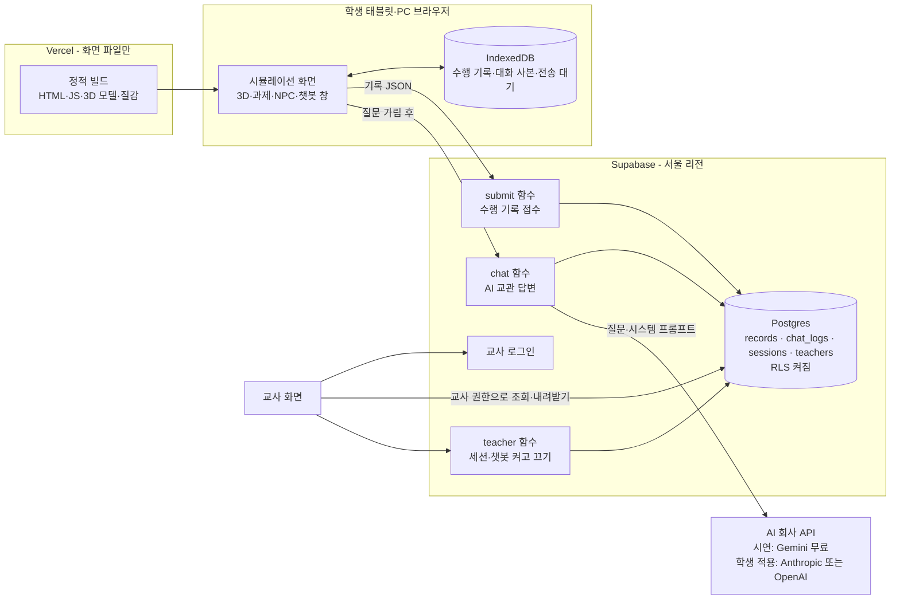
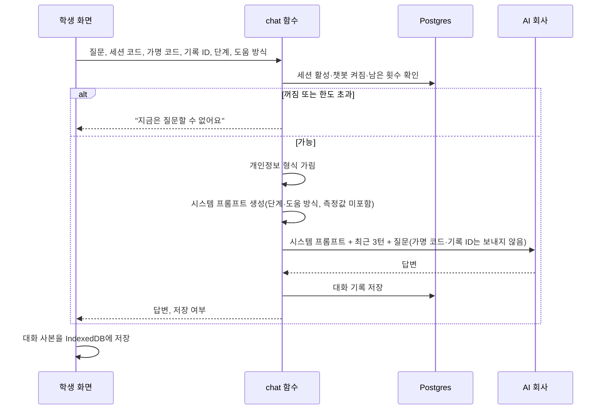

# 07. 변경 설계안 — Vercel + Supabase, AI 교관 챗봇, 5차시 흐름, 3D 품질 (승인 요청)

작성 2026-10-28 · Claude Code · 근거: `docs/design/docs/20_2026-10-28_면담결정_변경기록.md`(D0~D8), `docs/05_영향분석_2026-10-28.md`, `docs/06_챗봇_시스템프롬프트_초안.md`
상태: **승인 요청.** 이 문서가 승인되기 전에는 앱 코드를 바꾸지 않는다. 목표: 11-10(화)까지 교수님이 열어 볼 시연 URL(가짜 데이터).

---

## 0. 한눈에 보기

- 화면은 **Vercel**에 정적 파일로만 올린다. 서버 일은 전부 **Supabase** 한 곳(Edge Function 3개 + Postgres 표 4개)에서 한다. 서버가 한 곳이라 비밀 키도 한 곳(Supabase)에만 있다.
- 학생은 지금처럼 **로그인 없이** 가명 코드로 들어온다. 학생 화면은 표를 직접 읽거나 쓰지 못하고 서버 함수만 부른다. 교사만 로그인해 기록·대화를 본다.
- 수행 기록 전송 규칙(기기 먼저 저장, 같은 기록 ID 한 번만 접수, 접수번호, 재전송, CSV 백업, 해시 대조)은 **그대로** 쓰고 받는 곳만 바꾼다.
- AI 교관 챗봇은 NPC 교관 옆 창으로 열린다. 판정은 하지 않고, 무안내 단계에서는 정답 대신 힌트만 준다. 시연은 Gemini 무료 API, 학생 적용 전 유료 모델로 바꾼다.
- 3D는 실제 장비 사진을 보고 제동력 시험기·리프트·차량을 다시 만들고, 실제 질감(콘크리트·금속·고무)과 조명·그림자를 넣는다. 태블릿용 "낮음", PC용 "높음" 품질 단계를 둔다.

## 1. 전체 구조

| 구성요소 | 하는 일 | 비밀 키 |
|---|---|---|
| Vercel | 빌드된 화면 파일 제공. 서버 함수 없음 | 없음(공개 값만) |
| Supabase `submit` | 기존 Apps Script 수신 규칙을 그대로 옮김: 엄격 파싱, 스키마 검사, 해시 계산, 같은 ID·같은 해시면 기존 접수번호, 다른 해시면 충돌 거절 | 서버 내장 키 |
| Supabase `chat` | 세션·챗봇 켜짐 확인 → 횟수·길이 제한 → 개인정보 가림 → 시스템 프롬프트 생성 → AI 호출(모델 교체 지점 1개) → 대화 기록 저장 → 답변 반환 | AI API 키 |
| Supabase `teacher` | 교사 로그인 확인 후 세션 만들기, 챗봇 켜고 끄기 | 서버 내장 키 |
| Postgres 표 | 아래 2절 | — |

함수 실행 지역은 서울로 고정한다(요청 머리글 `x-region: ap-northeast-2`). 공식 문서는 기본값이 "요청한 사용자와 가까운 리전"이라고 한다.

## 2. 표와 접근 제한(RLS)

| 표 | 주요 칸 | 학생(공개 키) | 교사(로그인) | 서버 함수 |
|---|---|---|---|---|
| `sessions` | session_code, class_condition_code, lesson_flow(1~2차시/5차시), chatbot_enabled, chat_cap_per_student, active | 접근 불가 | 읽기·만들기·수정 | 읽기 |
| `records` | record_id(고유), receipt_id, accepted_at, payload_hash, payload(JSON 원본), session_code, anonymous_student_code, run_purpose | 접근 불가 | 읽기 | 쓰기 |
| `chat_logs` | chat_id, record_id, session_code, anonymous_student_code, difficulty_mode, step_id, turn_index, question_masked, answer, masked_patterns, provider, model, model_version, prompt_version, latency_ms, status, created_at | 접근 불가 | 읽기 | 쓰기 |
| `teachers` | user_id(교사 계정) | 접근 불가 | 자기 행 읽기 | 읽기 |

- 모든 표에 RLS를 켠다. 학생용 공개 키에는 어떤 정책도 주지 않아 **조회·쓰기가 전부 막힌다.** 학생은 서버 함수만 부를 수 있다.
- 교사 정책은 "로그인한 사용자가 `teachers`에 있을 때만"으로 건다.
- `records.record_id`에 고유 제약을 걸어 같은 기록이 두 번 저장되지 않게 한다. 이것이 Apps Script의 잠금(LockService) 역할을 대신한다.

## 3. 수행 기록 전송

- 학생 화면의 전송 코드(`src/delivery/submit.ts`·`jcs.ts`·`outbox.ts`)는 바꾸지 않는다. 받는 주소만 `VITE_SUBMIT_ENDPOINT`로 Supabase `submit` 함수를 가리킨다.
- `submit` 함수는 `archive/apps-script`의 규칙을 TypeScript로 옮기고, 해시 계산은 학생 화면과 같은 `src/delivery/jcs.ts`를 공유한다. 기존 시험 11개를 새 함수에 맞춰 옮겨 같은 결과가 나오는지 확인한다.
- 시연 버전은 지금처럼 "전송은 교사 조작으로만" 표시를 유지하고, 가짜 코드만 받는다.

## 4. AI 교관 챗봇

### 4-1. 화면
- 3D 장면의 NPC 교관을 누르면 오른쪽에 챗봇 창이 열린다. 기존 대본형 NPC 대화(과제 안내·검사)는 그대로 있고, 창 위쪽에 "AI 교관에게 질문하기" 탭을 둔다.
- 창 맨 위에 항상 표시: **"AI 교관과 대화합니다(사람이 아님). 이름·전화번호 등 개인정보를 쓰지 마세요."**
- 남은 질문 수를 보여 준다(예: 18/20).

### 4-2. 처리 순서

- AI 회사가 한도 초과(429)를 주면 함수가 `retry-after`만큼 한 번 기다려 다시 보낸다. 그래도 실패하면 학생에게 "잠시 후 다시 물어보세요"를 보인다.
- 기록 저장에 실패하면 답변은 보여 주되 `저장 안 됨`으로 돌려주고, 학생 기기가 대화 사본을 전송 대기열에 넣어 나중에 다시 보낸다. 수행 기록과 같은 원칙이다.

### 4-3. 제한값 (시연 기본값, 교사가 세션별로 조정)
| 항목 | 값 |
|---|---|
| 학생 1인 질문 수 | 차시당 20개 |
| 질문 길이 | 300자 |
| 답변 길이 | 최대 400토큰(약 3~5문장) |
| 세션 전체 하루 상한 | 시연 300개, 수업 1,000개 |
| 대화 문맥 | 최근 3턴까지만 AI에 보냄 |

### 4-4. 모델 교체
- 서버 함수의 설정값 두 개(`CHAT_PROVIDER`, `CHAT_MODEL`)만 바꾸면 모델이 바뀐다. 어댑터는 `scripts/chat-eval/providers.mjs`와 같은 모양으로 만든다.
- 시연: Gemini `gemini-3.5-flash-lite` 무료(성인만, 합성 데이터만). 학생 적용 전: 같은 질문 5개로 Anthropic·OpenAI를 시험해 정한다.
- 시스템 프롬프트는 v0.2(교사 검토 중). 버전이 바뀌면 대화 기록에 버전이 남는다.

## 5. 교사 화면

- 교사 화면 진입 시 Supabase 로그인(이메일+비밀번호). 교사 계정은 사용자가 Supabase 관리 화면에서 직접 만든다.
- 할 일: ① 수업 세션 만들기(세션 코드, 차시 흐름 1~2차시/5차시, 조건 코드) ② 챗봇 켜기/끄기, 1인 질문 수 조정 ③ 가명 코드별 대화 기록 보기·CSV 내려받기 ④ 접수된 수행 기록 CSV 내려받기.
- 이 기기에만 있는 기존 기능(수업 설정 잠금, 이 기기 기록 관리)은 그대로 둔다.

## 6. 5차시 시작 흐름

시작 화면의 "수업 시점" 선택을 아래 두 버튼으로 바꾼다. 교사가 세션을 5차시로 만들면 학생 화면은 그 흐름으로 고정된다.

| 버튼 | 차시 | 도움 방식 | 수행 역할 | 수업 시점(usagePhase) | 챗봇 |
|---|---|---|---|---|---|
| 1~2차시 연습 | 1~2차시(3~4차시 보조 사용도 이 버튼, 기록은 other) | 안내 있음으로 시작, 2차시 끝에 무안내 1회 선택 | 연습 | preview | 설명 위주 |
| 5차시 정리 | 5차시 | 무안내 | 주수행(보완 시 보완) | review | 힌트·되묻기만 |

- 지금 코드는 "실습 후 복습"을 고르면 수행 역할을 보완(remediation)으로 넣는다. 5차시는 주수행이어야 하므로 이 규칙을 고친다.
- 시간제한 평가 단계는 계속 비활성.

## 7. 3D 품질 개선 계획

### 7-1. 지금 상태 (개선 전 캡처 `docs/captures/before_2026-10-28/`)
- 장비 23개가 모두 상자·원기둥과 단색. 조명은 전체광 1개 + 방향광 1개, 그림자·질감 없음. 바닥은 초록 단색.

### 7-2. 방법 비교
| 방법 | 장점 | 단점 | 판단 |
|---|---|---|---|
| A. 라이선스 확인된 무료 3D 모델·질감 사용 | 빠르게 사실감이 오름 | 우리 학교 장비(롤러식 제동력 시험기, 노란 ABS TESTER)와 똑같은 모델은 없음. 모델마다 라이선스 확인·기록 필요. 용량 큼 | 질감·조명·공구·차량 일부에 사용 |
| B. 실습장 사진을 보고 장비를 코드로 다시 만들기 | 실제 장비 모양·색과 맞출 수 있음. 라이선스 문제 없음. 가벼움 | 시간이 듦 | **제동력 시험기·조작부·리프트에 사용** |
| C. PBR 재질(실제 금속·고무·콘크리트의 거칠기·반사) | 같은 모양도 훨씬 실제처럼 보임 | 질감 파일 용량 | A의 질감과 함께 사용 |
| D. 조명·그림자 품질 단계 | 저사양 태블릿 보호 | 단계별 시험 필요 | 낮음/높음 두 단계 |

**추천: B + C + D 중심, A는 CC0 질감·환경광·공구에 한정(7-4).** 학교 실습장과 "닮음"이 핵심이라 주요 장비는 사진을 보고 다시 만들고, 재질과 조명으로 사실감을 올린다. 사진은 참고만 하고 화면에 넣지 않는다.

### 7-3. 대상과 우선순위 (시연 범위)
1. 제동력 시험기(롤러 2쌍, 빨간 덮개, 리프트 판), 노란 ABS TESTER 조작부 — 사진 14·27·28 기준
2. 차량 — 바퀴·타이어·브레이크 디스크가 보이는 후축 중심
3. 2주식 리프트 3대 — 사진 1~8 기준
4. 바닥(콘크리트, 안전선 노란 도장), 벽·기둥, 천장 조명
5. 공구(공구대, 기록 책상) — 시간이 남으면

### 7-4. 무료 에셋 출처와 라이선스 (2026-10-28 공식 페이지 확인)

| 출처 | 라이선스 | 웹 앱에 넣어 배포 | 출처 표기 | 판단 |
|---|---|---|---|---|
| Poly Haven (https://polyhaven.com/license) | CC0 | 가능 | 의무 아님 | **사용** — 바닥·금속 질감, 정비소 환경광, 공구 |
| ambientCG (https://docs.ambientcg.com/license/) | CC0 1.0 | 가능 | 의무 아님(권장) | **사용** — 도장 금속 질감. 1K 파일만 받음(2K 묶음은 25~35MB) |
| Sketchfab (https://sketchfab.com/licenses) | 모델마다 CC0·CC BY·CC BY-NC·Standard·Editorial | CC0·CC BY 가능, Editorial 부적합 | CC BY는 필수 | **이번 시연에서 제외** — 로그인 후 내려받기, 모델 페이지별 확인 필요, 후보 리프트가 우리 장비와 다름 |
| Kenney, Quaternius | 검색 요약상 CC0(Quaternius 일부는 재배포 제한 QAL) | — | — | 제외 — 학교망에서 공식 페이지가 차단돼 확인 불가 |

**쓸 후보 (모두 CC0, Poly Haven·ambientCG)**
| 용도 | 에셋 | 크기 |
|---|---|---|
| 콘크리트 바닥 | Poly Haven `garage_floor` 또는 `concrete_floor_worn_001` | 2K 기본색 0.5~2.8MB, 시연은 1K |
| 도장 금속(롤러 덮개·조작부 노랑·리프트 기둥) | ambientCG `PaintedMetal004`·`PaintedMetal006`, Poly Haven `blue_metal_plate` | 1K |
| 정비소 환경광(반사·조명 분위기) | Poly Haven `autoshop_01` 또는 `auto_service` | 1K HDR 1.6MB |
| 공구 | Poly Haven `combination_wrench`, `adjustable_wrench`, `flathead_screwdriver` | 2,000~5,400 폴리곤 |

**직접 만드는 것(사진 기준, 라이선스 문제 없음):** 롤러식 제동력 시험기(무료 모델 없음), 노란 ABS TESTER 조작부, 2주식 리프트, 차량(차체는 단순하게, 후축 바퀴·타이어·브레이크 디스크는 자세히).

- 받은 에셋은 `public/assets/`에 두고 `docs/design/docs/08_ASSET_AND_COPYRIGHT.md`의 기록표에 출처 URL·작성자·라이선스·받은 날짜·수정 여부를 한 줄씩 적는다. CC0라 화면 표기 의무는 없지만 앱의 "만든 사람들" 화면에 출처를 적는다.
- 학교망이 일부 에셋 사이트를 막으므로 내려받기는 이 맥북에서 열리는 Poly Haven·ambientCG만 쓴다.

### 7-5. 품질 단계와 성능 목표
| 항목 | 낮음(태블릿·크롬북 기본) | 높음(PC) |
|---|---|---|
| 해상도 배율 | 1 | 최대 1.5 |
| 그림자 | 끔(바닥에 미리 구운 그림자 질감) | 켬(방향광 1개) |
| 질감 해상도 | 1K | 2K |
| 환경광(HDRI) | 작은 것 1개 | 같은 것 |
| 목표 프레임 | 30fps 이상 | 50fps 이상 |

- 용량 기준: 3D 모델·질감 전체 15MB 이하, 모델 1개 3MB 이하(glTF 압축). 첫 화면이 학교 Wi-Fi에서 10초 안에 뜨는 것이 목표.
- 시작 화면에서 기기 종류(태블릿/PC)를 보고 단계를 정하고, 교사가 바꿀 수 있다(지금의 "저사양" 체크를 확장).
- 확인: 학교 태블릿(크롬북) 1대와 교사 PC에서 프레임을 재고 기록한다. 헤드리스 캡처는 성능 측정에 쓰지 않는다.

### 7-6. 개선 전/후 캡처
- 개선 전 5장은 저장됨. 개선 후 같은 위치·같은 크기로 다시 찍어 `docs/captures/after_2026-11-xx/`에 두고, 교수님 메일용으로 2장을 나란히 붙인 비교 그림을 만든다.

## 8. 설문 방식 — 프로그램 안 vs 외부 폼 (결정은 사용자)

| 기준 | 프로그램 안에 넣기 | 외부 폼(구글 폼 등) |
|---|---|---|
| 수행 기록과 연결 | 가명 코드·기록 ID로 자동 연결 | 학생이 코드를 직접 입력, 오타 위험 |
| 개발 시간 | 2주 일정에 부담(문항 화면·저장·내보내기) | 거의 없음 |
| 문항 수정 | 코드 수정·재배포 필요 | 폼에서 바로 수정 |
| 전문가 타당화(교사 7명) | 학생 앱에 넣을 이유 없음 | 적합 |
| 개인정보·IRB | 같은 Supabase 저장소로 설명이 한 곳 | 구글 저장소가 하나 더 생겨 IRB 표에 추가 |
| 응답률 | 수행 직후 바로 이어서 응답 | 링크 이동 시 이탈 가능 |

- 제안: **전문가 타당화는 외부 폼.** 학생 설문은 이번 시연에서는 외부 폼으로 하고, 12월 적용 전에 프로그램 안으로 옮길지 다시 정한다. 프로그램 결과 화면에 "설문하러 가기" 링크(가명 코드 자동 채움)만 넣으면 연결 문제를 줄일 수 있다.

## 9. 일정 (승인일 기준)

승인이 11-04 회의라면 구현은 5일이다. **오늘 승인하면 이틀을 더 쓸 수 있다.**

| 날 | 작업 | 끝났다는 증거 |
|---|---|---|
| 1 | Supabase 표·RLS·교사 계정, `submit` 함수와 시험 이식 | 시험 통과, 학생 공개 키로 표 조회가 거절되는 것 확인 |
| 2 | `chat` 함수(가림·제한·Gemini·기록), 챗봇 창 | 화면에서 질문 5개 동작, 대화 기록 행 생성 |
| 3 | 교사 화면(로그인, 챗봇 켜고 끄기, 대화·기록 CSV), 5차시 시작 흐름 | 교사 로그인 후 내려받기, 학생 화면 조회 차단 |
| 4~5 | 3D 품질(제동력 시험기·조작부·차량·리프트, 재질·조명·품질 단계) | 개선 후 캡처, 태블릿·PC 프레임 기록 |
| 6 | Vercel 배포, 학교 Wi-Fi·태블릿 확인, 시연 안내문, 뺀 기능 목록 | 시연 URL, 확인표 |

**시간이 부족하면 빼는 순서:** ① 교사 화면의 대화 기록 보기 화면(대신 Supabase 관리 화면에서 CSV 내보내기) ② 품질 단계 자동 선택(수동 선택만) ③ 리프트·공구 재모델링(제동력 구역만 개선) ④ 대화 문맥 3턴(한 턴씩만).

## 10. 계정 설정 안내 (비개발자용, 학교 밖에서)

Vercel 관리 화면은 학교 Wi-Fi에서 막힌다. **1~2단계는 집이나 휴대폰 LTE에서** 한다.

1. **Supabase**
   1. https://supabase.com 에서 GitHub 계정으로 가입한다.
   2. "New project" → 이름 `chassis-3d-lab` → 지역 **Northeast Asia (Seoul)** → 데이터베이스 비밀번호를 정해 따로 보관한다. 지역은 나중에 못 바꾼다.
   3. Authentication → Users → "Add user"로 교사 계정(이메일·비밀번호)을 만든다.
   4. 나머지(표 만들기, 함수 올리기, Gemini 키 등록)는 Claude Code가 명령줄로 한다. 이때 브라우저 로그인 창이 한 번 뜨면 승인만 누른다.
2. **Vercel**
   1. https://vercel.com 에서 GitHub 계정으로 가입한다(Hobby 무료).
   2. "Add New → Project"에서 GitHub 저장소 `chassis-3d-lab`을 가져온다.
   3. 환경 변수는 Claude Code가 알려 주는 값 4개(공개 값)만 넣는다. 비밀 키는 넣지 않는다.
3. **Gemini 키**는 이미 `.env.local`에 있다. 배포 때 Supabase 비밀값으로 옮기며, 화면 파일에는 들어가지 않는다.

| 넣는 곳 | 이름 | 공개 여부 |
|---|---|---|
| Vercel | `VITE_SUPABASE_URL`, `VITE_SUPABASE_ANON_KEY`, `VITE_SUBMIT_ENDPOINT`, `VITE_CHAT_ENDPOINT` | 공개해도 됨(학생 화면에 들어감) |
| Supabase 비밀값 | `GEMINI_API_KEY`, `CHAT_PROVIDER`, `CHAT_MODEL`, `ALLOWED_ORIGINS` | 비밀 |
| Supabase 내장 | 서버 전용 키 | 비밀, 자동 제공 |

- **확인 필요:** Vercel Hobby 요금제는 "개인·비상업 용도"로 제한된다는 검색 결과가 있다(이 네트워크에서 원문을 열지 못함). 학교 수업·연구용 무료 사용이 해당하는지 가입할 때 약관을 읽어 보시라. 걱정되면 같은 정적 파일을 다른 무료 호스팅으로 옮길 수 있다(서버는 Supabase라 영향 없음).
- Supabase 무료 요금제는 1주 동안 활동이 적으면 프로젝트가 멈춘다. 시연 직전에 한 번 접속해 깨워 두고, 12월 적용 기간에는 유료(Pro, 월 $25부터) 전환을 검토한다.

## 11. 위험과 대응

| 위험 | 대응 |
|---|---|
| 11-10까지 시간 부족 | 9절의 빼는 순서. 매일 끝에 배포 가능한 상태 유지 |
| 무료 Gemini 한도(25명 동시 시 일부 429) | 시연은 교수님 1인이라 문제없음. 수업은 유료 모델·재시도 |
| 시연 URL 남용으로 AI 비용·한도 소진 | 세션 코드가 있어야 챗봇 동작, 하루 상한, 시연 후 챗봇 끄기 |
| 학교 태블릿에서 3D가 느림 | 낮음 단계 기본, 용량 기준, 실제 기기 측정 |
| 새 서버가 기존 규칙과 다르게 동작 | 기존 시험 11개 이식, 같은 결과 확인 전 배포 안 함 |
| Supabase 무료 프로젝트 일시정지 | 시연 전날 접속, 적용 기간 유료 검토 |

## 12. 승인 요청 항목

- [ ] 1절 구조: 화면 Vercel(정적), 서버 Supabase 한 곳
- [ ] 2절 표 4개와 RLS(학생 직접 접근 전부 차단, 교사만 조회)
- [ ] 4절 챗봇 흐름·제한값·모델 교체 방식
- [ ] 5절 교사 로그인(이메일+비밀번호)
- [ ] 6절 5차시 시작 흐름(1~2차시 연습 / 5차시 정리)
- [ ] 7절 3D 개선 방향(사진 보고 주요 장비 재제작 + PBR 재질 + 품질 2단계, 무료 에셋은 질감·소품)
- [ ] 8절 설문 방식(전문가 타당화는 외부 폼, 학생 설문은 이번엔 외부 폼)
- [ ] 9절 일정과 빼는 순서
- [ ] 10절 계정 준비(학교 밖에서 Supabase·Vercel 가입)
