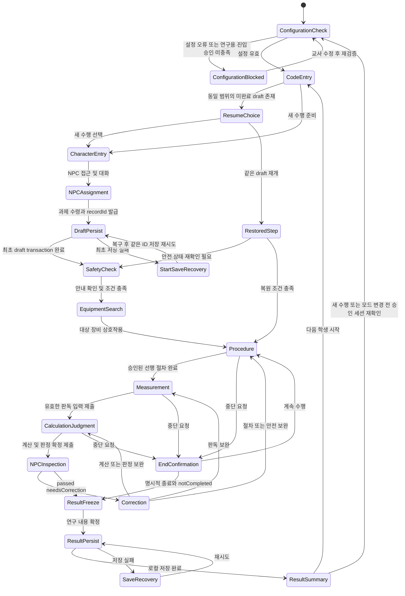
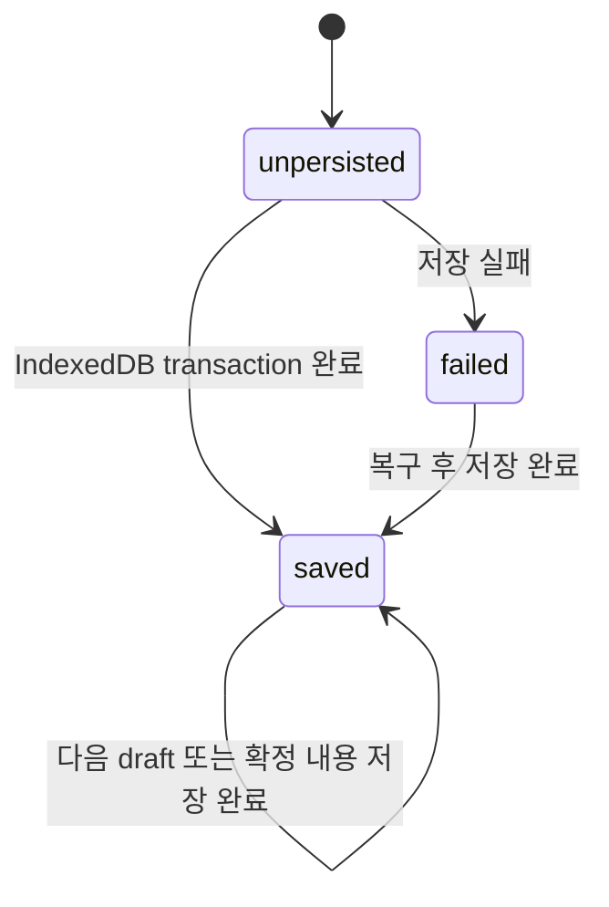
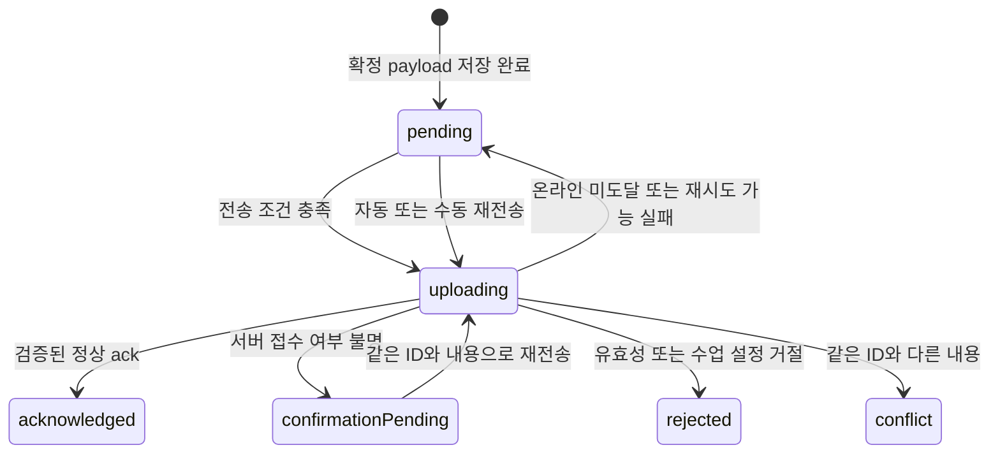

# 02. 게임 흐름과 스토리보드

> 설계 검토본 v0.1 · 2026-10-16 · 대사·화면·동작은 아래 등급에 따라 구현 전 검토한다. 현재 앱 구현 및 현장 실행 검증은 하지 않았다.

학생은 자기 캐릭터로 NPC에게 과제를 받고, 안전 조건을 확인한 뒤 제동력 시험기를 찾아 절차·판독·계산·판정을 수행한다. NPC는 수행이 적절했는지 검사한다. **측정 대상의 vehicleVerdict(pass/fail/null), 학생 최초 판정의 judgmentCorrect, NPC의 최종 수행 검사, 서버 접수는 서로 다른 결과**다. 학생이 불량 시나리오를 정확히 판단하면 NPC 검사에서는 통과할 수 있다. 최초 오답을 보완해 통과해도 judgmentCorrect를 바꾸지 않는다.

연결 문서: [요구사항](01_REQUIREMENTS.md) · [기술 구조](03_TECH_ARCHITECTURE.md) · [과제·로그 계약](04_TASK_AND_LOG_SCHEMA.md) · [제출 흐름](05_RESEARCH_DATA_PIPELINE.md) · [로드맵](06_MVP_ROADMAP.md).

## 1. 고정 흐름과 제안 표현

**확정 흐름:** 시작 → 익명 코드 → 학생 캐릭터 입장 → NPC 과제 수령 → 안전수칙 → 장비 탐색 → 절차 수행 → 측정값 판독·판정 → NPC 검사 → 보완 또는 통과 → 결과 확인·제출.

**제안 표현:** 캐릭터가 보이는 3인칭, 기본 카메라 흔들림 없음, 조작 중 언제든 목표·현재 코드 확인, 텍스트 자막과 아이콘 병행, 터치와 키보드·마우스의 동등한 핵심 행동. NPC는 미리 작성한 대사와 과제 규칙으로 동작하며 LLM 대화는 MVP에 넣지 않는다.

실제 학교 배치 재현은 사용자 확정이다. 2026-10-20 사진·스케치로 상대 배치는 정리됐지만 실측 치수·연결부·학생 시작점이 미확정이므로 `layoutConfirmed:false`를 유지한다. 아래 ‘NPC·시험기 화면’은 역할과 관계를 설명한 것이며 실제 좌표·장비 개수·실내 치수·출입구 위치를 확정하지 않는다. 조사·교사 검토 후 layout 버전을 부여한다.

## 1-1. 수업 시점별 흐름 — 대기 중 예습 → 실제 실습 → 실습 후 복습 (2026-10-20 추가)

이 절은 §1의 확정 흐름을 **수업에서 언제 쓰는가**로 나눈 것이다. 예습/복습은 시점이고 안내/무안내는 도움 방식이므로 서로 조합한다. 모드 이름을 ‘예습 모드’처럼 합치지 않는다.

| 시점 | 학생 상황 | 앱에서 하는 일 | 기본 조합(제안) | 기록 구분 |
|---|---|---|---|---|
| 대기 중 예습 | 별도 강의실에서 순번을 기다림 | NPC 과제 수령 → 안전 조건 → 실습장에서 제동력 시험기·공용 조작부 찾기 → 조작부와 안전 조건 익히기 → 고정 예시값 판독·계산·판정 → NPC 검사 | guided(처음) → unguided(두 번째 이후) | `attemptRole:practice` 또는 수업 설정에 따른 `primary`. 세션 코드에 예습 회차 표시 |
| 실제 실습 | 교사 임장 지도로 실제 차량·장비 사용 | 앱 사용 없음(필요 시 대기 조가 재연습) | — | 앱 로그 없음. 없는 로그를 0으로 넣지 않음 |
| 실습 후 복습 | 실습을 마치고 돌아옴 | 실제 실습에서 혼동한 조작·판독·계산을 다시 확인. 틀린 단계부터 재수행 | unguided 기본, 안전 경고 유지 | `attemptRole:remediation`, `retryOfRecordId`로 예습 기록과 연결 |

예습 기록과 복습 기록은 `recordId`가 다르며 서로 덮어쓰지 않는다. 어느 시점의 기록을 분석 대표값으로 쓸지는 연구자가 정한다. 현재 계약에 시점 필드가 없으므로 [04 §12](04_TASK_AND_LOG_SCHEMA.md)의 `usagePhase` 제안을 검토한다.

## 2. 수행 상태 전이

상태 전이는 ‘어떤 화면에 있으며 어떤 조건을 갖추면 다음 단계로 갈 수 있는가’의 약속이다. 게임 상태와 저장·전송 상태는 별도로 관리한다.

`EndConfirmation`의 ‘계속 수행’은 실제로 중단 직전 상태로 돌아간다. 그림의 Procedure 연결은 대표 표시이며 구현에서는 이전 상태를 보존한다. 새로고침 복원 시 모터 작동 같은 순간 장비 상태를 그대로 재현하지 않고 안전한 정지 상태에서 필요한 조건을 재확인한다. 복원으로 어떤 단계를 다시 확인해야 하는지는 교사 승인 과제 데이터에 둔다.

**평가 진입 차단:** 수식·단위·기준·출처·승인·지원 버전이 미확정이면 `ConfigurationBlocked`이다. 연구용 진입은 layoutConfirmed와 configurationApproval.researchUseApproved도 확인한다. researchUseApproved는 연구자의 사용 허용 상태이며 IRB 승인을 대신하지 않는다. 미확정 설정으로 차량 판정이나 학생 정오를 임의 계산하지 않는다. 공간·화면 시연만 허용할 경우 `runPurpose:demo`, `researchEligible:false`로 표시한다. 배치 검토 전 ‘실제 학교 재현 완료’ 인수도 할 수 없다.

## 3. 화면별 스토리보드

| 화면 | 학생에게 보이는 내용 | 행동·다음 조건 | 기록·주의 |
|---|---|---|---|
| S0 준비 확인 | 수업 세션·앱 버전·준비 상태 | 교사 설정이 유효해야 코드 입력으로 이동 | 미확정 기준/배치 상태를 숨기지 않음 |
| S1 코드 입력 | 세션 코드, 익명 코드, 코드 규칙, 간단한 수집 안내 | 형식 검사 후 현재 코드 확인 | 이름 등 원본 식별정보 입력란 없음. 아직 수행 recordId 발급 전 |
| S2 재개 선택 | 현재 입력 범위와 일치하는 미완료 기록의 재개 안내 | 재개 또는 새 수행 | 다른 학생 코드·결과 목록을 노출하지 않음. 같은 draft 재개는 같은 ID |
| S3 입장·조작 익히기 | 캐릭터·목표·조작 안내·NPC 상호작용 표시 | NPC에게 접근해 대화 | 조작 익히기는 주 과제 성과에 자동 포함하지 않음 |
| S4 과제 수령 | 제동력 과제, 모드, 목표, 앞/뒤 지정, 안내 정책 | 승인된 sessionSnapshotId를 확인하고 과제 수령·최초 draft 저장 완료 | 새 recordId·startedAt, versions.sessionConfigVersion/researchProtocolVersion/feedbackPolicyVersion과 과제·기준·측정·배치 버전 고정. 저장 실패 시 S5 이후로 진행하지 않고 같은 ID로 복구 |
| S5 안전 안내 | 승인된 안전수칙과 필수 확인 항목 | 안내 확인과 필요한 안전 조건 충족 | ‘읽음’과 실제 장비 안전 상태를 분리 |
| S6 장비 탐색 | 학교 배치 기반 장비·목표 | 제동력 시험기와 의도적으로 상호작용 | guided는 위치 안내 가능. unguided 안내 수준은 연구자 정책 적용 |
| S7 장비 준비·측정 | 준비 상태·조작부·계기 | 단계 선행 조건을 만족시키며 측정 | 조작 오류·안전 오류를 구분. 장비 상태는 데이터 규칙으로 관리 |
| S8 판독 | 제시된 계기값과 단위, 학생 입력란 | 좌·우·축중 등 승인된 입력 제출 | 실제 시나리오값과 first/final 판독값 분리. 입력 중 모든 키를 수집하지 않음 |
| S9 계산·판정 | 학생 계산·판정 입력과 제출 | 최초 답 저장 후 승인된 정책에 따라 피드백 | calculationAnswers에 편차·합의 첫/최종 입력·단위·정오, judgmentAnswers에 판정 답 보존. 자동 계산 정답을 학생 입력 전에 노출하지 않음 |
| S10 NPC 검사 | 수행 결과, 통과 또는 보완 이유 | 보완 단계 이동 또는 결과 확정 | 검사 결과와 학생의 차량 불량 판정을 혼동하지 않음 |
| S11 결과·접수 | 차량 판정·학생 최초/최종 답·NPC 검사, 오류·안전·힌트·시간, 저장·접수 | 자동 전송·재전송·CSV·다음 수행/학생 | vehicleVerdict와 judgmentCorrect·최종 정오·NPC 결과를 분리. 전체 정답률 분모는 중복 제거한 필수 판독+계산+판정 항목. 서버 접수 전 온라인 접수 완료 표시 금지 |

결과 화면의 기본 병렬 표시는 ‘실습 결과: 통과/보완/미완료’, ‘이 기기 저장: 저장됨/실패’, ‘온라인 접수: 대기/확인 중/완료/교사 확인’이다. 색상만으로 구별하지 않는다.

## 4. 제동력 작업 흐름의 근거와 변환

원문: `제동장치 정비(LM1506030327_23v4)`, 교육부 저작권·한국직업능력연구원, 판권면 발행일 2025.12.31. PDF 110~112쪽은 인쇄 p.98~100이다. 아래는 **그 판본에 기재된 학습내용의 3D 변환 제안**이며 실제 학교 시험기 지침을 대신하지 않는다.

| 작업 묶음 | 원문 근거 | 3D 상태·상호작용 제안 |
|---|---|---|
| 타이어·설비 점검 | p.98 순서1~2: 타이어, 오일 댐퍼, 롤러 이물질, 리프트 지지부, 스위치 OFF 후 전원 | 안전 준비 체크. 이상 시 측정 차단과 정비 필요 안내. 수리 구현은 범위 밖 |
| 차축 위치·축중·영점 | p.98 순서3~7: 정위치·조향 이상·대상 차축·축중·METER/P/L/영점·중앙 정렬 | 지정된 앞/뒤 차축, 축중 출처, 정렬과 영점 확인. 학교 장비에 맞게 단계 확정 |
| 롤러·제동 조작 | p.99 순서8~10: 리프트 하강·MOTOR/P/L·점진 제동 | 선행 조건 충족 후 허용. 실제 힘/차량 물리 대신 의도적 조작을 사용 |
| 고정·판독·안전 종료 | p.99 순서11~14: METER OFF·정지/지침 고정·좌우 기록·MOTOR OFF·출차 | 값 고정 전 판독과 롤러 작동 중 출차 오류. 화면 계기와 first/final 입력 연결 |
| 계산·판정 | p.99~100 순서15 및 표3-1 | 해당 축의 좌우 값·축중을 기준으로 계산·비교. 앞/뒤·전체/주차 제동의 분모를 혼합하지 않음 |

기존 `tasks.json:2468~2473`의 다섯 문자열은 위의 장비 준비·조작·안전 종료를 실행 가능한 단계로 갖고 있지 않다. `steps`에 단계 ID·허용 행동·선행 조건·완료 조건·오류/안전 코드·피드백·근거를 추가하는 변환이 필요하다. 세부 스키마는 [04](04_TASK_AND_LOG_SCHEMA.md)를 따른다.

**현장 사진 관찰(2026-10-20):** 14번 사진의 공용 노란 조작부(ABS TESTER, GS-17GA 표기, DKM-6000 본체)에는 ESC·SIDE SLIP·BRAKE·SPEED·AXLE Load·LIFT UpDn·MOTOR 버튼이 보인다. 27·28번에는 차량 후륜 아래 빨간 덮개의 롤러, 기록용 책상, ‘위험 뛰지말것’ 표지와 실습장 안전수칙 게시판이 보인다. 버튼 이름은 NCS 절차의 ‘축중 측정·리프트 하강·MOTOR ON’과 대응할 가능성이 있으나, 실제 조작 순서·작동 화면은 기자재 고장으로 미확인이다. 3D 조작부는 이 버튼 이름을 쓰되 순서는 교사 확인 후 확정한다. 제시 측정값은 26번의 고정 예시(후 좌 240kg·우 200kg·후축중 600kg)를 교사 확인 입력으로 쓴다.

자료에서 확인한 앞 합50%·뒤 합20%·편차8%는 이 판본의 학습내용이다. 현재 학교 적용 승인값이나 현행 법정기준으로 자동 채택하지 않는다. p.98의 일반 합50% 문장과 p.99의 앞/뒤 조건, 압력 ‘7~10kg/㎠ 이상’ 표현은 교사·학교 장비 지침 확인 대상으로 남긴다.

## 5. 안내·무안내·보완의 경계

| 항목 | guided | unguided | 보완 |
|---|---|---|---|
| 수행 목적 | `attemptRole:practice` 연습 | 수업 설정에 따라 공식 수행 후보 | 같은 수행 내 정정 또는 새 `attemptRole:remediation` 수행 |
| 다음 단계 | 승인된 안내를 보여줌 | 정답 절차를 자동 공개하지 않음 | 오류가 난 부분과 수정 행동을 설명 |
| 안전 | 차단·경고·설명 유지 | 차단·경고·설명 유지 | 실제 위험 조건을 먼저 해소 |
| 요청 힌트 | 사용 가능 여부는 수업 정책 | 허용·비허용과 분석 제외 규칙을 연구자가 결정 | 사용 시 기록 유지 |
| 연구 결과 | 연습 자료 | 최초 공식 무안내 성과를 주 분석 후보로 제안 | 첫 답을 바꾸지 않고 최종 답/완수 자료로 구분 |

학생이 요청한 힌트만 `hintCount`에 더한다. guided의 자동 설명은 힌트 요청 횟수가 아니다. 무안내에서는 오류 유형 알림과 정답·완전 해설 공개의 시점을 교사·연구자가 구분해 승인한다. 적용 정책은 versions.feedbackPolicyVersion에 고정한다. `feedbackShown` 이벤트에 feedbackKind(safety/explanatory/hint/guidance)·feedbackKey·해당 시 itemId·시점을 남겨 최초 답 이전/이후의 지원 노출을 구분한다. 최초 답이라는 이유만으로 무지원 응답이라고 해석하지 않는다. 무안내 안전 경고는 늦추지 않는다.

동일 수행 안의 NPC 재검사는 `npcInspectionCount`만 늘리고 `retryCount`를 늘리지 않는다. 학생이 ‘새로 수행’을 선택하면 승인된 세션 스냅샷을 다시 읽고 모드·수행 역할·코드를 확인한 뒤 새 recordId, 새 고정 버전·측정세트와 `retryOfRecordId`/`retryCount`를 만든다. 이전 확정 payload는 수정하지 않는다. 연습 완료 후 실전 시작도 새 수행이다. 학생이 화면에서 무안내 모드를 임의 선언하여 공식 수행으로 만들지 않으며 교사가 공개한 모드와 설정을 따른다.

## 6. NPC 대사와 분기 — 제안 초안

대사의 차량·장비·측정 위치·기준은 승인 데이터에서 채운다. 아래 문장에 없는 수치나 절차를 NPC가 임의 생성하지 않는다.

| 시점 | 대사 예시 | 분기 |
|---|---|---|
| 과제 수령 | ‘오늘은 제동력 값을 읽고 편차와 합을 계산한 뒤 차량 상태를 판단합니다. 지금은 [안내/무안내] 모드입니다.’ | 학생이 모드·앞/뒤 지정 확인 후 수령 |
| 안전 안내 | ‘장비를 작동하기 전에 이 과제의 안전 조건을 확인하세요. 준비되지 않은 조작은 진행되지 않습니다.’ | 승인된 체크와 인터록 안내 |
| 순서 오류 | ‘현재 필요한 확인이 끝나지 않아 이 조작을 진행할 수 없습니다. [부족한 조건]을 확인하세요.’ | 오류 유형·선행 단계에 연결 |
| 판독 오류 | ‘확정된 계기 표시와 입력값이 다릅니다. [확인할 눈금/단위]를 다시 확인하세요.’ | 첫 답 보존 후 최종 답 수정 |
| 계산 오류 | ‘선택한 축과 분모를 확인하세요. [확인된 수식 설명]을 적용해 다시 계산할 수 있습니다.’ | 정답 공개 시점은 모드 정책 적용 |
| 검사 보완 | ‘[확인된 보완 사유]가 남아 있습니다. [해당 단계]를 보완한 뒤 다시 검사를 받으세요.’ | needsCorrection, 검사 횟수 증가 |
| 검사 통과 | ‘필요한 절차와 판정이 확인되었습니다. 결과와 기록 접수 상태를 확인하세요.’ | passed 후 freeze·로컬 저장 |
| 서버 미접수 | ‘실습 결과는 이 기기에 저장되어 있습니다. 온라인 접수는 아직 확인되지 않았습니다.’ | 실제 저장 성공인 경우에만 표시 |

`passed`는 최종 응답·완료 절차·현재 안전조건에 대한 수행 검사이지 차량 양호 선언이나 최초 정답 선언이 아니다. vehicleVerdict:fail을 정확히 판정하거나 첫 오답을 최종 정답으로 보완하면 통과할 수 있다. 과거 오류·안전 위반 횟수와 첫 답은 계속 보존한다. 필요한 조치 방향의 자유문장을 자동 채점할지, 선택형으로 제한할지는 교사 확인 전 확정하지 않는다.

## 7. 저장·제출 상태 전이

아래 전이는 게임 상태와 독립이다. 전송 대기 중에도 다음 학생으로 넘어갈 수 있지만 전송은 저장된 원래 payload를 사용한다.

`rejected`·`conflict`는 학생이 결과를 임의 고쳐 재전송하는 상태가 아니다. 교사가 원인을 확인하며 원본을 보존한다. 응답은 `ok:true`, 일치하는 recordId, receiptId, acceptedAt, 검증한 payloadHash가 있어야 정상 ack로 인정한다. 중복 접수 응답도 같은 receiptId를 반환한다. API와 정규화는 [04](04_TASK_AND_LOG_SCHEMA.md)·[05](05_RESEARCH_DATA_PIPELINE.md)를 따른다.

초기 전송 예산은 **제안값**으로 canonical payload UTF-8 32KiB, POST 48KiB, stepEvents 200개이다. 초과하면 잘라내거나 조용히 버리지 않는다. 명시적 중단·교사 확인 상태로 전환하고 원기록을 보존하며 업로드 시도가 학습오류에 더해지지 않게 한다.

## 8. 공용 기기·성능·복원 분기

- **다음 학생 시작:** 현재 코드·입력·결과 화면과 현재 수행 참조를 비운다. 기존 미전송 payload와 deliveryEnvelope는 독립 대기열에 보존하고 새 학생 코드로 덮어쓰지 않는다.
- **같은 draft 복원:** sessionSnapshotId·코드·과제·고정 버전을 대조하고 현재 공개 스냅샷으로 바꾸지 않는다. 완료 payload를 draft로 다시 열지 않는다. 여러 탭이 같은 수행을 갱신하면 잠금·복구 안내를 보여준다.
- **새로고침·숨김:** 활성 학습시간 누적을 멈추고 재개 시 복원·일시중지 횟수와 시간품질을 남긴다. 온라인 전송 시간은 학습시간에서 제외한다.
- **WebGL/성능 문제:** 품질 설정을 낮추거나 현재 표현을 diagram으로 전환한다. 시작 displayMode는 바꾸지 않고 experiencedDisplayModes에 경험 모드를 남긴다. displayModeChanged 이벤트의 fromDisplayMode/toDisplayMode·시점·이유로 경험 순서를 확인한다. 규칙이 같아도 공간학습 동등성은 주장하지 않는다.
- **저장 실패:** 전송 선행 조건을 충족하지 못했음을 표시한다. 화면 보존·재저장·가능한 비상 CSV를 제공하되 이미 유실된 데이터를 복구한다고 보장하지 않는다.

## 9. 검토용 시나리오

| 시나리오 | 기대 결과 |
|---|---|
| 학생이 올바른 절차·판독·계산으로 불량 차량을 정확히 판정 | vehicleVerdict:fail, judgmentCorrect:true, NPC passed, 접수는 별도 진행 |
| 최초 실전 판정 오답 후 보완하여 정답 | judgmentCorrect:false 유지, finalCorrect:true, 검사 횟수만 증가. 연구 대표 수행을 보완 결과로 자동 교체하지 않음 |
| 안전 준비 없이 MOTOR 작동 시도 | 작동 차단, 설명적 안전 피드백, safetyViolationCount 증가. errorCount에 중복 합산하지 않음 |
| 완료 후 인터넷 단절 | 결과 저장 확인, uploadStatus:pending. 서버 접수번호는 아직 표시하지 않음 |
| 서버 저장 후 응답만 유실 | confirmationPending → 동일 ID 재전송 → 같은 receiptId, 정본 한 행 |
| A학생 미접수 상태에서 B학생 시작 | B에게 A의 결과가 보이지 않으며 A의 원 payload는 A 코드 그대로 재전송 |
| 미확정 기준 또는 빈 단위 | 공식 평가 시작 차단, 판정 불가. 0이나 기본 상수로 자동 합격/불합격 처리하지 않음 |
| 실측 미확정(사진·스케치만 확보) | layoutConfirmed:false, 모눈·사진으로 좌표 추정 금지, 상대 배치 초안은 ‘임시 개념 배치’로 표시, 실제 학교 재현 완료 인수 보류 |
| 콘텐츠·배치 승인됐지만 연구 사용 미허용 | configurationApproval.researchUseApproved:false, 연구용 진입 차단. 시연 시 runPurpose:demo와 researchEligible:false |
| 3D에서 도식으로 전환한 뒤 최종 답 제출 | displayMode:threeD 유지, experiencedDisplayModes에 두 모드 보존, fromDisplayMode/toDisplayMode 이벤트 이후의 답과 지원 노출을 식별 |
