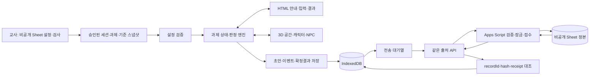

# 03 기술 구조

> **2026-10-28 변경:** 이 문서의 일부 조항은 [20 면담 결정 변경 기록](20_2026-10-28_면담결정_변경기록.md)으로 대체되었다. 충돌하면 20번 문서를 따른다.

작성일: 2026-10-16 · 설계안 v0.1 · 구현·배포 전

## 1. 최종 추천안

**React + Vite + TypeScript + Three.js/React Three Fiber + 필요한 Drei 도우미 + React reducer/context**를 추천한다. 과제·기준·NPC 대사·배치를 데이터로 나누고, **IndexedDB → 같은 출처 제출 중계 → Apps Script → 비공개 Google Sheet**로 기록한다. 같은 출처란 학생 화면과 API의 프로토콜·도메인·포트가 같다는 뜻이다.

교사가 자주 바꾸는 내용은 수업·과제·기준 설정 화면과 데이터로 옮긴다. 교사가 Three.js 코드나 개발자 도구를 직접 다루어야 운영되는 구조는 수용하지 않는다. 3D 표현, 학습 판정, 연구기록, 전송을 별도 모듈로 나누는 것이 라이브러리 수를 줄이는 것보다 중요하다.

## 2. 대안 비교

| 선택 | 장점 | 비용·위험 | 결정 |
|---|---|---|---|
| React/Vite/TS + R3F + reducer | 기존 React 교과서 구조와 가까우며 입력 패널과 3D를 같이 관리한다. 자료형 검사로 계약 누락을 줄인다 | 기존 JS의 입력·판정 가정을 검토하며 변환해야 한다 | **추천** |
| 같은 구조 + Zustand | 많은 장면과 패널의 공유 상태를 선택해서 읽기 쉽다 | MVP부터 별도 저장소 규약과 의존성이 늘어난다 | 실제 복잡도가 확인되면 추가 |
| Vite/TS + Three.js 직접 사용 | 렌더링 제어가 직접적이다 | UI 연결·자원 해제·상태 갱신을 더 직접 작성한다 | 유지관리 부담 때문에 보류 |

| 세부 선택 | 추천 | 포기한 대안과 이유 |
|---|---|---|
| TypeScript / JavaScript | TypeScript | 기존 JS를 그대로 쓰는 속도보다 과제·로그 계약의 명확성을 우선한다. 타입만으로 런타임 검증을 대신하지 않는다 |
| 로컬 저장 | IndexedDB | localStorage는 동기식 문자열 저장이며 수행·이벤트·대기열의 트랜잭션에 부적합하다. 비민감 UI 설정만 저장한다 |
| NPC | 조건·대사 데이터에 따른 규칙형 | 생성형 AI는 비용·오답·재현성·개인정보와 연구조건 통제 부담이 추가된다 |
| 움직임 | 단순 보행/이동, 충돌 영역, 지정 위치 이동 보조 | 차량 물리·복잡한 애니메이션·전체 실습장 상호작용은 학습 범위를 넘는다 |
| 제출 | 중계 + Apps Script/Sheet | Google Form 직접 전송은 자동 receipt·멱등 계약을 갖춘 공식 제출 API가 아니다 |
| 호스팅 | Cloudflare Pages + Pages Functions | GitHub Pages 단독에는 서버 중계가 없다. 별도 API 출처를 쓰려면 CORS·운영 지점이 늘어난다 |

이 선택은 설계 제안이다. 실행 기기와 계정 정책을 확인한 결과 더 단순한 검증된 경로가 있으면, 변경 이유와 계약 영향부터 기록한다. 2026-10-20 검토에서 제출 경로(Cloudflare 같은 출처 중계 vs GitHub Pages + Apps Script 직접 호출)는 교사 결정 질문으로 남겼다(`../../collaboration/CLAUDE_REVIEW.txt` 질문 2). 어느 쪽이든 [04](04_TASK_AND_LOG_SCHEMA.md)의 receipt·hash·멱등 계약은 유지한다. **2026-10-20 사용자 결정:** 비전공자가 구현·운영하기 쉬운 쪽을 택해 GitHub Pages(비공개 저장소는 Actions 빌드) + 브라우저에서 Apps Script 직접 호출을 0C에서 먼저 시험한다. 응답 읽기·중복 방지가 안 되면 같은 출처 중계로 전환한다. 호스팅 우선 제안은 이에 따라 GitHub Pages로 바뀐다.

## 3. 책임과 데이터 흐름



| 모듈 | 책임 | 경계 |
|---|---|---|
| `configuration` | 과제·세션·기준·배치의 버전과 승인상태 검사 | 빠진 기준을 기본값으로 채우지 않는다 |
| `task-engine` | 상태 전이, 안전 인터록, 절차, NPC 검사 | 화면·네트워크·브라우저 저장소에 직접 의존하지 않는다 |
| `judge-engine` | 승인된 연산, 단위·범위 검증, 최초/최종 정오 | JSON 문자열을 `eval`로 실행하지 않는다 |
| `scene` | 실제 배치의 시각화, 이동·근접·상호작용 대상 식별 | 정답·통과 상태를 독자적으로 계산하지 않는다 |
| `ui` | 접근 가능한 안내·입력·설명적 피드백·전송 상태 | 3D 캔버스 안의 글자만으로 중요 정보를 전달하지 않는다 |
| `records` | 초안 저장, 의미 이벤트, 결과 확정, 로컬 트랜잭션 | 저장 요청의 성공과 전체 트랜잭션 완료를 구분한다 |
| `outbox` | 불변 결과의 재전송, 재시도 간격, ack 저장 | 현재 화면의 학생 코드로 과거 기록을 바꾸지 않는다 |
| `submission-api` | 요청 제한·검증, 서버 비밀, Google 응답 검사 | 연구기록 조회·설정 변경을 학생용 공개 API에 넣지 않는다 |
| `gas-receiver` | ScriptLock 아래 중복·충돌 검사, 정본 기록과 receipt | 모든 쓰기가 동일 잠금 규약을 따라야 한다 |
| `teacher-operations` | 수업 설정 검사·공개, 결과·누락 후보 확인 | 교사 계정으로 보호된 Sheet/운영 경로를 이용한다 |

## 4. 구현 시 만들 폴더 구조

아래는 **향후 구조의 제안**이다. 이번에는 `src`·서버 파일·의존성을 생성하지 않는다.

```text
chassis-3d-lab/
  docs/                 설계·근거·검토표
  contracts/            검토용 JSON Schema
  examples/             미승인 설정·가짜 코드 기록 예시
  src/
    app/                 화면과 과제 context/reducer 연결
    configuration/       승인/버전/세션 스냅샷 검증
    domain/              task-engine, judge-engine, metrics
    scene/               room, equipment, avatar, npc, camera
    ui/                  안내, 판독, 결과, 접근성, 도식 모드
    records/             IndexedDB repository, draft, event, outbox
    data/                승인된 과제·배치·대사·연산 참조
  functions/api/         제출·공개 세션 읽기를 위한 작은 중계
  apps-script/           교사 설정메뉴·세션 공개·접수 프로그램
  public/assets/         직접 제작/허가된 에셋과 라이선스
  tests/                 도메인·저장·전송·현장 시나리오
  CLAUDE.md
  IMPLEMENTATION_PROMPT_FOR_CLAUDE_CODE.md
```

폴더별 파일 수를 미리 늘리지 않는다. 인터페이스마다 한 책임을 유지하고 실제 필요가 생길 때 나눈다. 서비스 워커/PWA는 MVP 필수로 두지 않는다. **열려 있던 앱에서 오프라인 수행·재전송을 지원하는 것과, 인터넷 없이 최초 접속하는 것은 다르다.** 완전 오프라인 최초 실행은 후속 범위다.

## 5. 기존 자료 재사용

기존 교과서의 41개 과제 전체를 MVP에 옮기지 않는다. `braking-force`의 용어·장비·절차 요약·기록 필드만 원문과 비교하여 변환한다.

| 자산 | 활용 | 필요한 수정 |
|---|---|---|
| `tasks.json` | 과제 ID, 관련 장비·공구, 문구·안전 참조 | 문자열 절차를 ID·선행조건·완료조건·피드백을 갖춘 단계로 변환. 실제 장비 절차와 대조 |
| `standards.json` | ‘교사가 기준값을 채운다’는 설정 방식 | 비어 있는 값 유지, 단위·차량·시험조건·출처·승인·버전 추가 |
| `forms.json` | 15안별 과제 ID 참조 인덱스 | 과제 선택 관계만 재사용. 측정값/규정값/양호불량/조치의 기록표 필드는 `tasks.json.recordSheet`에서 확인 |
| `judge.js` | 지원 판정유형의 개념, 계산 검토 출발점 | 기본 기준값 대입 제거, 음수·잘못된 축 위치·규칙 누락·경계값·표시 반올림 검증. 그대로 복사 금지 |
| 기존 2D UI | 판독 입력과 결과표의 사용 경험 참고 | 캐릭터·장면·저장·연구기록까지 재사용된 것으로 간주하지 않음 |

상세 확인 위치와 재현한 문제는 [출처 기록](09_SOURCE_AUDIT_AND_DECISIONS.md)에 남긴다. 원본 교과서의 수정이나 일괄 리팩터링은 이 프로젝트에 포함하지 않는다.

## 6. 실제 실습장 배치

배치는 `layoutVersion`, `layoutConfirmed`, 좌표 기준점·축·미터 단위, 외곽·벽·기둥·출입구, 고정장비 위치/방향/점유영역, 안전통로, 과제 관련 접근점으로 분리한다. 사진의 픽셀만 보고 치수를 확정하지 않는다. 기준 치수와 장비 간 거리의 실측으로 축척을 맞춘다.

최소 수집 항목은 ① 교사 손그림 평면도, ② 공간의 가로·세로와 기준점, ③ 출입구·기둥·제동력 시험기 위치와 방향, ④ 주요 고정장비 간 거리, ⑤ 제동력 작업 동선, ⑥ 주요 방향에서 찍은 참고사진이다. 각 장비의 이름·코드·대략 크기·관련 사진을 대응시킨다. 학생·명찰·차량번호·게시된 이름은 수집·모델링 대상에서 제외한다. 자세한 조사표는 [에셋 계획](08_ASSET_AND_COPYRIGHT.md)에 둔다. 2026-10-20 기준 ① 손그림, ③ 장비 상대 위치, ⑥ 참고 사진은 확보됐고(`../../evidence/`, `../../review/`), ② 치수, ④ 장비 간 거리, ⑤ 동선은 미확정이다.

실제배치 검토가 완료되기 전 공개 세션은 `layoutConfirmed=false`, 좌표 `null`이다. 실측 후보값은 별도 비공개 배치 검토 초안(`sourceStatus=surveyed`)에 담되 승인된 학교 배치로 공개하지 않는다. 개발용 회색 도형 배치를 사용하면 ‘개발용 임시배치’라고 표시한다. 수업용 학교배치 버전으로 조용히 바꾸지 않는다. 실제 규모가 커도 필요한 구역부터 나누어 로딩하고, 장비 외형의 상세도와 그림자로 성능을 조절한다. 출입구와 장비 위치를 줄여서 성능을 맞추지 않는다.

## 7. 교사 운영과 권한

교사 설정의 최소안은 **교사 계정으로 보호된 Google Sheet의 설정 탭과 ‘검사 후 수업 공개’ 메뉴**다. 과제·세션 코드·안내/무안내·승인된 기준 버전을 선택한다. Apps Script가 필수값과 범위를 검사하고, 새 버전 스냅샷을 만들어 수업에 공개한다. 기준 수정은 기존 수행에 소급하지 않는다. 실제 메뉴와 보호범위는 구현·계정 시험이 필요하다.

학생 앱은 공개 세션 스냅샷만 읽는다. 스냅샷은 `sessionSnapshotId`와 `sessionConfigVersion`을 가지며 모드·기준·배치·피드백 정책·연구 프로토콜 버전을 묶는다. 연구자가 확인한 `researchUseApproved`도 별도 조건이며, 실제 IRB·동의 절차를 대신하지 않는다. 안내에서 무안내로 바꿀 때도 새 승인 스냅샷을 확인하고 새 수행을 시작한다. 설계 인터페이스는 `GET /api/sessions/{sessionCode}`이며 응답은 허용된 과제·모드·버전·승인된 설정이다. 이름·전체 결과·대응표·시트 편집권한·서버 비밀을 반환하지 않는다. 과제 기준을 브라우저에 전달하므로, 개발자 도구를 통한 정답 열람까지 막는 고부담 시험 시스템이라고 주장하지 않는다.

공개 세션 코드는 인증 비밀이 아니다. 교사 설정 변경은 학생 경로에서 허용하지 않는다. 공개 화면에 숨긴 메뉴·공통 PIN만으로 교사 권한을 보호했다고 하지 않는다. Sheet 설정의 소유자와 실제 편집자는 `[교사 확인 필요]`이다.

교사는 접수된 기록을 Sheet에서 확인할 수 있다. **연결되지 않은 기기의 미전송 기록을 서버가 자동으로 알아낼 수는 없다.** 수업 종료 시 학생 화면의 접수번호와 교사가 별도 보관한 배부 코드 목록을 대조한다. 미접수 학생은 같은 기기에서 재전송하거나 현재 수행 CSV를 낸다. 전체 학생 결과를 공용 학생 화면에 공개하지 않는다.

## 8. 저장·네트워크의 경계

진행 중에는 의미 있는 조작·응답 직후 초안을 자동 저장한다. 새로고침은 같은 `recordId`·학생·과제·버전의 초안을 복원한다. 수행 확정 시 불변 `recordPayload`와 전송용 `deliveryEnvelope`를 같은 트랜잭션으로 보존한다. 세부 계약은 [04](04_TASK_AND_LOG_SCHEMA.md), 장애 흐름은 [05](05_RESEARCH_DATA_PIPELINE.md)에 따른다.

외부 전송 전에 로컬 트랜잭션 완료를 확인한다. 불변 payload의 SHA-256과 서버 응답을 대조하고, 정상 ack만 `acknowledged`로 바꾼다. `no-cors` 응답, HTTP 200, iframe 로딩은 접수 증거가 아니다. 다른 학생의 화면으로 전환해도 outbox는 원래 payload를 보낸다.

## 9. 성능·접근성 제안

아래 숫자는 **실측 결과나 공식 보장값이 아닌 첫 제작 예산**이다. 실제 실습장 크기와 학교 기기 측정 후 조정한다.

| 항목 | 초기 목표 | 검증 |
|---|---|---|
| 이동 중 FPS | PC 60 지향, 대상 태블릿 30 이상 | 같은 60초 동선에서 평균·끊김·발열 기록 |
| 첫 과제 전송량 | 10 MB 이하 | 캐시를 끈 전체 네트워크 전송 확인 |
| 장면 | 그리기 호출 100 이하, 삼각형 10만 이하 | 대표 장면 통계. 반복 모델 재사용·구역 로딩 |
| 해상도 | 태블릿 DPR 1, PC 최대 1.5 시작 | HTML 글자는 선명하게 유지, 3D만 조절 |
| 텍스처·효과 | 한 변 1024px 우선, 실시간 그림자·후처리 초기 제외 | 장비 식별·판독에 필요한 수준인지 교사 검토 |
| 조작 | 키보드·단일 터치로 핵심 과제 완료 | 드래그·호버·정밀 3D 클릭 없이도 실행 |
| 글자/버튼 | 본문 18px, 주요 터치영역 44×44 CSS px 이상을 시작안으로 | 기기별 확대·회전·초점 확인. 준수 인증 의미 아님 |

NPC 대화·판독은 HTML로 제공하고 카메라를 멈춘다. 흔들림·자동 회전·급격한 확대는 기본으로 끈다. `Escape`로 이동 조작을 빠져나올 수 있고 텍스트 입력 중 WASD가 이동으로 해석되지 않아야 한다. WebGL 실패·저사양·학생 선택 시 도식 화면으로 전환한다. `displayMode`와 전환을 기록하며, 공간학습 평가의 동등성은 별도로 검토한다.

## 10. 버전과 배포

구현 시작 시 안정 버전의 React·Three·R3F·Drei와 Node 요구사항 및 `peerDependencies`를 함께 확인하고 lockfile로 고정한다. 문서 작성일의 ‘최신 버전’을 추정해 지정하지 않는다. 공개 preview가 운영 Sheet에 쓰지 못하도록 가짜 데이터용 preview와 운영 접수 설정을 분리한다. 호스팅 비용·쿼터·비밀·접근 설정을 확정하기 전에는 실제 학생 데이터를 전송하지 않는다.

## 11. 공식 기술 근거

- [Vite 시작하기](https://vite.dev/guide/): React/TS 템플릿과 정적 빌드.
- [R3F 소개](https://r3f.docs.pmnd.rs/getting-started/introduction), [성능](https://r3f.docs.pmnd.rs/advanced/scaling-performance), [Canvas](https://r3f.docs.pmnd.rs/api/canvas): React 렌더러, 버전 호환·성능 조절·GL 대체 화면.
- [React reducer/context](https://react.dev/learn/scaling-up-with-reducer-and-context), [Zustand](https://zustand.docs.pmnd.rs/learn/getting-started/introduction): 상태관리 대안.
- [Vite 정적 배포](https://vite.dev/guide/static-deploy.html#github-pages): GitHub Pages의 base·빌드 배포.
- [Cloudflare Pages Functions](https://developers.cloudflare.com/pages/functions/), [Bindings](https://developers.cloudflare.com/pages/functions/bindings/): 같은 프로젝트의 서버 기능과 서버측 설정.
- [WCAG 2.2 빠른 참조](https://www.w3.org/WAI/WCAG22/quickref/): 키보드·초점·드래그 대안·터치 대상 기준. 위 설계 수치 전체가 WCAG 요구라는 뜻은 아니다.

공식 문서 확인일은 2026-10-16이며 실제 기기·학교망·계정 연결의 실행 검증을 대신하지 않는다.
