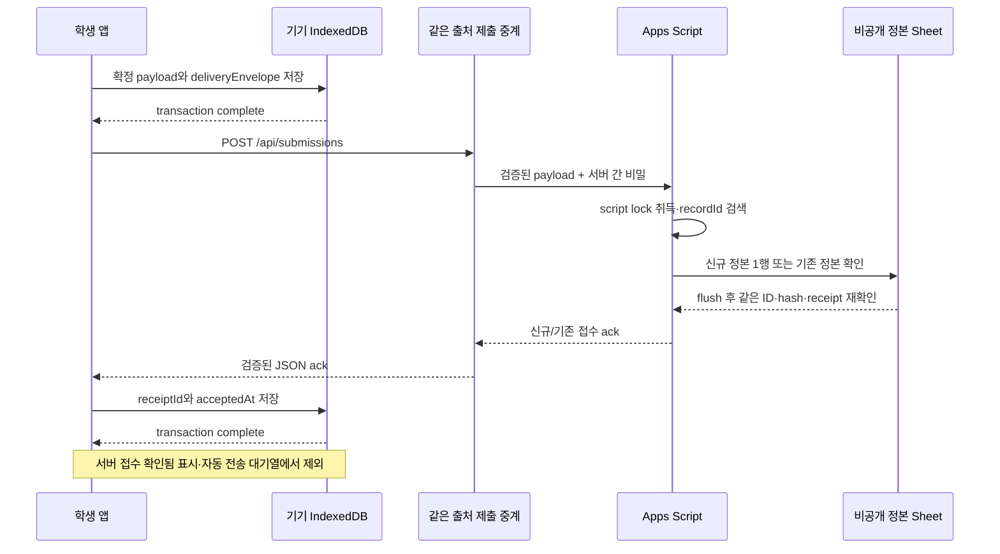

# 05. 연구자료 저장·제출·복구 설계

> 설계 검토본 · 2026-10-16 · 제품 구현·실제 배포·계정 설정·외부 제출을 수행하지 않았다.

학생에게는 **‘이 기기에 저장됨’과 ‘서버에서 접수 확인됨’을 따로 보여준다.** 통신이 끊겼을 때 결과를 잃지 않도록 먼저 기기에 저장하고, 서버가 반환한 접수번호를 확인한 뒤 제출 완료를 표시한다. NPC의 실습 통과 여부는 이 제출 상태와 별개다.

이 문서의 요구는 공통 데이터 명세인 [04_TASK_AND_LOG_SCHEMA.md](04_TASK_AND_LOG_SCHEMA.md)와 함께 읽는다. 필드명·불변 원본·정규화 규칙은 04를 기준으로 맞추며, 아래 숫자 중 ‘초기 제안’은 Google 또는 Cloudflare의 보장 한도가 아니다.

## 1. 결정 상태와 범위

| 구분 | 내용 |
|---|---|
| 확정 요구 | 1인 브라우저 수행, 완료 결과 선저장, 온라인 자동 제출, 서버 접수번호 확인, 실패 시 재전송, CSV 내보내기 |
| 제안 구성 | IndexedDB + 같은 출처 제출 중계 + Apps Script Web App + 교사 소유 비공개 Google Sheet |
| 호스팅 우선 제안 | React/Vite/TypeScript 정적 UI를 Cloudflare Pages로 제공하고 Pages Functions의 `/api/submissions`로 중계 |
| 연구자 확인 필요 | 연구 참여·가명 대응표·동의 절차·접근자·보관기간·철회 및 파기·기관 심의 절차 |
| 실제 시험 필요 | 학교 PC·태블릿, 학교망, 익명 접근 가능한 학교 Google 계정 정책, 동시 제출, 응답 유실, 한 행 저장 용량 |

현재는 웹 공식 문서의 기능을 확인한 단계다. 학교 계정으로 사용할 수 있는 배포 옵션, Google 연결 성공, CORS 실제 응답, 동시 처리량, 운영 비용을 검증한 상태는 아니다. 2026-10-20: 제출 경로 선택(중계 vs Apps Script 직접 호출)은 교사 결정 질문으로 남겼다(`../../collaboration/CLAUDE_REVIEW.txt`). 선택과 무관하게 §7의 ack 계약과 §9의 정본 규칙은 유지한다. **2026-10-20 사용자 결정:** GitHub Pages + Apps Script 직접 호출을 먼저 시험한다(이유: 비전공자 운영 부담 최소화, 교사 구글 계정만 필요). 직접 호출 시 서버 간 비밀을 둘 곳이 없으므로, 남용 방지는 세션 코드 검증·요청 크기·ScriptLock·중복 방지로 한정하고 그 한계를 운영 문서에 적는다. 실패하면 §3의 중계 구성으로 전환한다. 논문·NCS·실제 실습장 자료에서 이 시스템의 저장 용량이나 통신 성능 수치를 추정하지 않는다.

## 2. 교사가 이해할 제출 흐름

1. 학생이 수행을 시작하면 수행 기록 번호 `recordId`를 한 번 만든다.
2. 수행 중에는 같은 번호로 초안을 자동 저장한다. 새로고침하면 그 초안을 재개한다.
3. 완료 또는 명시적 중단 시 결과 원본 `recordPayload`를 확정한다. 이후 원본은 바꾸지 않는다.
4. 기기 저장이 완료된 것을 확인한 뒤 서버로 보낸다.
5. 서버는 같은 번호가 이미 있는지 확인하고, 신규 기록을 저장하거나 기존 접수번호를 돌려준다.
6. 앱은 기록 번호·내용 해시·접수번호가 맞는 응답을 확인한 뒤 ‘서버 접수 확인됨’을 표시한다.
7. 응답이 사라졌다면 같은 번호와 같은 내용을 다시 보낸다. 이미 접수된 경우 원래 접수번호를 회수한다.

서버에 기록한 뒤 마지막 응답만 끊기는 경우가 있다. 따라서 통신 오류를 ‘서버에 기록 없음’으로 해석하지 않는다. 이 경우 화면은 ‘접수 확인 필요’이며 원본과 같은 `recordId`를 유지한다.

## 3. 구성과 대안 비교

| 구성 | 장점 | 현재 요구에 대한 판단 |
|---|---|---|
| **Pages + Pages Functions + Apps Script + 비공개 Sheet** | 정적 앱과 `/api/submissions`가 같은 출처. 브라우저가 Google 응답을 직접 읽을 필요가 없고 비밀을 서버에 둘 수 있음 | 우선 제안. 함수 운영·오류 관찰·계정 정책·요금 확인은 필요 |
| GitHub Pages 단독 + 브라우저의 Google 직접 호출 | 정적 파일 배포는 단순 | 자동 접수 확인을 포함한 완전한 기본 구성이 아님. 직접 호출의 사전 요청·리다이렉트·응답 읽기를 검증하지 않은 채 약속할 수 없음 |
| 공식 Google Form 화면/삽입 | Google이 제공하는 응답 화면·미리 채운 링크 사용 | 학생의 수동 예비 경로. 앱의 불변 `recordId` 멱등 제출과 자동 접수번호 ack를 대체하지 못함 |
| Workers Static Assets + Worker API + Apps Script | 정적 자산과 같은 출처 API를 하나의 Worker 구성으로 제공 가능 | 유효한 대안. 현재의 중계 1개에는 Pages Functions로 설명 가능하므로 우선안을 늘리지 않음 |
| HTML form/iframe + Apps Script HtmlService의 메시지 ack | 브라우저 `fetch`의 교차 출처 응답 읽기를 피할 후보 | Google의 중첩 iframe·sandbox·origin·source 검증이 필요. 실제 시험 전 기본 경로로 채택하지 않음 |

Cloudflare의 공식 [React API 예제](https://developers.cloudflare.com/pages/tutorials/build-an-api-with-pages-functions/)는 정적 UI가 상대 경로 `/api/posts`를 호출하고 Functions가 JSON을 반환하는 구성을 보여준다. [Routing 문서](https://developers.cloudflare.com/pages/functions/routing/)는 파일 경로 기반 API, Vite의 `dist`, 함수 호출 경로 제어를 안내한다. 이것은 **같은 출처 중계 구성이 가능한 근거**이며 이 프로젝트의 Google 제출이 작동했다는 증거는 아니다.

향후 구현에서는 `functions/api/submissions.ts`에 대응하는 POST 경로만 중계하고, 정적 모델·텍스처·JS가 불필요하게 함수 호출이 되지 않도록 산출된 `_routes.json`을 확인한다. API가 정적 HTML 200으로 대체되면 성공으로 처리하지 않는다. 한도 소진 시 [fail-open/fail-closed 동작](https://developers.cloudflare.com/pages/functions/routing/#fail-open--closed)도 검토한다.

[Pages Functions 가격 문서](https://developers.cloudflare.com/pages/functions/pricing/)에 따르면 함수 요청은 Workers 계정 사용량에 포함된다. 이 학교의 계정 플랜·기존 사용량·트래픽을 확인하지 않았으므로 무료 운영을 보장하지 않는다. 결제 수단 추가·유료 전환은 설계 범위에 포함하지 않는다. [Workers와 Pages 공식 비교표](https://developers.cloudflare.com/workers/static-assets/migration-guides/migrate-from-pages/#compatibility-matrix)의 지원 차이 때문에 Cloudflare Vite plugin이나 Workers의 Rate Limiting binding을 Pages Functions에서도 그대로 쓸 수 있다고 적지 않는다.

## 4. 연구 원본과 전송 상태를 분리한다

| 객체 | 역할 | 변경 규칙 |
|---|---|---|
| `recordPayload` | 학생이 실제로 수행한 연구 원본 | draft 동안 변경 가능. 완료·명시적 중단으로 freeze한 뒤 수정 금지 |
| `deliveryEnvelope` | 기기 저장·업로드 시도·접수 확인 상태 | 재시도·응답 확인에 따라 변경. payload hash에 넣지 않음 |
| 서버 정본 행 | 접수된 불변 원본과 서버 receipt | 중복 요청으로 새 행 추가·덮어쓰기 금지 |
| 분석 요약·이벤트 시트 | 연구자의 분석과 검토를 위한 파생 자료 | 정본에서 재생성 가능. 정본 대신 중복 판정 근거로 사용하지 않음 |

`recordPayload`에는 공통 명세의 `schemaVersion`, `recordId`, `sessionSnapshotId`, `anonymousStudentCode`, `classConditionCode`, `sessionCode`, `taskId`, `difficultyMode`, `startedAt`, `completedAt`, `durationSeconds`, `stepEvents`, `errorCount`/`errorTypes`, `safetyViolationCount`/`safetyViolationTypes`, `hintCount`, `measurementInputs`, `calculationAnswers`, `judgmentAnswers`/`judgmentCorrect`, `vehicleVerdict`, `npcInspectionResult`, `retryCount`, `clientAppVersion` 및 버전·수행 역할·화면 모드 관련 확장을 보존한다. `sessionSnapshotId`는 교사가 공개한 불변 세션 스냅샷의 UUID이며 학생별 수행 UUID인 recordId와 다르다.

`versions`에는 과제·기준·측정세트·배치·판정엔진 버전과 함께 `sessionConfigVersion`, `researchProtocolVersion`, `feedbackPolicyVersion`을 보존한다. `configurationApproval.researchUseApproved`는 내용·배치 검토와 별개인 연구 운영 허용 상태이며 실제 IRB 승인이나 동의 절차 자체를 대체하지 않는다. 연구자료 대상 여부 `researchEligible`은 내용·배치 승인, 연구 운영 허용, 공식 모드·피드백 정책을 모두 충족해야 한다. 시연·미승인 상태를 제출 성공만으로 연구 적격으로 바꾸지 않는다.

전송은 `taskId=braking-force`의 MVP만 다룬다. `timedAssessment`는 비활성이다. `attemptRole=practice|primary|remediation`, `retryOfRecordId`, `displayMode=threeD|diagram`, `completionStatus=completed|aborted`, 배치 확인 상태, `runPurpose=demo|research`, `researchEligible`을 보존하여 연구자가 시범·연습·대표 수행·보충 수행·2D 전환을 구별할 수 있게 한다. 접수됐다는 이유만으로 분석 대상에 자동 편입하지 않는다.

특히 `judgmentCorrect`는 필수 항목의 최초 확정 답이 모두 정답이면 true, 모두 응답했지만 오답이 있으면 false, 하나라도 미응답이면 null이며 마지막 답으로 덮지 않는다. `calculationAnswers`는 계산 응답을 판독·판정 답과 분리해 보존한다. 차량 측정 결과의 `vehicleVerdict`, 학생 응답의 정오, NPC 검사 결과, 서버 접수 성공은 서로 다른 결과다. 비안전 학습오류 `errorCount`, 안전 위반 `safetyViolationCount`, 학생이 요청한 `hintCount`를 분리한다. 업로드 오류를 학생의 실습 오류로 합산하지 않는다. `durationSeconds`는 보이는 구간의 단조시간 누적이며 네트워크 대기·업로드 시간·새로고침 공백을 넣지 않는다. 단말 벽시계 차이인 completedAt-startedAt으로 대체하지 않고 `timing.pauseCount`, `resumeCount`, `timeQuality=continuous|resumed|uncertain`을 보존한다. 강제 종료·시계 변경 등으로 신뢰하기 어려우면 uncertain으로 표시한다. 자세한 시간 품질과 이벤트 규칙은 04를 따른다.

## 5. IndexedDB 선저장 계약

교사에게 보이는 기준은 ‘저장 버튼을 눌렀다’가 아니라 ‘브라우저의 저장 트랜잭션이 끝났다’이다. [IndexedDB 표준](https://www.w3.org/TR/IndexedDB/#transaction-lifecycle)은 개별 request의 성공과 transaction commit을 구별하며, commit 완료 후 transaction `complete`가 발생한다고 명시한다.

- `recordId`는 **수행 시작 시 1회 UUID로 발급**한다. 초안 저장·같은 수행 재개·업로드 재시도에서 바꾸지 않는다.
- 확정 payload와 해당 envelope를 같은 readwrite 트랜잭션에 기록한다. transaction `complete` 전에 전송을 시작하지 않는다.
- 완료 버튼 연타는 같은 freeze 요청을 다시 만들지 않게 막는다. 다른 탭이 같은 기록을 열었는지도 확인한다. 이 UI 처리는 서버 중복 방지의 대체물이 아니다.
- `strict` durability는 지원 기기에서 검토할 수 있는 힌트다. 저장 완료가 전원 손실·기기 초기화·사용자 삭제까지 막아준다고 설명하지 않는다.
- 저장 트랜잭션 안에서 네트워크 응답을 기다리지 않는다. 로컬 저장을 마친 다음 전송하며 receipt 저장은 별도 짧은 트랜잭션이다.
- draft 재개와 frozen outbox 재전송을 구분한다. 미완료 draft는 전송 대상이 아니고, 명시적 중단은 그 상태와 `npcInspectionResult=notCompleted`를 보존한 별도 확정 결과가 될 수 있다.
- 새 학습 수행을 시작하는 경우에만 새 `recordId`를 만든다. 학습 재수행의 `retryCount`와 통신 시도 수인 `uploadAttemptCount`를 섞지 않는다.

### 저장 상태

`deliveryEnvelope` 필드는 `recordId`, `localSaveStatus`, `uploadStatus`, `uploadedAt`, `receiptId`, `uploadAttemptCount`, `lastErrorCode`, `nextRetryAt`로 통일한다.

| `localSaveStatus` | 뜻 | 화면·전송 처리 |
|---|---|---|
| `unpersisted` | 현재 기록의 로컬 저장 완료를 아직 확인하지 못함 | 저장 중 표시. 전송 시작 금지 |
| `saved` | 현재 로컬 쓰기의 transaction complete 확인 | frozen 원본이면 제출 가능 |
| `failed` | 저장·상태 갱신 실패 감지 | 저장 완료 주장 금지. 원본 보존·파일 내보내기·교사 확인 |

수행 중 초안 저장에 실패하면 학생이 오랫동안 기록 없는 활동을 계속하지 않도록 저장 복구를 안내한다. 서버 ack 수신 후 receipt의 로컬 저장만 실패한 경우에는 **서버 접수는 확인됐지만 기기 상태 갱신은 실패**했다고 구별한다. 메모리에 있는 receipt를 보여줄 수 있고 기존 frozen 원본은 유지한다. 다음 실행에서 오래된 uploading 상태를 읽으면 같은 ID로 접수를 재확인한다.

IndexedDB는 원격 백업이 아니다. [Storage Standard](https://storage.spec.whatwg.org/#storage-pressure)는 best-effort 저장의 정리를 허용하며, persist 허용 여부와 사용자 삭제를 별개로 다룬다. [WebKit 공식 설명](https://webkit.org/blog/14403/updates-to-storage-policy/)도 저장 압박·한도·삭제 가능성을 설명한다. `navigator.storage.persist()`의 성공 여부를 확인하되 거절돼도 정상 동작할 대체 경로를 준비한다. API 부재·거절·관리 PC 프로필 초기화 정책을 현장에서 확인한다. IndexedDB가 있다는 이유만으로 첫 접속을 포함한 앱 전체 오프라인 실행을 보장하지 않는다.

## 6. 업로드 상태와 화면 문구

| `uploadStatus` | 진입 조건 | 학생에게 보여줄 뜻 |
|---|---|---|
| `pending` | 아직 전송하지 않았거나 인터넷 미도달이 확인된 대기 | 이 기기에 저장됨 · 전송 대기 |
| `uploading` | frozen 원본을 보내고 응답을 기다리는 중 | 제출 중 |
| `confirmationPending` | timeout·응답 유실·잘못된 ack 등 접수 여부가 불명 | 접수 확인 필요 · 기록은 이 기기에 보관 |
| `acknowledged` | 정상 ack의 ID·hash·receipt 확인 | 서버 접수 확인됨 · 접수번호 표시 |
| `rejected` | 자료형·크기·스키마 등의 확정 거절 | 제출자료 확인 필요 · 교사에게 확인 |
| `conflict` | 같은 ID에 다른 원본이 존재 | 기록 충돌 · 원본 유지 · 교사에게 확인 |

온라인 감지 이벤트나 `navigator.onLine`은 실제 서버 도달·저장 증거가 아니다. 명확히 전송 전인 오프라인은 pending을 유지하고, 요청이 도달했을 가능성이 있으면 confirmationPending을 쓴다. 자동 재시도 상한을 넘었다는 이유로 acknowledged 또는 rejected로 바꾸지 않는다.

ACK를 확인하면 `receiptId`를 envelope에 넣고 **`uploadedAt`에 서버의 `acceptedAt`을 보관**한다. 브라우저가 응답을 받은 현재 시각을 uploadedAt으로 대체하지 않는다. `startedAt`/`completedAt`의 단말 시각과 서버 접수 시각은 서로 다른 의미다.

자동 재시도 초기 제안은 짧은 지수 지연과 무작위 지연을 사용해 5회 이내로 멈추고, 이후 대기 기록과 수동 재시도 버튼·교사 안내를 남기는 것이다. 이는 부하 시험으로 조정할 운영 값이며 자료를 폐기하는 한도가 아니다. `nextRetryAt`과 `uploadAttemptCount`는 payload 밖에서 관리한다. 여러 탭이 동시에 대기열을 보내는 일을 줄이되, 최종 일관성은 서버 `recordId` 규칙으로 보장하도록 설계한다.

## 7. API와 정상 접수 응답

학생 앱의 **연구기록 쓰기 경로는 POST `/api/submissions`** 하나다. [03 기술 구조](03_TECH_ARCHITECTURE.md)의 **GET `/api/sessions/{sessionCode}`**는 읽기 전용 공개 설정 경로다. 이름·연구결과·대응표·Sheet 편집권한·서버 비밀을 반환하지 않으며, 학생에게 집계·전체조회·설정 변경 API를 제공하지 않는다.

공개 GET는 교사가 ‘검사 후 수업 공개’한 세션의 허용 필드만 반환한다. `sessionSnapshotId`와 과제·모드·측정세트·기준·배치·세션 설정·연구 프로토콜·피드백 정책 버전 및 승인된 설정을 시작 시 고정하고 로컬 초안에 연결한다. 정답에 필요한 기준이 브라우저에 전달되므로 고부담 시험의 정답 비공개를 보장하지 않는다. 서버 수신 시에는 sessionSnapshotId와 가명코드 형식·세션/조건/버전의 조합을 보관된 승인 스냅샷과 대조한다. 클라이언트가 임의 주장한 researchUseApproved/researchEligible을 승인 증거로 쓰거나 불일치를 조용히 수정하지 않는다. 늦은 재전송은 현재 설정으로 재채점하지 않고 시작 때 고정된 스냅샷과 연구 운영 허용 상태를 확인할 수 있어야 한다. 세션 종료 이후의 접수 허용 기간은 연구자·교사가 정할 운영 정책이다.

요청 명세는 `protocolVersion`이 문자열 `"1"`이고 `payload`가 04의 완전한 recordPayload 객체인 JSON이다. `payload`를 JSON이 들어 있는 문자열로 이중 인코딩하지 않는다. deliveryEnvelope·서버 비밀·클라이언트가 정한 receipt는 요청 payload에 넣지 않는다. 정상 응답은 아래 필드를 갖는다.

| 필드 | 의미·검증 |
|---|---|
| `protocolVersion` | 문자열 `"1"` |
| `ok` | boolean true |
| `recordId` | 요청 frozen 원본의 ID와 일치 |
| `receiptId` | 서버가 발급·보존한 접수번호. 동일 원본 재시도에서는 같은 값 |
| `acceptedAt` | 서버가 최초 접수 시 기록한 UTC 시각. 재시도 응답 시각으로 교체 금지 |
| `payloadHash` | 검증된 recordPayload의 서버 재계산 SHA-256 |
| `duplicate` | 기존 접수를 회수한 경우 true, 신규 접수면 false |

프론트·중계·Apps Script는 04의 **RFC 8785 JCS → UTF-8 → SHA-256** 규칙을 공유한다. deliveryEnvelope, receiptId, acceptedAt, 전송 시도 수는 hash 입력에서 제외한다. 서버는 브라우저의 hash를 신뢰하는 대신 원본에서 다시 계산한다. 서버가 허용되지 않은 필드를 조용히 지워 원본을 다른 내용으로 만들지 않고 스키마 오류를 돌려준다.

[RFC 8785](https://www.rfc-editor.org/rfc/rfc8785.html)는 문자열 보존과 UTF-8 출력을 설명한다. 한글을 NFC/NFD로 자동 정규화하거나 문자열 trim·코드 대소문자 변경·숫자 재반올림·배열 재정렬을 하여 같은 내용으로 취급하지 않는다. 필요한 입력 정리는 freeze 이전에 명세로 정의한다. NaN·Infinity·잘못된 Unicode·중복 객체 키 같은 유효하지 않은 입력을 처리하는 방식도 04와 같은 시험자료로 맞춘다.

중계는 HTTP 상태를 구별하되, Google이 HTTP 200을 돌려줬다는 이유만으로 앱에 ok=true를 보내지 않는다. 정상 JSON·프로토콜·ID·hash·receipt가 모두 맞아야 한다. CORS 실패를 피하려고 [opaque 응답](https://fetch.spec.whatwg.org/#concept-filtered-response-opaque)의 상태·본문을 읽을 수 없는 `no-cors`로 바꾸지 않는다.

### 오류 계약과 재시도 판단

오류 본문은 `{protocolVersion:"1",ok:false,code,retryable,recordId?}` 형식이다. 아래 코드는 05의 제안 오류 목록이며 구현 시 04와 같은 목록으로 고정한다.

| 오류 예 | 중계 HTTP 제안 | 업로드 상태·다음 행동 |
|---|---|---|
| `INVALID_PAYLOAD`, `UNSUPPORTED_SCHEMA` | 400 또는 422 | `rejected`, 원본 보존·무한 재시도 금지 |
| `PAYLOAD_TOO_LARGE` | 413 | `rejected`, 잘라내지 않고 교사 확인·원본 내보내기 |
| `RECORD_ID_CONFLICT` | 409 | `conflict`, 덮어쓰기·자동 새 ID 발급 금지 |
| `RATE_LIMITED`, `LOCK_BUSY` | 429 또는 503 | `pending` 또는 `confirmationPending`, 상태 확실성에 따라 지연 재시도 |
| `UPSTREAM_UNAVAILABLE`, `UPSTREAM_INVALID_ACK`, timeout | 502 또는 504 | `confirmationPending`, 같은 원본으로 접수 확인 |
| 서버 간 비밀 누락·오류 | 운영 설정 오류로 처리 | 학생 답안 오류로 집계 금지. 세부 비밀을 응답하지 않고 교사 점검 |

가동 중 페이지를 닫거나 브라우저에서 요청을 취소해도 이미 시작한 서버 작업까지 취소됐다고 가정하지 않는다. 새로고침 후 남은 uploading 기록은 confirmationPending으로 복원하여 같은 ID로 재전송한다. API 오류의 retryable 값이 true여도 자동 횟수·화면 안내 규칙을 적용한다.

## 8. 중계 서버와 비밀 보관

브라우저에는 공개 상대 경로 `/api/submissions`만 필요하다. Google 자격증명과 서버 간 비밀은 학생 코드에 들어가지 않는다.

1. Pages Function이 POST·JSON·요청 크기·프로토콜·schema를 먼저 검증한다.
2. 함수가 서버에 보관한 비밀과 검증된 payload를 Apps Script의 고정 `/exec` URL로 전달한다. 학생이 전송 목적지 URL을 지정할 수 없게 한다.
3. Apps Script `doPost`가 서버 간 비밀과 schema를 검증한다. 비밀이 없는 직접 호출은 저장하지 않는다.
4. 함수는 ContentService의 리다이렉트를 서버에서 처리한다. 허용된 Google 호스트, 응답 크기, 최종 MIME·JSON·ack를 확인한다. 로그인 화면·권한 HTML·Google 오류 문구를 접수 성공으로 바꾸지 않는다.
5. 브라우저에는 필요한 ack 또는 정제된 오류 코드만 반환하고 `Cache-Control: no-store`를 제안한다. 원본 payload나 내부 Google URL·비밀을 오류 설명에 덧붙이지 않는다.

[Cloudflare secrets 문서](https://developers.cloudflare.com/pages/functions/bindings/#secrets)는 암호화 binding과 함수의 `context.env` 접근을 안내한다. **제안:** 공유 비밀은 `SUBMISSION_UPSTREAM_SECRET`이라는 서버 secret과 Apps Script Script Properties에만 보관한다. 일반 평문 변수와 구분하고 local secret 파일은 Git에서 제외한다. [Vite 문서](https://vite.dev/guide/env-and-mode#env-variables)에 따라 `VITE_` 변수는 프론트 번들에 노출되므로 비밀에 사용하지 않는다.

[Apps Script 웹앱 이벤트](https://developers.google.com/apps-script/guides/web#request_parameters)는 POST 본문 접근을 문서화하지만 일반 요청 헤더 접근은 명시하지 않는다. 임의 Authorization 헤더를 `e.headers`로 읽을 수 있다고 가정하지 않고, **중계→Apps Script의 서버 간 POST 본문**에 공유 비밀과 payload를 담는 최소 계약을 제안한다. 이 비밀은 브라우저 요청에는 없고 연구 payload hash에도 없다. query string에 넣지 않는다.

공유 비밀은 Apps Script 직접 저장의 남용을 줄이는 수단이다. 공개 제출 중계 자체에 대한 남용까지 없애지는 못한다. Origin 검사는 보조 수단이며 학생 신원 인증이 아니다. 요청 크기·속도·허용 수업/세션을 제한하는 방법을 운영 환경에서 정하되 학교 공인 IP 하나를 학생 전원과 같은 사용자로 오판해 막지 않게 시험한다. 부가 인증·Turnstile 등은 현재 확정 기능으로 넣지 않는다.

production과 preview는 secret·대상 Sheet를 분리한다. preview에 운영 secret을 주지 않거나 실제 전송을 차단한다. 운영 관찰에는 상태 코드·처리 시간·오류 분류·제한된 상관 ID 정도만 쓰고 **원본 연구자료, 가명학생코드, 대응표, 공유 비밀, OAuth 토큰을 로그에 출력하지 않는다.** 플랫폼의 네트워크/운영 로그에 남는 정보와 보관 설정은 별도 확인하며 ‘IP가 어디에도 남지 않는다’고 보장하지 않는다.

## 9. 서버 정본과 중복 방지

교사가 결과 표를 정리하는 동안 접수 원본이 바뀌면 안 된다. 따라서 정본 시트는 아래 5열을 중심으로 보존하고 사람이 직접 정렬·수정하는 분석 시트와 분리한다.

| 열 | 규칙 |
|---|---|
| `recordId` | 서버 중복 판정 키 |
| `receiptId` | 서버가 신규 접수 시 생성. 행 번호나 순번 변경에 의존하지 않음 |
| `acceptedAt` | 최초 서버 접수 시각 |
| `payloadHash` | JCS/UTF-8/SHA-256 결과 |
| `payloadJson` | 완전한 canonical 원본 JSON. 일부 필드만 축약한 요약이 아님 |

Apps Script 저장 순서는 다음과 같다.

1. 공유 비밀·요청 크기·schema 검증과 hash 계산을 마친다.
2. `LockService.getScriptLock()`을 취득한다. 제한 시간 내 실패하면 저장 완료를 말하지 않는다.
3. 정본의 recordId를 검색한다. 같은 ID가 하나이고 hash·내용이 같으면 기존 ack를 반환한다.
4. 같은 ID의 내용이 다르면 RECORD_ID_CONFLICT로 거절한다. 동일 ID가 여러 행이면 정본 이상으로 보고 운영 점검으로 보낸다.
5. 신규 접수면 같은 행에 receipt·시각·hash·payloadJson을 함께 기록한다. 별도 번호 발급만 먼저 확정하지 않는다.
6. `SpreadsheetApp.flush()` 후 같은 행을 읽어 ID·receipt·hash·원본이 맞는지 재확인한 뒤 ack를 구성한다.
7. finally 구간에서 잠금을 해제한다. 분석 시트 생성·CSV 작업·외부 요청은 잠금 구간에 넣지 않는다.

[LockService](https://developers.google.com/apps-script/reference/lock/lock-service)는 웹앱에서 document lock이 null일 수 있음을 설명하고 script lock을 제공한다. [Lock 문서](https://developers.google.com/apps-script/reference/lock/lock)는 잠금 해제 전 Sheet flush를 권고한다. 이는 Sheet가 고유 제약·다중 서비스 트랜잭션을 제공한다는 뜻은 아니다.

모든 쓰기가 같은 스크립트·잠금 규칙을 따르고 정본이 보존된다는 전제에서 실용적 멱등 처리를 설계한다. **절대적인 exactly-once 저장을 보장하지 않는다.** 다른 스크립트·수동 편집·행 삭제·부분 기록이 발견되면 정상 접수 ack를 꾸며내지 않고 정본 이상으로 다룬다. 단순 검색이 커지는 비용은 실제 수업량으로 측정한다. 검색용 캐시·인덱스를 후속 도입하더라도 cache가 정본을 대신하지 않으며 재생성 가능해야 한다.

### 한 셀에 원본을 넣는 크기 제한

이 MVP는 이미지·음성·영상·3D 모델을 결과에 넣지 않고 의미 있는 수행 이벤트와 답만 보내는 소형 원본을 전제로 한다. 카메라 매 프레임 좌표, 마우스 이동, 터치 이동 전부를 수집하지 않는다. 학습 단계 선택·확정 답·힌트 요청·안전 위반·검사·화면 전환처럼 연구 해석에 필요한 사건을 기록한다.

**초기 제안:** JCS payloadJson은 UTF-8 기준 32 KiB 이하, 브라우저→중계 전체 요청 본문은 48 KiB 이하, `stepEvents`는 최대 200개로 제한한다. 이는 학교 기기 시험 후 조정할 보수적 설계값이며 실제 Apps Script/Sheet 보장 한도가 아니다. KiB는 1,024바이트 단위이고 글자 수와 다르다. 전체 요청의 추가 공백·escape·envelope 오버헤드를 따로 제한하고 클라이언트·중계·Apps Script에서 같은 단위를 쓴다.

[Google 공식 Drive 파일 한도 도움말](https://support.google.com/drive/answer/37603?hl=en)은 **Excel→Sheets 변환 시** 50,000자를 넘는 셀의 제거를 설명한다. 이 문구를 Apps Script `setValues`의 일반 API 한도로 확대해 확정하지 않는다. Apps Script 공식 Range 명세에서 이 제출 원본의 한 셀 허용 길이를 확증하지 못했으므로 한글·숫자·escape가 섞인 상한 표본을 실제 쓰고 읽어 hash와 길이가 완전히 같은지 확인해야 한다.

원본이 상한을 넘으면 이벤트를 조용히 버리거나 잘라 성공 처리하지 않는다. 특히 안전·오류 사건을 삭제해 200개에 맞추지 않는다. 수행 중 용량/이벤트 상한 도달이 예상되면 명시적 중단과 교사 확인으로 전환하고, 이미 발생한 사건을 포함한 로컬 원본을 보존한다. 상한을 넘은 원본의 자동 제출은 중단하며 PAYLOAD_TOO_LARGE와 JSON 원본 내보내기 등 회수 경로를 안내한다. 수업 전 상한을 넘는 표본이 발견되면 연구상 필요한 사건을 유지하는 용량 정책을 먼저 바꾸고, 그래도 필요하면 원본 파일 저장소+참조 해시 등 별도 설계를 검토한다. 확정 원본의 일부를 지우거나 ID만 바꿔 우회하지 않는다. 이 변경은 현재의 ‘정본 1행’을 그대로 두고 되는 작업이라고 취급하지 않는다.

## 10. 응답 유실과 실패 복구

| 실패 상황 | 접수 여부 | 복구·검증 기준 |
|---|---|---|
| 로컬 저장 이전 종료·transaction abort | 새 전송 시작 없음 | saved 표시·전송 금지. 마지막 저장된 draft와 구분 |
| 저장 완료 후 오프라인 | 미접수 또는 아직 미전송 | pending 보존. 온라인 복귀·수동 재시도 |
| Google 저장 성공 후 ack 유실 | 접수됐을 수 있음 | 같은 ID·원본 재전송 → 같은 receipt·acceptedAt, 정본 행 추가 없음 |
| 브라우저 timeout·탭 닫기·요청 취소 | 불명 | confirmationPending. 서버 취소로 가정하지 않음 |
| CORS·리다이렉트 읽기 실패 | 저장됐을 수 있음 | no-cors 성공판정 금지. 중계의 실제 최종 응답 점검 |
| JSON 대신 Google 로그인·권한 HTML | 저장 전/후 상태 불명 | UPSTREAM_INVALID_ACK 등으로 구별. 이전 원본 유지 |
| lock·쿼터·함수 한도 | 실패 또는 불명 | 백오프·자동 횟수 상한·교사 점검. 새 ID로 재시도 금지 |
| 같은 recordId·다른 hash | 원본 충돌 | conflict. 기존 결과 덮어쓰기 금지·수동 검토 |
| ack 수신 후 로컬 상태 쓰기 실패 | 서버 접수 확인 | receipt 표시·기존 outbox 보존·다음 접속에 같은 ID로 회수 |
| 다음 학생 시작 | 기존 자료가 기기에 남아 있을 수 있음 | 새 수행 화면만 초기화하고 미접수 immutable outbox를 지우지 않음 |
| 다른 기기·다른 origin·새 프로필 | 이전 IndexedDB 접근 불가 | 이전 기기 receipt 확인 또는 보관된 원본 파일로 교사 회수 |

[Apps Script 쿼터 문서](https://developers.google.com/apps-script/guides/services/quotas)는 한도 초과 시 실행 중단과 예외, 사전 통지 없는 한도 변경 가능성을 설명한다. 따라서 사용자당/스크립트당 동시 실행 수치만 보고 ‘한 반 동시 제출 가능’이라고 결론내리지 않는다. 실제 배포자 권한·학교망·저장 행 크기로 시험한다.

서버 receipt는 ‘어떤 내용 해시의 기록을 접수했다’는 확인이다. 익명 학생의 신원, 실제 장비 조작, 실습 정답, 연구 참여 적격성을 증명하는 서명으로 설명하지 않는다. receipt가 있어도 NPC 검사 결과·demo·배치 미확인·분석 대상 여부는 별도로 검토한다.

## 11. 분석 시트·이벤트 시트·CSV 재생성

정본을 사람이 분석하기 좋은 여러 열로 풀어쓰되 원본 자체를 고치지 않는다. 분석 파이프라인은 `recordId`와 `payloadHash`를 기준으로 중복을 확인하고, 파생 버전을 남긴다.

| 파생 자료 | 생성 원칙 |
|---|---|
| 수행 요약 | recordId당 1행. sessionSnapshotId·가명코드·조건·회차·시작/완료·활성시간·판독/계산/판정 최초·최종 답·vehicleVerdict·오류·안전·힌트·NPC 검사·역할·화면모드·각 버전·runPurpose·researchEligible 등 |
| 이벤트 자료 | `(recordId, eventId)`로 식별하고 `sequence`로 순서를 보존. `actionId`는 행동집계 중복 제거용이며, 같은 행동에서 나온 서로 다른 사건과 actionId가 없는 paused/resumed 등을 합치지 않음. `feedbackShown`의 feedbackKind/feedbackKey, 화면 전환의 fromDisplayMode/toDisplayMode를 보존 |
| 제출 운영 자료 | 접수·재시도·오류 품질을 학습 성과와 분리. 필요한 최소 운영 필드만 별도 관리 |
| CSV | schemaVersion·파생 규칙 버전·생성 시각을 함께 설명. 무응답/null을 0·오답·빈 문자열로 일괄 치환하지 않음 |

재생성 절차는 정본 읽기 → schema 검증 → hash 재계산 대조 → 중복/충돌/손상 분리 → 버전별 파생 → 요약·이벤트 산출 순서다. 새 분석 시트를 만든 뒤 행 수와 event 수를 대조하고 기존 분석판을 바꾸는 시점은 연구자가 정한다. 손상된 행을 조용히 제외한 뒤 ‘전체 자료’라고 부르지 않는다.

설명적 피드백의 실제 노출 `feedbackShown`을 기록해 학생이 힌트를 요청한 사건과 구별한다. 자동 피드백을 hintCount에 더하지 않는다. 같은 actionId로 답 제출과 피드백 노출이 이어져도 별도 eventId의 사건은 둘 다 남기며, 첫 답을 피드백 후 답으로 덮지 않는다. 최종 displayMode만 보고 처음부터 도식 화면을 썼다고 판단하지 않고 fromDisplayMode/toDisplayMode와 순서를 확인한다.

`primary`나 대표 수행을 선택하는 규칙은 연구자 확인이 필요하다. 여러 재수행 중 마지막 기록을 무조건 주 분석에 쓰지 않는다. 시범 자료, 미확정 판정 기준, layoutConfirmed=false, 중단·diagram 전환·시간 품질 문제도 데이터에 남겨 검토할 수 있게 한다. 제외 사유와 제외 규칙은 연구 설계 문서와 일치시킨다.

[Range.setValues 공식 문서](https://developers.google.com/apps-script/reference/spreadsheet/range#setvaluesvalues)는 `=`로 시작하는 값의 수식 해석을 설명한다. 자유입력을 분석 시트나 CSV로 전개할 때 수식으로 실행되지 않는 텍스트 출력 규칙을 적용하고, 원본 JSON은 바꾸지 않는다. CSV는 컬럼 분석용이며 frozen JSON을 완전히 복원하는 유일한 백업으로 취급하지 않는다.

## 12. 공용 PC·태블릿 운영

다음 학생이 이전 학생의 결과를 보지 않게 화면을 초기화하는 것과, 전송 전 기록을 지우지 않는 것은 동시에 필요하다.

- 시작 화면에서 새 가명코드·조건·회차를 확인하고 이전 학생의 코드·답·접수번호를 자동으로 다시 보여주지 않는다.
- ‘다음 학생’은 현재 화면·입력·아바타·연습 상태를 초기화한다. 기존 frozen outbox는 별도 저장소에 보존하고 같은 ID로만 재시도한다.
- 학생용 기록 목록에 전체 사용자의 결과를 열람시키지 않는다. 미접수 건의 회수는 교사가 관리하며 학생에게 원본 전체를 보이는 전역 관리 화면을 두지 않는다.
- 화면 초기화는 같은 브라우저 프로필의 IndexedDB를 암호학적으로 격리하는 기능이 아니다. 공용 계정의 개발자 도구·파일 다운로드·브라우저 초기화 권한을 고려한다. 간단한 프론트 PIN이나 화면 숨김을 보안 인증으로 부르지 않는다.
- 수업 종료 때 교사는 미접수 건과 접수번호를 대조한다. 로컬 파일 내보내기가 생겼다면 관리 경로·전달자·삭제 시점을 기록한다. 여러 학생 자료를 일반 다운로드 폴더에 무기한 방치하지 않는다.
- 로컬 보관·삭제 시점은 연구자와 기관 절차에서 정한다. 전송 시도 또는 다음 학생 시작만으로 미접수 원본을 삭제하지 않는다. 서버 확인 이후의 로컬 삭제도 확정된 보관 규칙을 따른다.
- 태블릿의 홈 화면 앱·일반 브라우저·개인정보 보호 모드·학교 관리 프로필은 저장 동작이 다를 수 있어 동일하다고 가정하지 않는다. 실제 기기의 정상 모드를 정해 안내한다.

## 13. 개인정보·연구윤리 확인표

이 절은 법률 판단이나 IRB 승인 결과가 아니라 **연구자가 기관 담당자와 확인할 항목**이다. `anonymousStudentCode`는 대응표와 연결될 수 있어 완전 익명이라고 단정하지 않고 가명코드로 설명한다.

- [ ] 수업 활동과 연구자료 제공을 어떻게 구분하는지, 참여 거절·중단·철회가 학습·평가에 미치는 영향을 연구자가 정했는가.
- [ ] 학생·보호자 설명/동의 등 필요한 절차와 기관의 심의·확인 여부를 실제 연구대상과 학교 맥락에 맞춰 확인했는가.
- [ ] 연구 프로토콜·피드백 정책 버전과 researchUseApproved를 실제 허용 범위에 맞춰 기록했는가. 이 데이터 플래그를 기관 승인·동의 서류의 대체물로 설명하지 않았는가.
- [ ] 수집할 필드와 목적을 설명했는가. 이름·이메일·학번·전화번호·원본 사진·음성·정밀 위치·키 입력 원문은 기본 제출에서 제외했는가.
- [ ] 가명코드 대응표의 보관자·장소·접근자를 결과 Sheet와 분리했는가. 조건코드만으로 학급·학생이 쉽게 재식별되는지도 검토했는가.
- [ ] 교사 소유 Sheet의 일반 공유·공개 링크·결과 요약·export 권한을 점검했는가. 학생에게 쓰기 권한을 주지 않았는가.
- [ ] Cloudflare·Google을 통한 처리, 학교 계정 정책, 기관이 요구하는 서비스·저장 위치·수탁·국외 처리 관련 검토 항목을 담당자와 확인했는가.
- [ ] 브라우저 로컬 원본·서버 정본·파생 CSV·백업·대응표·플랫폼 운영 로그 각각의 **보관기간과 삭제 책임자**를 정했는가. 이 문서는 기간 숫자를 확정하지 않는다.
- [ ] 철회 요청 시 가명코드/recordId 매칭, 정본·파생·백업 반영, 재시도로 삭제 자료가 다시 생기지 않게 하는 운영 절차를 정했는가.
- [ ] 원본·비밀·가명코드가 앱/서버 오류 로그, URL, 소스맵, 공개 저장소, 스크린샷에 남지 않는지 점검했는가.
- [ ] 공용 PC 미접수 기록과 다운로드 파일의 회수·접근·삭제를 누가 맡는지 정했는가.
- [ ] 데이터 유출·오접수·중복·정본 손상·수업 중단 발생 시 연락·보고·복구 경로를 정했는가.

연구자료 삭제를 실행하는 학생용 공개 API는 MVP에 없다. 철회 요청 처리 방식이 미정이면 연구자 확인 항목으로 남기고, 동의·승인·보관 정책이 확정됐다고 표시하지 않는다.

## 14. 학교 계정과 실제 운영 전 확인

[Apps Script manifest](https://developers.google.com/apps-script/manifest/web-app-api-executable)는 비로그인 접근 `ANYONE_ANONYMOUS`와 배포자 실행 `USER_DEPLOYING`을 구분한다. [웹앱 가이드](https://developers.google.com/apps-script/guides/web)는 배포자 권한 실행과 권한 정책, 테스트 `/dev`의 편집자 제한을 설명한다.

교사 설정의 최소안은 [03의 보호된 Sheet 설정 탭·설정 검사·수업 공개 메뉴](03_TECH_ARCHITECTURE.md)다. 교사 계정으로 내용·배치 승인, 연구 운영 허용, 모드·피드백 정책과 각 버전을 검사한 뒤 새 sessionSnapshotId의 불변 세션 스냅샷을 공개하며, 기존 버전과 진행 중 수행을 덮어쓰지 않는다. Sheet 보호범위와 실제 편집자는 계정 시험으로 확인한다. 학생용 GET는 이 공개 스냅샷만 읽고 설정 편집이나 정본 조회를 할 수 없다. 숨겨진 메뉴·프론트 공통 PIN만으로 교사 권한을 구현하지 않는다.

교사가 실제로 확인할 것은 다음이다.

1. 연구에 사용할 교사/기관 계정이 익명 Web App 배포를 허용하는가. 허용되지 않으면 개인 계정으로 우회하지 말고 기관과 대체 수집 구성을 정한다.
2. 학생 로그인 없이 `/exec` POST가 가능한가. 소유자 로그인 브라우저 성공만으로 판정하지 않는다.
3. 학교망에서 앱 호스트·`script.google.com`·`script.googleusercontent.com` 연결이 가능한가. 중계 사용 시 학생 브라우저와 중계 서버의 접근 경로를 구분해 본다.
4. Sheet는 교사에게만 편집권한이 있고 Apps Script는 그 권한으로 정본을 쓰는가. 학생에게 공유 Sheet 쓰기를 열지 않는다.
5. 프리뷰·개발·운영의 대상 Sheet와 비밀이 분리됐는가. `/dev`를 학생 배포 URL로 쓰지 않았는가.
6. Script 소유권·학교 계정·담당자 변경 때 URL·권한·secret·운영 책임을 어떻게 인계할지 정했는가.

Google Form을 비상 경로로 쓰는 경우에도 [공식 도움말](https://support.google.com/docs/answer/2839588?hl=en)에 따라 응답 접근과 공개 결과 요약을 확인한다. ‘1회 응답 제한’은 Google 로그인을 요구하므로 비로그인 중복 방지 수단으로 쓰지 않는다. [Forms REST 응답 메서드](https://developers.google.com/workspace/forms/api/reference/rest#rest-resource:-v1.forms.responses)는 get/list만 문서화하므로 내부 제출 URL을 공식 안정 API처럼 약속하지 않는다.

## 15. 수용 시험과 완료 증거

다음은 아직 실행하지 않은 **검증 계획**이다. 실제 기기명·OS·브라우저 버전, 배포 버전, 학교망, 시험 시각을 기록한다.

| 시험 | 통과 증거 |
|---|---|
| 로컬 선저장 | transaction complete 이전 서버 요청 0건, 이후에만 전송 |
| 저장 실패 | 기기 저장 완료·제출 완료 오표시 없음. 원본 회수 경로 안내 |
| 새로고침·재시작 | 같은 draft 재개 또는 같은 frozen ID 재전송. 새로운 ID로 복제되지 않음 |
| 오프라인·재연결 | pending/confirmationPending 보존, 수동·자동 재시도 후 receipt 확인 |
| 저장 직후 응답 유실 | 서버 정본 1행, 같은 ID 재시도에 같은 receipt·acceptedAt·hash |
| 연타·두 탭·수업 규모 동시 제출 | 동일 원본 중복행 없음, lock·함수·Google 오류가 사용자에게 구별됨 |
| 같은 ID·다른 내용 | 409/RECORD_ID_CONFLICT, 기존 원본 변경 없음 |
| 잘못된 ack·HTML 200 | acknowledged로 바뀌지 않음 |
| hash 일치 | 한글·Unicode 조합·배열·숫자·null 표본의 프론트/중계/Apps Script hash 동일 |
| 행·요청 크기 상한 | 초기 제안 경계값 표본의 기록/읽기 길이·hash 동일. 초과는 잘림 없이 거절 |
| 비밀·자료 노출 | 학생 POST에는 필요한 recordPayload만 포함하고 서버 비밀은 없음. 빌드·URL·정상/오류 로그에 학생 원문·서버 비밀 없음 |
| 공용기기 다음 학생 | 이전 답·코드·receipt 미노출, 미접수 outbox 보존·교사 회수 가능 |
| 분석 재생성 | 정본에서 다시 만든 수행 행/이벤트 수·hash·첫/최종 답이 일치 |
| 계정·망·한도 오류 | 학생 로그인 없이 실제 사용 가능, 실패 시 접수 완료 오표시 없음 |
| 공개 세션·교사 권한 | GET는 승인 스냅샷 허용 필드만 반환. 학생 경로로 설정/정본 편집 불가. 기존 수행은 시작 버전을 유지 |

완료 증거는 **학생 화면 receipt, 서버 정본의 같은 recordId/receipt/hash, 재전송 후 정본 1행**의 일치다. 설계 문서 작성이나 공식 예제를 읽은 사실만으로 이 검증을 통과했다고 기록하지 않는다.

## 16. 공식 근거 확인 범위

2026-10-16에 위 링크의 본문을 실제 열어 확인했다. 저장·전송 설계는 Google Web Apps/ContentService/Lock/Quotas/Range, Cloudflare Routing/React API/Secrets/Pricing, Vite env, IndexedDB·Storage·Fetch 표준, WebKit 저장 정책, RFC 8785를 근거로 제안했다. [ContentService 공식 리다이렉트 설명](https://developers.google.com/apps-script/guides/content#redirects)과 [TextOutput 공개 메서드](https://developers.google.com/apps-script/reference/content/text-output)는 임의 CORS 헤더 설정을 전제로 하지 않는 이유다. 문서에 메서드가 없다는 사실을 ‘모든 배포의 직접 fetch는 항상 실패한다’로 확대하지 않았다.

현재 미확인 사항은 실제 학교 계정 배포 허용, 앱/Google/Sheet의 실제 통신, 원본 용량 경계, 수업 동시 부하, 공용기기 정책, 비용, 연구·보관 승인이다. 이 항목은 구현·운영 전 확인으로 남는다.
