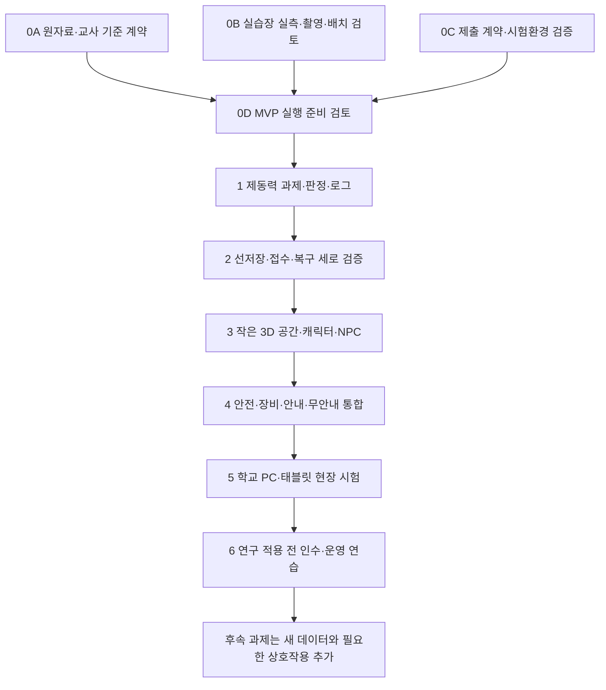

# 06. MVP 구현 순서와 완료 기준

> 설계 검토본 v0.1 · 2026-10-16 · 이 문서는 다음 구현 단계의 지침이다. 현재 요청에서는 앱·빈 스캐폴딩·서버 배포를 만들지 않는다.

가장 먼저 확인할 것은 3D 장면의 화려함이 아니라 **확인된 제동력 과제를 수행할 수 있는가, 실제 학교 배치를 재현할 근거가 있는가, 결과가 사라지거나 중복되지 않는가**이다. 기준·배치자료·제출 계약을 먼저 검증한 뒤 작은 장면에 연결한다. 완료 선언은 각 단계의 관찰 가능한 증거가 있어야 한다.

연결 문서: [개요](00_PROJECT_BRIEF.md) · [요구사항](01_REQUIREMENTS.md) · [게임 흐름](02_GAME_FLOW_AND_STORYBOARD.md) · [구조](03_TECH_ARCHITECTURE.md) · [데이터](04_TASK_AND_LOG_SCHEMA.md) · [제출](05_RESEARCH_DATA_PIPELINE.md) · [인수 실행 프롬프트](../IMPLEMENTATION_PROMPT_FOR_CLAUDE_CODE.md).

## 1. 구현 시작 전 상태

| 항목 | 현재 확인 상태 | 처리 |
|---|---|---|
| 사용자 범위 | 1인용·캐릭터+NPC·제동력 단일 과제·안내/무안내·선저장/접수 확인 확정. 2026-10-20 사용자 결정: 시간제한 평가(`timedAssessment`)는 1차 비활성, 2차에서 활성 | 유지 |
| 실제 배치 재현 | 사용자 확정. 2026-10-20 사진 44장·손 스케치 확보, 상대 배치 정리됨. 실측·연결부·학생 시작점 미확정 | `layoutConfirmed:false` 유지. 상대 배치 초안 교사 검토 → 실측 → 승인을 0B로 둠 |
| NCS 근거 | `LM1506030327_23v4`, 발행2025.12.31, 인쇄p.98~100의 절차·표·수식 PDF 시각 대조 | 해당 판본 학습내용으로 참조. 학교 차량/장비 승인 기준과 현행 법정기준으로 자동 채택하지 않음 |
| 기존 데이터 | 5단원41과제, 규정값16항목 모두 null, braking-force는 별도 상수 | 콘텐츠 출발점으로 활용. 규칙 검증·승인 구조로 변환 |
| 기존 판정 함수 | 음수·잘못된 위치·누락 규칙·경계 표시 문제 확인 | 그대로 복사하지 않음. 아래 재현 사례를 검증 목록으로 사용 |
| 연구 계획 | 두 학급 비교·면담 틀, 대표 수행·배점·시기·IRB 세부 미확정 | 연구 적용 전에 연구자 승인. 연구문제3개와 thesis CLAUDE의 2개 이하 원칙 충돌도 해소 |
| 앱/학교 기기 실행 | 이번 단계에서 미실행 | 아래 테스트는 계획이며 통과했다고 표현하지 않음 |

구현 작업은 교사가 이 설계 검토본과 남은 확인 사항을 검토한 뒤 시작한다. 교사 기준·배치·연구 사용 승인이 없는 개발용 시연은 `runPurpose:demo`, `researchEligible:false`로 명확히 구분하고 연구용 평가·수집에 사용하지 않는다.

## 2. 단계별 순서

0A~0C는 서로 독립적인 부분을 병행할 수 있지만, 모르는 기준과 배치를 추측해 3D 구현을 먼저 진행하지 않는다. 제안 스택과 제출 환경은 [03](03_TECH_ARCHITECTURE.md), [05](05_RESEARCH_DATA_PIPELINE.md)의 선택 이유·제약을 따른다.

### 0A. 원자료와 교사 기준 계약

**할 일:** 읽기 전용 thesis와 기존 소스를 조사하고 확인된 사실·기존 결함·교사 결정을 나눈다. `braking-force`의 목표·단계·안전·측정 입력·수식·기준·반올림·피드백을 한 과제 계약으로 만든다. 차량/시험기·기준 출처·판·쪽·승인일·버전을 기록한다. NCS p.98의 일반50%와 p.99의 앞50/뒤20 조건, 장비 압력 표현을 교사와 확인한다. 2026-10-20 현장 사진의 고정 예시(26번: 후 좌 240kg·우 200kg·후축중 600kg, 소수 첫째 자리 기재·둘째 자리 절사)와 조작부 버튼(14번)을 교사 확인 입력으로 쓰되, 확인 전에는 승인값으로 넣지 않는다.

**완료 기준:** 교사가 사용할 단위와 연산·기준·적용 차량·기기를 확인했으며, 미확정 규칙이 평가 진입을 막는 조건이 명시된다. sessionSnapshotId와 versions.sessionConfigVersion/researchProtocolVersion/feedbackPolicyVersion, configurationApproval.researchUseApproved를 가진 불변 설정 계약을 확정한다. 연구자의 사용 허용은 IRB 승인을 대체하지 않는다. 단위 공란·0 분모·미지원 규칙이 조용히 합격/불합격으로 바뀌지 않고 승인 전 파일은 미확정 상태를 유지한다.

**검증:** 교사가 정상·불량·경계·예외 입력 사례를 검토한다. 사례의 입력·수식·예상 결과·출처가 대응하고 예시값을 실제 차량 정비 기준으로 취급하지 않는다. 기존 소스의 빈 `standards`를 0으로 채우지 않는다.

**위험:** 문서에 적힌 ‘법정 고정값’ 표현을 그대로 신뢰함, 장비가 다른데 스위치·안전 절차를 복사함, 자동 계산 정답을 먼저 보여주어 학생 계산 성과가 측정되지 않음.

### 0B. 실제 학교 배치 조사와 확정

**할 일:** (2026-10-20 갱신) 촬영과 손 스케치는 끝났다(`../../assets/`, `../../review/`). 남은 일은 ① 스케치·사진 기반 상대 배치 초안을 교사가 눈으로 검토, ② 실측(가로·세로·높이, 기둥 간격, 장비 간 거리, 통로 폭, 개방 연결부 범위), ③ 학생 과제 시작점·동선·대기 교실 위치 확정이다. 다음 항목을 조사표로 받는다.

| 조사 항목 | 남길 자료 | 확인 방법 |
|---|---|---|
| 실습장 외곽과 기준점 | 주요 벽·출입구·기둥, 실제 길이 단위, 좌표 기준점과 방향 | 실측치와 표시한 평면 스케치 대조 |
| 고정장비 | 장비명·대략의 외형·차지하는 영역·고정 위치 | 사진과 실측표에서 같은 장비 ID 사용 |
| 제동력 시험기 | 표시부·조작부 명칭, 롤러/리프트 구성, 학생 작업 위치 | 실제 장비 지침·교사 확인 |
| 이동·안전 구역 | 차량 진입/출차·학생 동선·출입 제한 구역 | 교사의 안전 검토 |
| 사진 관리 | 배치와 장비 확인에 필요한 사진, 촬영 범위·사용 허용 | 학생 얼굴·이름표 등 불필요한 식별정보를 자료에 넣지 않는 방식으로 준비 |
| 교사 검토 | 실측 스케치와 3D 배치 초안의 차이 | 재현할 요소와 교육적 단순화 구분, 배치 버전 승인 |

**완료 기준:** 확인된 좌표·치수·장비 위치에 출처가 있고 교사가 배치를 검토한다. 검토 전은 `layoutConfirmed:false`; 교사 검토 후 해당 layout 버전만 확정 상태로 바꾼다. 다른 장비의 위치를 재현하더라도 작동 과제는 제동력 하나로 제한한다.

**검증:** 사진/스케치↔배치 모델의 장비 ID·상대 위치·이동 연결을 교사가 대조한다. 좌표 단위·원점·방향·축 변환을 확인하고 학생이 NPC와 제동력 시험기에 도달하는 동선을 시험한다. 조사 자체는 실제 학교의 공간·안전 상태를 시뮬레이션이 인증하는 절차가 아니다.

**위험:** 자료가 없는데 임의 가구·치수·장비 위치를 실제처럼 제시함, 사진의 식별정보 포함, 모든 장비를 작동 구현하려 범위가 늘어남. 자료 확보 전에는 정식 학교 배치 재현 완료 인수를 보류한다.

### 0C. 제출 계약과 시험환경 검증

**할 일:** 개인정보가 없는 합성 시험 기록으로 API 요청·정상 응답·중복·충돌·유효성·크기 제한을 확정한다. 같은 출처의 중계→Apps Script→교사 소유 비공개 Sheet 제안이 수업 환경에서 응답 본문과 접수번호를 검증할 수 있는지 먼저 확인한다. 실제 학생자료는 사용하지 않는다.

**완료 기준:** 정상 ack에 protocolVersion·ok·recordId·receiptId·acceptedAt·payloadHash·duplicate가 있고, 중복은 같은 receipt를 반환한다. 동일 ID·다른 payload는 `RECORD_ID_CONFLICT`. 서버도 sessionSnapshotId·버전·연구 사용 허용을 승인 스냅샷과 대조한다. 학생 공개 경로에는 전체조회·설정변경이 없다. Apps Script의 HTTP200만으로 성공을 판정하지 않는다.

**검증:** 브라우저에서 응답을 읽고 검증하는지 확인한다. 동일 기록 동시 제출, 서버 저장 후 응답 유실, 일시 네트워크 장애, 잘못된 스키마, 해시 불일치, 과대 기록을 재현한다. 서버 정본이 recordId당 한 행인지 교사 Sheet에서 확인한다. 테스트용 기록과 실제 연구 기록의 혼합을 막는다.

**용량 제안:** canonical payload UTF-8 32KiB, POST 48KiB, stepEvents 200개. 초과 시 잘라내기·조용한 이벤트 삭제·부분 성공은 금지한다. 명시적 중단과 교사 확인, 로컬 원기록 보존·가능한 비상 내보내기로 연결한다. 이 한도는 운영 시험 후 검토할 초기 제안값이다.

**위험:** `no-cors`를 전송 성공으로 오해함, 공개 학생 코드나 프론트에 중계 비밀을 넣음, 동시 검사/쓰기가 분리되어 중복 행 발생, 응답 유실을 새 ID로 제출하여 중복됨. 학교 계정 권한·실행량·배포 제약은 실제 설정과 공식 자료로 확인한다.

### 0D. MVP 실행 준비 검토

0A~0C의 결과와 미해결 사항을 교사가 한 장의 검토표로 확인한다. 앱 구현을 시작해도 되는 범위, 시연 전용 범위, 연구 적용 전까지 막아야 할 범위를 구분한다. 콘텐츠·배치 승인과 연구자의 사용 허용을 각각 확인하고, researchUseApproved:false인 설정의 연구용 진입을 차단하는 예시를 점검한다. **원자료 미확정 상태를 파일 생성 자체로 해결됐다고 간주하지 않는다.**

### 1. 제동력 과제·판정·로그 계약 구현

**할 일:** 3D 없이 한 과제의 단계 전이, 승인 기준 판정, 측정 제시값과 학생 첫/최종 답, NPC 검사 결과, 요약·이벤트를 검증한다. measurementInputs·calculationAnswers·judgmentAnswers를 구분하고 편차·합 계산답의 입력·단위·정오를 보존한다. TypeScript와 스키마 검증을 사용하되 JSON 수식 문자열을 임의 코드로 실행하지 않는다.

**완료 기준:** guided/unguided와 practice/primary/remediation가 구분되고 judgmentCorrect는 최초 판정 정오/null을 유지한다. vehicleVerdict는 측정 대상 pass/fail/null, NPC는 최종 응답·절차·안전조건 검사로 구분한다. 최초 오답 후 최종 정답이거나 불량 차량을 정확히 판정한 학생도 NPC passed가 가능하다. 최초/최종 정답률 분모는 필수 판독+계산+판정 itemId의 중복 없는 합집합으로 고정한다. 설정·전송 오류는 errorCount에 더해지지 않는다.

**테스트:** 단위·빈값·음수·무한대·0 분모·미지원 위치/규칙·반올림 경계·앞/뒤 적용을 검증한다. 안전 차단과 actionId 중복 제거, 판독·계산·판정 중 미응답 항목의 분모/정오 처리, vehicleVerdict:fail와 judgmentCorrect:false 각각에서 가능한 최종 NPC 통과를 확인한다. 모든 테스트 기준은 승인 과제 데이터와 연결한다.

**위험:** 판정 엔진과 표시 수식이 달라짐, 학생 판정과 차량 판정을 혼동함, 최종 정답이 첫 답을 덮어씀. 다음 절의 기존 오류 재현 항목을 필수로 포함한다.

### 2. 선저장·접수·복구를 작은 화면에서 연결

**할 일:** 승인 sessionSnapshotId·버전 고정→recordId 한 번 발급→draft 저장→핵심 사건 저장→완료/명시적 중단 freeze→로컬 저장 완료→자동 전송을 연결한다. 최초 draft 저장 실패 시 학습 진행을 차단하고 같은 ID로 복구한다. 불변 recordPayload와 변경 가능한 deliveryEnvelope를 분리하고 공용 기기 전환·미전송 대기열을 검증한다.

**완료 기준:** `localSaveStatus:unpersisted | saved | failed`, `uploadStatus:pending | uploading | confirmationPending | acknowledged | rejected | conflict`를 정확히 표시한다. 전송 재시도·새로고침은 같은 ID, 새 학습 수행만 새 ID이다. 접수번호 확인과 CSV 비상 백업이 가능하다.

**테스트:** 오프라인→복구, 새로고침/재시작, 저장소 거부·용량 부족, 서버 저장 후 응답 유실, 여러 탭, A학생 미접수 뒤 B학생 시작, 같은 ID 다른 내용 충돌, CSV/온라인 병합을 재현한다. transaction 완료 전 전송이 없는지 확인한다.

**위험:** 현재 학생 상태를 참조하여 이전 outbox의 코드·모드를 바꿈, 초기화가 대기열을 삭제함, CSV에 다른 학생 자료가 노출됨, 숨김/업로드 시간이 학습시간에 섞임.

### 3. 작은 3D 공간·학생 캐릭터·NPC

**할 일:** 확정된 학교 layout을 바탕으로 단순 모델·최소 조명으로 공간을 만든다. 학생 캐릭터·NPC 한 명·제동력 시험기와 접근/대화/조작을 연결한다. 위치 학습용 다른 고정장비는 단순 외형과 이름으로 제한한다.

**완료 기준:** 캐릭터가 NPC와 장비에 도달하고 키보드·터치로 같은 핵심 조작을 완료한다. 실제 layout과 교육적 단순화가 교사에게 구분된다. 첫 3D 화면의 성능·접근성 저하가 저장·접수를 막지 않는다.

**테스트:** 대표 PC·태블릿에서 이동·터치·입력창 포커스·카메라·NPC 자막·글자 확대·장비 식별·경량 품질을 관찰한다. WebGL 실패 시 diagram 경로, 시작 displayMode 보존·experiencedDisplayModes 갱신·displayModeChanged의 fromDisplayMode/toDisplayMode와 전환 시점을 확인한다.

**위험:** 학교 공간 재현보다 모델 장식에 시간을 씀, 캐릭터를 생략함, 모델/텍스처·그림자로 저사양에서 멈춤, 저작권 미확인 모델 사용. 성능 예산은 [03](03_TECH_ARCHITECTURE.md)의 제안을 현장 측정 후 조정한다.

### 4. 안전·장비·안내·무안내 통합

**할 일:** [02](02_GAME_FLOW_AND_STORYBOARD.md)의 S4~S11을 실제 게임에 연결한다. 절차·측정·판정 상태는 장면 애니메이션과 분리하고, 애니메이션 종료만으로 실습 성공을 판단하지 않는다.

**완료 기준:** 과제 수령→안전→장비→측정→계산·판정→NPC 보완/통과→선저장→접수 흐름을 두 모드에서 끝까지 완료한다. 무안내에서도 안전 경고를 유지한다. NPC 재검사와 새 remediation 수행이 구분된다.

**테스트:** 정상·절차 오류·안전 차단·오답·보완·중단·힌트·재검사·새 수행·모드 변경·복원을 검증한다. 새 수행은 승인 스냅샷을 재조회하고 복원은 기존 스냅샷을 유지하는지 확인한다. versions.feedbackPolicyVersion과 feedbackShown의 feedbackKind(safety/explanatory/hint/guidance)·feedbackKey·itemId·시점을 대조하여 첫/최종 답 전후의 지원 노출을 재현한다.

**위험:** 무안내에서 정답 순서/계산 답을 자동 공개함, 학습오류와 안전오류 이중 합산, 임의100점 만점 도입, 마지막 통과만 연구 대표값으로 남김.

### 5. 학교 PC·태블릿 현장 시험

**할 일:** 학교에서 실제 사용할 브라우저·기기·네트워크로 대표 수업 흐름과 장애를 시험한다. 학급 전체 사용은 동시 공간 동기화가 아니라 각자의 정적 앱 실행과 제출 부하로 시험한다.

**완료 기준:** 교사가 개발자 도구 없이 세션 준비·학생 안내·저장/접수 확인·미접수 복구·CSV 취합·다음 학생 시작을 수행한다. 합의한 성능·읽기·터치·기록 보존 기준을 측정 결과로 확인한다.

**테스트:** 학교 기기별 결과표, 동시 제출 정본 수, 네트워크 단절/재접속, 브라우저 재시작, 저장 제한, 큰 글씨, 색상 구별 없이 상태 확인, diagram 전환 자료를 남긴다. 자료의 가명 코드·실험조건 혼합 여부를 점검한다.

**위험:** 개발자 PC 성공을 학교 검증으로 오해함, 학교 브라우저 정책이 저장/외부 요청을 막음, 느린 3D로 모드 경험 차이가 생김, 실제 기록을 시험 시트에 섞음.

### 6. 연구 적용 전 인수와 운영 연습

**할 일:** 교사·연구자가 대표 수행, 연구문제, 코드 발급, 두 학급 조건, 사전/사후 측정·면담과 IRB 보관·접근·폐기를 확정한다. 디자인/개발 검증과 교육 효과 검증을 구분한다.

**완료 기준:** 미확정 사항·남은 제약을 승인표에 남기고, 소스·설정·과제·layout·앱 버전을 고정한다. 합성 기록으로 실제 운영을 한 번 연습하여 로컬 자료→접수번호→교사 취합→중복 제거까지 검증한다. 연구 효과가 검증됐다고 주장하지 않는다.

**위험:** 개발 완료를 논문 결과로 대체함, 사후 대표 수행 규칙을 바꿔 좋은 결과만 남김, 데이터 보관 기간을 임의 지정함. 연구 적용 승인이 없으면 시연 상태를 유지한다.

## 3. 기존 소스 오류를 새 구현의 검증 사례로 전환

아래 입력은 기존 함수의 문제를 확인하기 위한 합성값이며 차량 기준·실측값이 아니다. 원 경로는 `07_simulation/digital_textbook/chassis-textbook/src/lib/judge.js`이다.

| 기존 위치·재현 | 새 구현에서 요구할 결과 |
|---|---|
| 107행: compute 없음 → 기준8/20/50 자동 사용 | 설정 오류/판정 불가, 공식 평가 차단 |
| 109행: 좌-180·우-170·축중-500, 뒤 → pass | 유효하지 않은 입력. 학생 차량 판정/정오로 채점하지 않음 |
| 115행: position unknown → 뒤 기준 적용 | 위치 미확정/오입력 오류 |
| 107~119행: 빈 rule → ready:true·fail | 설정 오류. 학생 오답/차량 불량으로 처리하지 않음 |
| 113~124행: 좌180.04·우100·축중1000 → 표시편차8·fail | 승인한 정밀도 정책에 따라 원시값·표시값·경계 근거를 일관되게 설명 |
| 13~16행: 공백과 Infinity 허용, 91~96행: 빈 range에서 pass | 공백·비유한수·빈 규칙 차단 |

기존 `tasks.json:2484/2490/2496`의 좌우 단위 공란/축중kgf, `standards.json`의 null 값, `01_JSON_검토.md:21~27`의 확장 과제 타입·단위 차이는 미확정 목록으로 남긴다. 원본을 이 프로젝트에서 수정하지 않는다.

## 4. 4~6차시 수업 배치안 — 제안

다음은 수업 운영을 논의하기 위한 **배치안**이며 확정 일정·날짜·평가 시점이 아니다. 학급 간 조건과 실제 차시별 활동은 연구계획과 교사가 정한다. 사전/사후 검사·면담을 어느 차시에 둘지는 임의 배정하지 않았다.

| 핵심 배치 | 제안 활동 | 운영 확인 |
|---|---|---|
| 핵심1 (대기 중 예습) | NPC 과제 수령·안전·장비 위치 찾기·조작부 익히기 | 실제 실습 안전교육과 가상 확인을 구분. 대기 학생이 순번을 기다리는 동안 수행 |
| 핵심2 | guided 절차·판독·계산 연습, 설명적 피드백 | practice 기록, 요청 힌트와 자동 안내 구별 |
| 핵심3 | unguided 수행, NPC 검사, 첫 답·최종 답 확인 | 공식 수행 여부·피드백 시점·대표 수행 규칙은 연구자 승인 |
| 핵심4 (실습 후 복습) | 실제 실습에서 혼동한 조작·판독·계산을 다시 확인, 결과·접수 확인 | remediation과 업로드 재시도 구별. 예습 기록과 복습 기록을 같은 모드 이름으로 합치지 않음 |
| 확장1~2 | 실제 실습과 비교·추가 보완·성찰 등 교사가 선택 | 추가 과제 구현을 전제로 하지 않음. 면담/검사는 별도 계획에 따라 결정 |

## 5. 후속 버전과 확장의 현실적인 경계

디스크 두께·런아웃, 페달 유격, 주차 브레이크 클릭 수, 톤 휠 간극 등은 후속 과제다. 설명·절차·기준·피드백의 추가는 데이터 중심으로 하되, **새 종류의 장비 조작은 해당 상호작용 모듈과 검증이 필요할 수 있다.** ‘JSON만 늘리면 어떤 정비도 자동 구현’된다고 약속하지 않는다.

시간제한·배점 평가, 사실적 차량 물리, 다수 NPC, LLM 대화, 멀티플레이·ZEP·역할 모드·HMD는 MVP에 넣지 않는다. 기능 확장 전 승인 기준·데이터 버전·연구 질문·학교 성능·저작권에 미치는 영향을 확인한다.

## 6. Claude Code의 첫 실행 작업

앱을 만드는 첫 명령은 ‘3D 프로젝트 생성’이 아니다. 인수 지침을 읽고 읽기 전용 원자료 접근, 교사 승인 기준, 실제 배치자료, 미확정 차단 규칙, 제출 시험환경을 점검하여 **0A~0D의 확인표와 미해결 목록**을 먼저 제시한다. 승인된 범위 안에서 단계1부터 작게 구현하고 각 단계의 검증 증거를 남긴다. 원 thesis·교과서를 수정하거나 외부 공개·업로드·설정 변경을 이 문서만으로 자동 실행하지 않는다.
