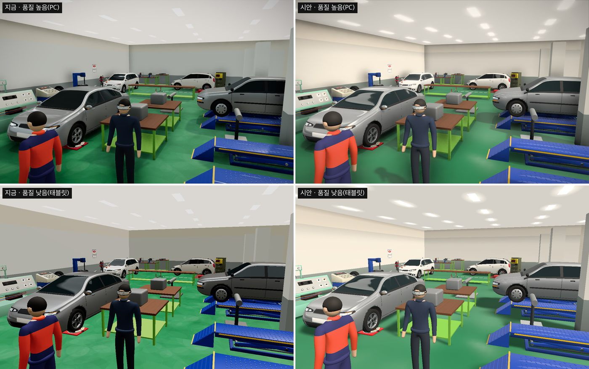
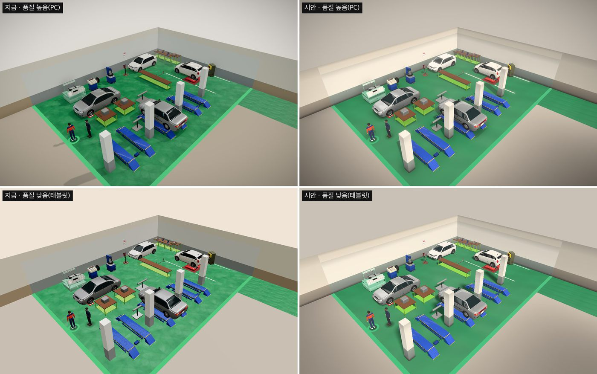
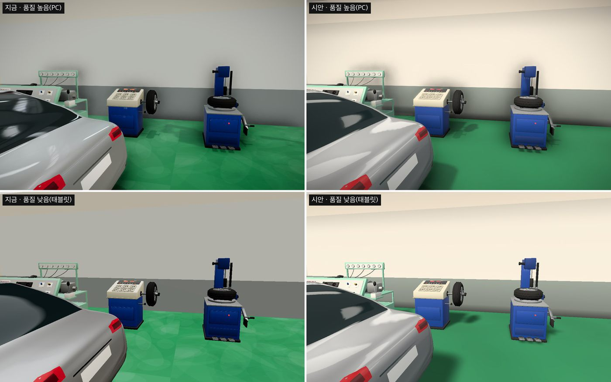
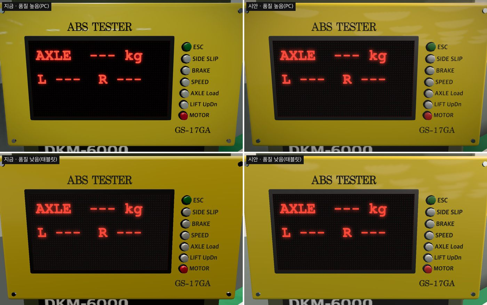

# 빛과 재질 다듬기 설계 — 화면 품질 묶음 '가' (2026. 11. 11.)

> 상태: **승인**(MOON 2026-11-11 "계획 세워"). 구현 계획: `docs/superpowers/plans/2026-11-11-light-and-material.md`. 계획을 세우며 저장소 복사본에서 끝까지 돌려 보고 §4.4·§4.6·§4.9·§4.10·§6·§10을 보완했다(§13).
> 브랜치 `cozy-stage1`에서 구현한다. main 합치기는 "브랜치 합쳐", 공개판 반영은 "재배포해"일 때만.
> 근거: MOON 요청(2026-11-11) — "게임처럼 보이는 요소를 잘 넣은 다른 작업과 견주면 우리 것은 숙련도 낮은 작업 같다. 품질을 끌어올릴 방법이 있나?" → 묶음 가(빛과 재질)·나(캐릭터와 움직임)·다(손맛)·라(공간 채우기) 제안 → "제안대로 가부터 해보자".
> 앞선 결정: 「따뜻한 정비 공방」 설계(`2026-11-06-cozy-workshop-design.md`) §2의 규칙(두 겹 색, 태블릿, 안내 없음)을 그대로 따른다.

## 0. 한눈에

- **바꾸는 것:** 조명, 그림자, 바닥 재질, 벽·천장 색과 그늘, 색 보정 방식. 화면에 보이는 겉모습만 바꾼다.
- **바꾸지 않는 것:** 채점, 기록 형식, 문구, 장비 배치, 캐릭터 모델, 장비 모델, 조작 방식.
- **기준:** 학생 태블릿은 '품질 낮음'으로 시작하고 자동으로 올라가지 않는다(`src/app/quality.ts`). 그래서 **품질 낮음에서 보이는 화면을 기준으로 설계**하고, 품질 높음(PC)에는 그 위에 덤을 얹는다.
- **시안 결과:** 아래 사진. 왼쪽이 지금, 오른쪽이 시안이고, 윗줄이 품질 높음(PC), 아랫줄이 품질 낮음(태블릿)이다.





## 1. 목표와 하지 않는 것

**목표:**
1. 물체가 바닥에 놓여 있고, 빛이 한쪽에서 들어온다는 느낌이 나게 한다(입체감).
2. 색을 한 계통으로 맞춘다: 아이보리 벽, 짙은 초록 광택 바닥, 은색은 은색으로.
3. 태블릿(품질 낮음)과 PC(품질 높음)의 인상을 같게 한다.
4. 계측부(눈금판·계기 화면·측정판)는 지금처럼, 또는 지금보다 원본 색에 가깝게 읽힌다.
5. 태블릿이 매 화면 그리는 양은 지금보다 늘리지 않는다.

**하지 않는 것(이번 묶음):**
- 캐릭터 모델·동작(묶음 나), 소리·연출·목표 표시(묶음 다), 벽 장식·소품·이름표(묶음 라).
- 바닥에 차·장비가 비쳐 보이는 반사. 장면을 한 번 더 그려야 해서 그리는 양이 두 배 가까이 된다. 필요하면 PC 전용으로 따로 정한다.
- 블렌더에서 미리 구운 조명 그림(§3의 다 안).
- 장비 모델 고치기. 시안에서 승용차 앞바퀴 둘레가 거칠게 보이는 것을 확인했지만 모델 문제라 묶음 나·라에서 다룬다.
- 태블릿 계단 줄이기(안티에일리어싱) 기본값 변경. 켜 볼 수 있는 주소 인자만 넣는다(§4.11).

## 2. 지금 화면에서 찾은 것

같은 구도로 지금 화면을 두 품질 모두 찍고, 코드를 읽고, 그리는 양을 쟀다(헤드리스 크롬, 이 맥의 GPU).

| # | 찾은 것 | 근거 |
|---|---|---|
| 1 | **빛이 납작하다.** 주변광이 주된 빛보다 세게 들어간다(어림 계산: 바닥에서 주변광 약 0.67, 주된 빛 약 0.34). 그늘과 밝은 면의 차이가 거의 없다. | `LabScene.tsx` 조명 값(반구광 0.7, 반사광 0.45, 주된 빛 1.4), 비교 사진 |
| 2 | **그림자 범위가 실습장을 다 덮지 못한다.** 주된 빛의 목표점이 원점(북서 모서리)이라 그림자 범위(±14 m)가 공용 조작부, 남동쪽 모서리, ABS 구역에 닿지 않는다. 제동력 시험기는 경계에 걸친다. | 조명 위치·범위로 계산(지금 코드의 값을 그대로 넣어 각 지점을 빛 기준으로 옮겨 봄) |
| 3 | **바닥 반사 세기 값이 적용되지 않는다.** 바닥 재질의 `envMapIntensity: 0.35`는 이 three.js 판(0.170)에서 장면 반사광을 쓸 때 무시된다. | `WebGLRenderer.js`의 `environmentIntensity` 처리 |
| 4 | **바닥 무늬가 얼룩처럼 보인다.** 밝은 민트색 바탕에 타원 얼룩 140개. | `textures.ts` `epoxyFloorTexture`, 비교 사진 |
| 5 | **벽·천장이 그늘 없는 한 가지 색 판이다.** 천장은 조명 영향을 받지 않는 밝은 회색이라 하얗게 날아간다. | `Surroundings.tsx`, 비교 사진 |
| 6 | **태블릿 화면에는 그림자도 구석 그늘도 없다.** 바닥에 닿는 옅은 그늘 한 겹만 있다. | `lowSpec` 분기 |
| 7 | **품질 높음에서는 화면 전체 색 보정이 계측부에도 걸린다.** 계기 화면 숫자 원본 색 (255, 74, 58)이 (247, 90, 63)으로 바뀐다. 측정판 종이색 (255, 248, 214)는 (224, 222, 211)로 바랜다. | 화면에서 잰 값(§10) |
| 8 | **그리는 양이 많다.** 한 화면에 그리기 호출이 품질 낮음 약 100~600번, 높음 약 580~1,090번이다. 삼각형은 낮음 최대 37만 개, 높음 최대 74만 개(그림자용으로 한 번 더 그리는 것 포함)다. | 화면에서 잰 값(§6) |

1·2·4·5·6이 "숙련도 낮아 보이는" 인상의 큰 부분이다. 3·7은 겉으로 드러나지 않던 결함이다. 8은 이번에 늘리면 안 되는 한도다.

## 3. 방식 비교

| 안 | 내용 | 좋은 점 | 나쁜 점 |
|---|---|---|---|
| 가 | **효과 더 얹기.** 지금 조명은 두고 빛 번짐·구석 그늘·반사를 화면 효과로 더한다. | 손이 적게 간다. | 화면 효과는 품질 높음에만 있다. **학생 태블릿 화면은 그대로다.** PC에서도 느린 기기는 품질이 낮아지며 효과가 다 꺼진다. |
| **나 (추천)** | **빛을 다시 짜고, 그림자는 한 번만 구워 바닥에 깐다.** 주된 빛 하나에 방향을 주고, 반사광은 실습장 자체로 만든다. 두 품질이 같은 빛·같은 색을 쓰고, PC에는 실시간 그림자와 화면 효과만 덤으로 얹는다. | 태블릿과 PC의 인상이 같다. 매 화면 비용이 늘지 않는다. 배치가 바뀌어도 자동으로 다시 굽는다. 내려받는 자료가 줄어든다. | 굽기 코드를 새로 쓴다(한 번 굽는 순간의 부담은 실기기 확인 필요). |
| 다 | **블렌더에서 조명을 미리 구워 그림으로 싣는다.** | 가장 보기 좋고 실행 비용이 가장 낮다. | 지금 배치는 임시(`layoutConfirmed=false`)다. 배치가 바뀔 때마다 블렌더에서 다시 구워야 한다. 그림 파일(수 MB)을 태블릿이 내려받는다. |

**추천: 나.** 시안도 나 안으로 만들었다. 다 안은 실제 학교 배치가 확정된 뒤에 다시 본다.

## 4. 설계

### 4.1 품질 단계별 구성

| 항목 | 품질 낮음(태블릿) | 품질 높음(PC) |
|---|---|---|
| 색 보정 곡선(§4.2) | 같은 곡선(렌더러에서) | 같은 곡선(화면 효과 맨 끝에서) |
| 주된 빛·주변광(§4.3) | 같음 | 같음 |
| 실습장 반사광(§4.3) | 한 번 그림, 해상도 128 | 한 번 그림, 해상도 256 |
| 그림자(§4.4) | **구운 바닥 그림자**(주된 빛 그림자 + 닿는 그늘), 사람은 발밑 둥근 그늘 | 실시간 그림자 + 구운 닿는 그늘 |
| 바닥·벽·천장(§4.5, §4.6) | 같음 | 같음 |
| 조명판 빛 번짐 | 조명판 둘레의 옅은 빛 판 | 같은 판(더 옅게) + 화면 효과 빛 번짐 |
| 구석 그늘 | 벽·기둥의 그린 그늘(§4.6) | 그린 그늘 + 화면 효과(N8AO) |
| 계단 줄이기 | 끔(지금과 같음, `?aa=1`로 켜 볼 수 있음) | SMAA(지금과 같음) |
| 내려받는 자료 | 추가 없음 | 정비소 사진(HDRI 1.6 MB)을 더 받지 않음 |

### 4.2 색 보정 곡선: 부드러운 꺾임

- **지금:** ACES. 화면 전체의 대비를 올리고 채도를 낮춘다. 빨강은 주황 쪽으로 밀린다(브레이크등 주석에도 적혀 있음).
- **바꾼 뒤:** 밝기 0.88(선형 값, 화면 값으로는 약 241/255)까지는 색을 그대로 내보내고, 그보다 밝은 부분(강한 반사, 조명판)만 흰색 쪽으로 부드럽게 눌러 준다. 꺾이는 식은 Khronos 중립 곡선과 같고, 어두운 색을 깎는 앞부분만 뺐다.
  ```
  p = max(r, g, b)
  p ≤ 0.88 이면 그대로
  아니면 d = 0.12, np = 1 − d² / (p + d − 0.88), 색 × (np / p),
        g = 1 − 1 / (0.15 × (p − np) + 1), 색 = 섞기(색, (np, np, np), g)
  ```
- **왜:** 색을 그대로 내보내므로 화면 색 토큰과 3D 색이 맞고, 계측부 색이 원본과 거의 같다(§10 측정값). three.js에 들어 있는 중립 곡선(Neutral)도 시험했는데, 어두운 채널을 깎아서 계기 화면 숫자가 (240, 60, 41)로 더 짙어졌다.
- **넣는 자리:**
  - 품질 낮음: 렌더러의 사용자 정의 색 보정(`CustomToneMapping`). three.js 셰이더 조각 `tonemapping_pars_fragment`의 빈 함수 한 줄을 이 곡선으로 바꿔 끼운다.
  - 품질 높음: 화면 효과 묶음 맨 끝에 같은 식의 효과 하나. 이 코드는 화면 효과 묶음 파일(`Effects`) 안에만 둔다. 태블릿이 받는 주 묶음에 `postprocessing`이 들어가면 안 된다.
- **식은 한 곳에:** 꺾임 값(0.88)과 채도 값(0.15)은 `src/scene/look/toneCurve.ts`의 상수 하나에서 GLSL 글과 시험용 JS 함수를 함께 만든다.
- **끼울 자리를 못 찾으면:** three.js가 바뀌어 빈 함수 줄이 없으면 경고를 남기고 three.js의 중립 곡선으로 돈다. 설치된 three.js에 그 줄이 있는지는 단위 시험이 지킨다.

### 4.3 조명

**주된 빛 하나에 방향을 준다.**
- 방향: 남쪽(트인 쪽)에서 서쪽으로 22° 돌아간 곳, 바닥에서 50° 위. 그림자는 북북동쪽으로 물체 높이의 0.84배 길이로 떨어진다. 북쪽·동쪽 벽이 둘 다 빛을 받는다.
- 색 `#fff1e0`(아주 옅은 따뜻한 흰색), 세기 3.7.
- 목표점은 실습장 가운데. 그림자 범위는 실습장(주 구역 + ABS 구역, 높이 4.4 m)의 여덟 꼭짓점을 빛 기준으로 옮겨 딱 맞게 잡는다(§2의 2번 고침).

**주변광은 낮춘다.**
- 반구광: 하늘 `#e8f0ff`, 바닥 `#3f5a46`, 세기 0.55(품질 낮음은 구석 그늘이 없으므로 ×1.15).
- 주된 빛이 닿는 바닥과 그늘진 바닥의 밝기 비가 어림 계산으로 약 2.7:1이 된다(지금은 약 1.5:1).

**반사광은 실습장 자체로 만든다(정비소 사진 대신).**
- 실습장 가운데(높이 1.4 m)에서 건물 껍데기만 한 번 그려 반사광으로 쓴다. 그리는 것: 천장, 천장 조명판 자리마다 부드러운 빛, 북·동 벽(밝게), 서·남 먼 벽(어둡게), 바깥 바닥, 실습장 바닥(채도를 낮춘 초록). 장비와 사람은 넣지 않는다.
- 세기 0.32. drei의 `Environment`에 자식으로 넣어 한 번만 그린다(`frames={1}`).
- **효과:** 차 도장과 유리에 실습장 천장 조명이 비친다. 두 품질이 같은 반사광을 쓴다. PC가 받던 정비소 사진 1.6 MB가 없어진다.
- **실습장 바닥 색의 채도를 낮추는 까닭:** 그대로 두면 크롬 부품(다이얼 게이지 테두리)이 초록으로 물든다(시안에서 확인하고 고침).

### 4.4 그림자

**품질 높음: 실시간 그림자.** 그림자 그림 2048, 종류 PCF(`shadows="percentage"`), 번짐 2.6, `bias −0.0006`, `normalBias 0.06`. 흰 차를 가까이서 봐도 점 무늬가 없는 값이다(시안 확인).

**품질 낮음: 한 번 구워 바닥에 까는 그림자.** 새 부품 `FloorShadowBake`가 아래를 한다.
1. 그림자를 드리우는 물체(`castShadow`인 메시)만 빛 쪽에서 깊이로 그린다(2048). 사람은 지금처럼 다른 레이어라 빠진다.
2. 바닥의 각 점에서 빛이 가려지는지 계산해 바닥 그림(1024)에 적는다. 가리는 물체가 멀수록 가장자리가 넓게 풀린다(빛의 퍼짐 각 4.5°, 가장자리 폭 2~50 cm). 그래서 기둥 그림자는 발치에서 또렷하고 끝에서 부드럽다.
3. 물체 바로 아래의 닿는 그늘(아래에서 위로 본 깊이, 높이 2.2 m까지)을 같은 그림에 합친다.
4. 작게 흐린 뒤, 바닥 위 판 **한 장**에 깐다(색 `#07180f`, 주된 빛 그림자 0.6, 닿는 그늘 0.5 — 품질 높음은 실시간 그림자·구석 그늘과 겹치므로 0.4).

- **매 화면 비용:** 섞어 그리는 판 한 장. 지금의 닿는 그늘 판(drei `ContactShadows`)을 이것으로 바꾸므로 늘지 않는다. drei `ContactShadows`는 더 쓰지 않는다.
- **굽는 때:** 모델을 다 불러온 직후 한 번(0.15초 뒤 — 로딩 화면이 걷히기 전에 끝나도록), 리프트·시험 차량 상태가 바뀌고 2.5초 뒤 한 번(지금 닿는 그늘과 같은 때), 품질을 바꿨을 때 한 번. 불러오는 동안에는 굽지 않는다.
- **메모리:** 굽는 데 쓴 중간 그림(깊이 2장, 계산용 4장)은 굽고 나서 버린다. 남는 것은 바닥 그림 한 장(1024², 약 4 MB)이다.
- **품질 높음에서도 같은 부품을 쓴다.** 닿는 그늘만 굽는다(주된 빛 그림자는 실시간이므로 3번만).
- **깊이는 색으로 싸서 적는다**(three.js 그림자와 같은 RGBA 방식). 깊이 그림을 바로 읽는 방식보다 기기 호환이 넓다.
- **굽기가 실패하면** 판을 숨기고 경고만 남긴다. 실습은 그대로 된다.
- **사람:** 품질 낮음에서는 지금처럼 발밑 둥근 그늘. 품질 높음에서는 실시간 그림자도 생긴다.

### 4.5 바닥 재질

- **색:** `#22774c` 한 가지에 아주 옅고 넓은 색 흐름만(±3%). 얼룩 무늬는 없앤다.
- **광택:** 거칠기 0.30 안팎, 넓은 얼룩으로 광택만 조금씩 다르게 한다.
- **반사:** 반사 방향을 건물 상자에 맞춰 고친다(상자 투영). 걸어 다녀도 천장 조명이 비치는 자리가 제자리에 있다. 반사 세기를 따로 두는 값을 넣는다(§2의 3번 고침). 시안 값 1.0, 낮은 각도에서 바닥이 뿌옇게 뜨면 0.7까지 낮춘다.
- **그림 만드는 법:** 색 흐름과 광택 그림은 **점마다 계산해** 만든다(온전한 주기의 코사인 물결 몇 개 → 이어 붙여도 이음매 없음). 캔버스의 번짐 그리기(gradient)는 쓰지 않는다. 크롬이 번짐에 넣는 미세한 점 처리가 바닥에 잔 그물 무늬로 보였다(시안에서 원인 확인).
- **셰이더 고침:** `MeshStandardMaterial`의 `onBeforeCompile`로 `envmap_physical_pars_fragment` 조각의 두 줄을 바꾼다. 끼울 줄이 없으면 고치지 않은 반사로 돌고 경고를 남긴다. 단위 시험이 설치된 three.js에 그 줄이 있는지 지킨다.

### 4.6 벽·천장·바깥 바닥·조명판

| 대상 | 지금 | 바꾼 뒤 |
|---|---|---|
| 실습장 벽 위쪽(1.1~3.4 m)·기둥 | `#eceff1` 한 색 | `#eeebe4`(그늘 그림 없음) |
| 실습장 벽 아래 띠 | `#9aa2a7` 한 색 | `#8e9a96` + 바닥에 닿는 쪽이 어두운 세로 그늘 |
| 건물 먼 벽, 실습장 벽 위 천장까지의 띠(3.4~4.2 m) | `#f3ece2` / `#b8a58f` | `#d5cfc5` / `#9a9288` + 세로 그늘(윗벽은 천장에 닿는 쪽이, 아래 띠는 바닥에 닿는 쪽이 어둡다) |
| 바깥 바닥 | `#a39a8f` 한 색 | `#b5afa6` × 실습장에서 멀수록 어두워지는 그림(0.55~1.0). 시선이 실습장에 모인다 |
| 천장 | `#e6ded3`(조명 영향 없음) | `#d6d1c8`(조명 영향 없음). 조명판이 도드라진다 |
| 조명판 | 흰 판 90개(메시 90개) | 밝기 1을 넘는 흰색. **인스턴스 한 묶음**으로 그린다 |
| 조명판 빛 번짐 | 없음 | 조명판마다 옅은 빛 판(2.0 × 0.95 m, 더하기 섞기, 낮음 0.3 / 높음 0.18). 인스턴스 한 묶음 |
| 배경·안개 | `#efe4d6`, 24~60 m | `#c9c1b5`, 20~62 m |

- 실습장 벽 위쪽에 위쪽 그늘을 넣으면 3.4 m 높이에서 띠가 보여서 뺐다(계획 중 확인). 천장에 닿는 그늘은 그 위의 띠가 맡는다.
- 세로 그늘과 바깥 바닥 그림도 점마다 계산해 만든다. 캔버스의 `filter`(흐림)는 쓰지 않는다(아이패드 사파리에서 안 되는 판이 있다).
- 조명판과 빛 판을 인스턴스로 묶으면 메시가 180개(시안 기준)에서 2개로 줄어든다(§6).

### 4.7 화면 효과(품질 높음)

차례: 구석 그늘 → 빛 번짐 → 색 보정 곡선 → 계단 줄이기 → 가장자리 어둡게.

| 효과 | 지금 | 바꾼 뒤 |
|---|---|---|
| 구석 그늘(N8AO) | 반지름 0.8, 세기 2.2 | 반지름 1.0, 세기 2.6, 색 `#0a1711` |
| 빛 번짐(Bloom) | 없음 | 밝기 **1.2를 넘는 것만**, 세기 0.5. 조명판과 강한 반사만 번진다 |
| 색 보정 | ACES | 부드러운 꺾임(§4.2) |
| 계단 줄이기(SMAA) | 있음 | 그대로 |
| 가장자리 어둡게 | 0.32 / 0.42 | 0.30 / 0.45 |

빛 번짐 문턱을 1.2로 두는 까닭: 계측부 색은 모두 1 이하이고, 빛을 받은 흰 면도 대부분 1.2 아래다. 계기 화면 숫자나 눈금판에는 빛 번짐이 걸리지 않는다(§5).

### 4.8 바닥 표시선

트인 변의 초록 띠와 시작점 고리는 지금 조명과 무관한 형광 초록(`#1fbf6b`)이다. 조명을 받는 칠 색(`#2f9e68`, 거칠기 0.5)으로 바꾼다. 자리·크기·"→ 엔진 실습 구역" 이름표는 그대로다. 장비 둘레 노란 빛 테두리, 다음 단계 표시 틀은 건드리지 않는다.

### 4.9 다른 3D 화면

- **캐릭터 만들기:** 캐릭터 미리보기도 같은 색 보정 곡선을 쓴다. 옷·피부 색이 실습장에서와 같게 보이게 하려는 것이다. 조명과 배경은 그대로 둔다.
- **기본 화면(패널)의 3D 창:** 게임 화면과 같은 장면 부품이라 함께 바뀐다. '품질 낮음' 칸에 마우스를 올리면 보이는 설명은 사실에 맞게 고친다("그림자·화면 효과를 끄고" → "실시간 그림자·화면 효과를 끄고", "모델은 같음" → "모델·빛은 같음").

### 4.10 코드 구조

`LabScene.tsx`가 이미 967줄이라 새 코드는 새 폴더에 두고, `LabScene`은 끼워 넣기만 한다.

| 파일 | 하는 일 | 시험 |
|---|---|---|
| `src/scene/look/lookConfig.ts` | 색·세기·방향 값 표, 품질별 구성(`lookFor(lowSpec)`), 주된 빛 방향 벡터, 그림자 범위 맞춤 계산(순수 함수) | 단위 시험 |
| `src/scene/look/toneCurve.ts` | 꺾임 곡선: 상수, GLSL 글, 같은 식의 JS 함수, 렌더러에 끼우기 | 단위 시험 |
| `src/scene/look/lookTextures.ts` | 바닥 색·광택, 벽 그늘, 바깥 바닥, 빛 판 그림(점마다 계산하는 순수 함수 + 그림 만들기) | 단위 시험(순수 함수) |
| `src/scene/look/WorkshopEnv.tsx` | 실습장 반사광 | 화면 확인 |
| `src/scene/look/floorMaterial.ts` | 광택 바닥 재질(상자 투영) | 끼울 줄 시험 + 화면 확인 |
| `src/scene/look/KeyLight.tsx` | 주된 빛과 그림자 범위 | 계산은 단위 시험 |
| `src/scene/look/ToneSetup.tsx` | 렌더러에 색 보정 곡선 걸기(실습장·캐릭터 만들기 공용) | 끼움 시험 |
| `src/scene/look/FloorShadowBake.tsx` | 구운 바닥 그림자 | 계산은 단위 시험, 결과는 화면 확인 |
| `src/scene/Surroundings.tsx` | 벽·천장·바깥 바닥 재질, 조명판 인스턴스 | 기존 시험 + 화면 확인 |
| `src/scene/Effects.tsx` | 화면 효과 구성, 꺾임 곡선 효과 | 끼움 시험 |
| `src/scene/LabScene.tsx` | 끼워 넣기만: 조명·반사광·바닥·그림자 부품 교체, 표시선 색, 배경·안개 값 | 끼움 시험 |
| `src/scene/models/models.tsx` | 벽·기둥 재질 값 | — |
| `src/app/quality.ts` | `?aa=1` 읽기(순수 함수) | 단위 시험 |
| `src/app/intro.ts`, `src/App.tsx` | 정비소 사진 미리 받기 빼기 | 기존 시험 고침 |
| `src/screens/AvatarScreen.tsx` | 같은 색 보정 곡선 | 끼움 시험 |
| `src/app/buildInfo.ts` | 앱 판 `0.3.3-demo` | 기존 시험 고침 |
| `src/records/researchBundle.ts` | 연구용 묶음 설명서의 앱 판 설명에 "0.3.3-demo부터 실습장 조명·바닥 겉모습이 달라짐(채점·기록은 같음)" 한 구절(글만) | 단위 시험 |
| `scripts/lookdev/` | 고정 구도 촬영 도구와 설명서(§7.2) | — |

정비소 사진 파일(`public/assets/hdri/autoshop_01_1k.hdr`)은 더 쓰지 않으므로 저장소에서 지운다(깃 이력에 남아 되살릴 수 있다). 저작권 표(`docs/design/docs/08_ASSET_AND_COPYRIGHT.md`)의 해당 줄에는 "0.3.3부터 쓰지 않음"을 적는다.

### 4.11 조정값과 주소 인자

- **값은 한 곳에:** 조명 세기·방향·색, 그늘 세기 같은 값은 모두 `lookConfig.ts`에 둔다. 구현하면서 화면을 찍어 보며 조정하고, 최종 값은 이 문서 §12에 적는다.
- **개발 서버 전용 조정 인자:** `?look=key:3.7,env:0.3`처럼 `lookConfig`의 숫자 값을 주소로 덮어쓸 수 있다(이름:값을 쉼표로 이음, 숫자만). `import.meta.env.DEV`일 때만 읽으므로 운영 묶음에는 들어가지 않는다. 화면 촬영 도구가 쓴다.
- **`?aa=1`:** 품질 낮음에서도 계단 줄이기를 켠다(운영에서도 됨, `?q=`와 같은 성격). 학교 태블릿에서 켠 것과 끈 것을 비교하려는 것이고, 기본값은 그 결과를 보고 따로 정한다.

## 5. 지키는 규칙

1. **계측부는 원래 색을 유지한다.**
   - 계기 화면, 조작부 글자, 측정판 눈금과 바늘은 조명과 무관한 재질(`MeshBasicMaterial`, `toneMapped: false`)이다. 이 속성을 그대로 두고, 끼움 시험으로 지킨다.
   - 품질 낮음: 화면에 나오는 색이 지금 판과 **같다**(§10 측정).
   - 품질 높음: 지금은 ACES가 걸려 원본과 달랐다(채널 차이 최대 31). 새 곡선에서는 원본에 더 가까워진다. 원본 색과의 차이가 채널마다 10(255 기준) 이내인 것을 기준으로 한다.
   - 빛 번짐·반짝임은 계측부에 걸리지 않는다(문턱 1.2, 계측부 색은 1 이하).
   - 다이얼 게이지 눈금판의 흰 판은 조명을 받는 재질이라 밝기가 조금 달라진다. 눈금·숫자·바늘 대비가 지금보다 나빠지지 않는지를 가까이 보기 사진으로 확인한다.
2. **채점·기록은 바꾸지 않는다.** 판정 계산, `record.schema`, 계산기 기록, 전송을 건드리지 않는다. 같은 입력이면 같은 기록이 나온다.
3. **안내 없음 원칙.** 새 조명은 과제 진행에 따라 바뀌지 않는다. 다음 단계 장비가 더 밝아지거나 그림자가 달라지는 일이 없다. 구운 그림자는 이미 보이는 상태(리프트 높이, 시험 차량 위치)에만 따라 다시 굽는다.
4. **태블릿.** 매 화면 그리는 양을 늘리지 않는다(§6). 새로 내려받는 파일이 없다.
5. **특정 게임을 따라 만들지 않는다.** 색·빛은 이 실습장 사진과 「따뜻한 정비 공방」 색 토큰에서 정한다. 상표·학교 표식을 넣지 않는다.
6. **움직임 줄이기.** 새로 움직이는 것이 없다.

## 6. 성능·용량

**그리는 양(그리기 호출 수, 헤드리스 크롬·이 맥에서 잼. 태블릿 값이 아님):**

| 구도 | 지금 낮음 | 새 판 낮음 | 지금 높음 | 새 판 높음 |
|---|---|---|---|---|
| 입구 | 560 | 541 | 1,043 | 1,060 |
| 위에서 | 602 | 561 | 1,085 | 1,080 |
| 북쪽 벽 | 99 | 100 | 582 | 619 |
| 시험 차량 가까이 | 239 | 241 | 722 | 760 |

- '새 판'은 계획의 코드(그림자 판 한 장, 조명판·빛 판 묶음 2개)를 저장소 복사본에서 돌린 값이다. 구도 열 개 전체 값은 계획 문서에 있다.
- **한도:** 품질 낮음의 그리기 호출 수가 **지금 값 + 2 이하**여야 한다. 조명판·빛 판 묶음 2개는 화면 밖에 있어도 늘 그려지기 때문이다. 천장이 보이는 구도에서는 지금보다 19~41번 줄어든다. 품질 높음은 지금 값의 +8% 이내(그림자 범위를 실습장 전체로 넓히고 빛 번짐을 더한 몫).
- 삼각형 수는 그대로다(모델을 바꾸지 않음).

**한 번만 드는 비용:**
- 실습장 반사광 그리기: 6면 × 메시 약 100개, 한 번.
- 그림자 굽기: 장면 깊이 두 번 + 바닥 그림 계산(1024², 점마다 표본 96개) + 흐림. 굽는 때는 §4.4. 이 맥에서는 22~48 ms다(셰이더를 처음 엮는 첫 굽기는 0.4초까지 걸린 적이 있다). **태블릿에서 얼마나 걸리는지는 모른다**(§8).

**묶음 크기 한도:** 주 묶음 +30 KB 이내(지금 로컬 빌드 1,600,421바이트), 화면 효과 묶음 +40 KB 이내(지금 로컬 빌드 313,498바이트). 복사본 빌드에서는 주 묶음 1,605,698바이트(+5 KB), 화면 효과 묶음 320,222바이트(+7 KB)였다. 정비소 사진 1.6 MB는 빠진다.

## 7. 시험·확인

### 7.1 단위 시험(vitest)
- `lookConfig`: 주된 빛 방향이 단위 벡터이고 남서쪽 위를 향한다. 그림자 범위가 실습장 여덟 꼭짓점을 모두 담는다. 품질 낮음 구성에는 실시간 그림자·화면 효과가 없다. 빛 번짐 문턱이 1보다 크다.
- `toneCurve`: 0.88 이하는 그대로, 단조 증가, 1을 넘지 않음, 꺾이는 점에서 이어짐, 계기 화면 숫자 색의 채널 비가 유지됨. 설치된 three.js 조각에 끼울 줄이 있음.
- `lookTextures`: 값 범위, 이음매 없음(왼쪽 끝 = 오른쪽 끝), 같은 입력이면 같은 값.
- 끼움 시험(소스 글 검사):
  - `LabScene`이 정비소 사진을 쓰지 않는다. `preloadPlan`에 정비소 사진이 없다.
  - `postprocessing`을 들여오는 파일은 `Effects.tsx`뿐이다(태블릿 묶음 보호).
  - 계측부 재질에 `toneMapped: false`가 남아 있다.
  - 조정 인자 `?look=`는 `import.meta.env.DEV` 안에서만 읽는다.
- 기존 시험 948개가 그대로 통과한다(정비소 사진·앱 판 관련 시험은 고친다).

### 7.2 화면 확인(촬영 도구)
`scripts/lookdev/`에 시안에서 쓴 도구를 정리해 넣는다. 의존 패키지 없이 시스템 크롬을 헤드리스로 띄우고, GET이 아닌 요청은 모두 막는다.
- **고정 구도 10개**(입구, 위에서, 시험기, 최소회전반경 차량, 리프트, 낮은 각도, 북쪽 벽, 부품 작업대, 차 가까이, 리프트 위)를 두 품질로 찍어 지금 판과 나란히 붙인다.
- **계측부 가까이 보기 3종**(계기 화면, 다이얼 게이지, 측정판)을 두 품질로 찍고 색을 잰다(§5의 1번 기준).
- 구도마다 그리기 호출 수를 재서 §6 한도와 견준다.
- 콘솔 오류 0건, 막힌 쓰기 요청 0건을 확인한다.
- 구운 그림자가 실제로 만들어졌는지 확인한다(개발 서버에서만 내는 굽기 통계: 평균 그늘 양이 0.05~0.5).

### 7.3 실기기(MOON)
1. 학교 태블릿에서 실습장에 들어갈 때와 리프트를 올린 뒤에 화면이 멈칫하는지.
2. 태블릿 화면이 이 문서의 '시안 · 품질 낮음' 사진과 같은 인상인지.
3. 계기 화면 숫자, 다이얼 게이지 눈금, 측정판 눈금이 잘 읽히는지.
4. `?aa=1`을 붙였을 때와 뺐을 때의 부드러움 차이.

## 8. 위험과 대비

| 위험 | 대비 |
|---|---|
| **태블릿에서 굽기가 오래 걸려 멈칫한다.** 확인하지 못했다. | 매 화면 비용은 그대로다. 굽기 해상도(1024→768)와 표본 수를 `lookConfig` 값으로 둬 낮출 수 있다. 그래도 길면 여러 화면에 나눠 굽는다(후속). |
| three.js가 바뀌어 셰이더 끼우기가 안 된다. | three는 `^0.170.0`으로 묶여 있다. 끼울 줄이 없으면 기본 동작으로 돌고, 단위 시험이 먼저 실패한다. |
| 일부 기기에서 굽기 결과가 깨진다. | 깊이를 RGBA로 싸서 적는다. 실패하면 판을 숨긴다(그림자만 없어짐). |
| 겉모습이 MOON 마음에 들지 않는다. | 값이 한 파일에 모여 있다. 합치기 전에 비교 사진으로 다시 확인받는다. |
| 프로그램 겉모습이 바뀌어 연구 절차에 영향이 있다. | 앱 판을 `0.3.3-demo`로 올려 기록에서 구분한다. 사용성 평가 전에 판을 확정해야 한다(공방 설계 §7). Hermes에게 "0.3.3부터 조명·바닥 겉모습 변경, 채점·기록 불변"을 전한다. |

## 9. 반영 순서

1. `cozy-stage1`에서 구현(계획 문서에서 과제로 쪼갬).
2. 촬영 도구로 비교 사진과 측정표를 만들어 MOON에게 보인다.
3. "브랜치 합쳐" → main.
4. "재배포해" → 공개판. 서버 쪽 변경은 없다(Supabase 함수 배포 불필요).
5. MOON 실기기 확인(§7.3). 결과에 따라 값 조정, `?aa=1` 기본값 결정.

## 10. 시안에서 확인한 것과 아직 모르는 것

**확인한 것(헤드리스 크롬, 이 맥, 1280×800):**
- 두 품질 모두 60 fps. 콘솔 오류 0건, 쓰기 요청 0건.
- 구운 바닥 그림자가 품질 낮음에서 나온다(기둥·차·작업대 그림자, 가장자리 풀림).
- 흰 차 표면의 그림자 점 무늬 없음(품질 높음, 가까이 보기).
- 바닥 잔 그물 무늬의 원인과 고침(§4.5).
- 계획 중 복사본에서 더 확인한 것: 그림자 판 한 장 합치기, 조명판·빛 판 묶음 그리기, 빛 번짐 문턱 1.2, 품질 바꾸기·화면 바꾸기에서 오류 없음(그때마다 다시 굽는다), 차 앞유리의 뿌연 조명 비침 없앰(반사광 속 조명판을 가장자리가 풀리는 둥근 빛으로).
- 계측부 색:

| 재는 곳 | 원본 | 지금 낮음 | 시안 낮음 | 지금 높음 | 시안 높음 |
|---|---|---|---|---|---|
| 계기 화면 숫자(가장 밝은 점) | 255, 74, 58 | 255, 74, 58 | 255, 74, 58 | 247, 90, 63 | 248, 76, 62 |
| 측정판 종이색(밝은 5%) | 255, 248, 214 | 254, 247, 215 | 255, 248, 217 | 224, 222, 211 | 247, 240, 212 |



**아직 모르는 것:**
- 학교 태블릿에서의 속도와 굽기 시간. 이 맥의 GPU로만 봤다.
- 아이패드 사파리에서의 동작. 크롬으로만 봤다.
- 실제 태블릿 화면에서 계단 현상이 얼마나 거슬리는지(`?aa=1` 비교로 정한다).

## 11. MOON이 정할 것

1. **시안 방향**(아이보리 벽, 짙은 초록 광택 바닥, 남서쪽에서 드는 빛)으로 진행해도 되는지. 더 밝게·더 어둡게·더 따뜻하게 같은 의견도 좋다.
2. **정비소 사진 파일을 저장소에서 지워도 되는지.** 추천: 지운다(쓰지 않게 되고, 깃 이력에서 되살릴 수 있다).
3. **Hermes에게 전할 말**(§8 마지막 줄)을 MOON이 전해 줄지.

→ **MOON 2026-11-11 "계획 세워":** 1은 승인으로 본다. 2는 추천안대로 지우는 것으로 계획에 넣었다(Task 8, 실행 전에 한 번 더 알린다). 3은 합칠 때 다시 묻는다.

## 12. 구현 뒤 최종 값

지금은 §4의 시안 값이 기준이다. 구현하면서 달라진 값만, 구현을 마친 뒤 이 절에 표로 적는다(값 이름, 시안 값, 최종 값, 바꾼 까닭).

## 13. 계획 중 보완(2026-11-11)

계획을 세우며 계획의 코드를 저장소 복사본(커밋 e1d36c2의 `src`)에 그대로 넣어 돌려 봤다(시험 1006개, 형 검사, 빌드, 두 품질 화면 촬영).

1. **그리기 호출 한도를 '지금 값 + 2 이하'로 고침(§6).** 조명판·빛 판 묶음 2개가 늘 그려져, 천장이 안 보이는 가까운 구도에서는 1~2번 늘어난다. 천장이 보이는 구도에서는 19~41번 줄어든다.
2. **실습장 벽 위쪽·기둥에는 그늘 그림을 넣지 않음(§4.6).** 3.4 m 높이에서 띠가 보였다.
3. **첫 굽기를 로딩 화면 안으로 옮김(§4.4).** 로딩 화면은 불러오기가 끝나고 0.4초 뒤에 걷힌다. 굽기를 0.15초 뒤에 해서 멈칫이 가려지게 했다.
4. **굽기에 쓴 중간 그림은 버림(§4.4).** 태블릿 메모리를 아끼려는 것이다.
5. **반사광 속 조명판을 둥근 빛으로(§4.3).** 시안에서는 네모 판이라 차 앞유리에 뿌옇게 비쳤다.
6. **화면 효과의 꺾임 곡선 객체에 정리 코드를 붙이지 않음(§4.2).** 붙였더니 화면을 바꿀 때 오류가 났다. 이 객체는 GPU 자원을 쥐지 않는다.
7. **조명판 묶음은 재질이 바뀌면 새로 만듦(§4.6).** 품질을 바꾸면 빛 판 세기가 바뀌는데, 묶음을 그대로 두면 자리를 잃었다.
8. **연구용 묶음 설명서에 판의 뜻을 한 구절 더함(§4.10).** 연구자가 0.3.3-demo부터 겉모습이 달라졌음을 기록만으로 알 수 있게 한다.
9. **촬영 도구에 품질 바꾸기·화면 바꾸기 검사를 더함(§7.2).** 6·7번을 이 검사가 잡았다.
