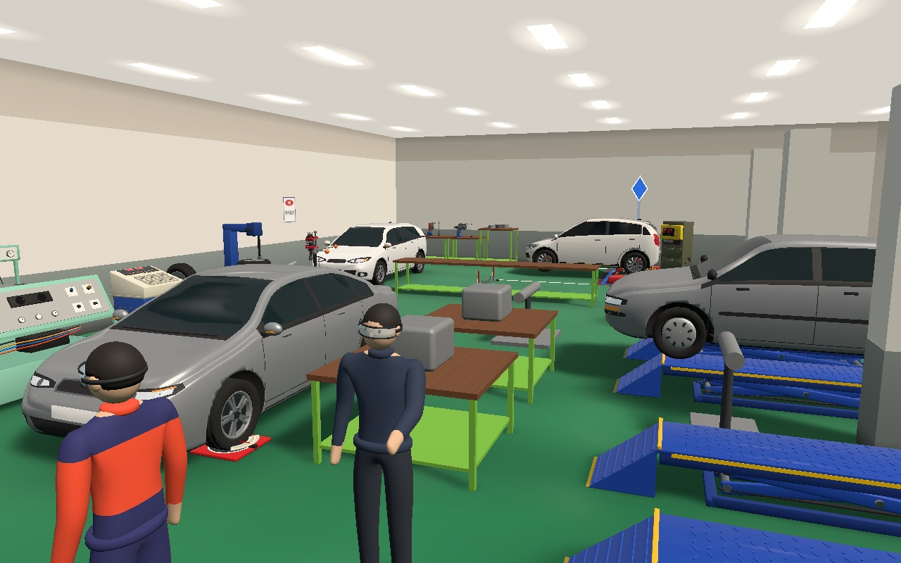
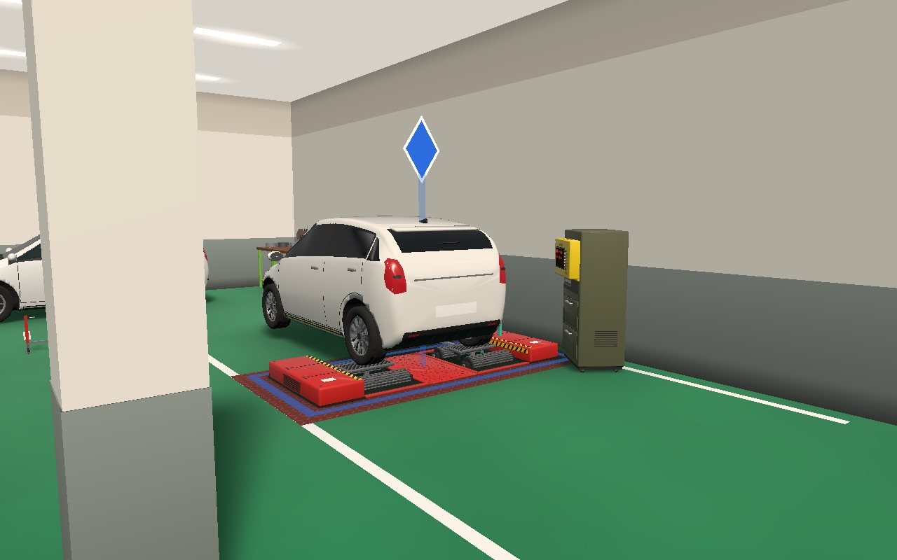
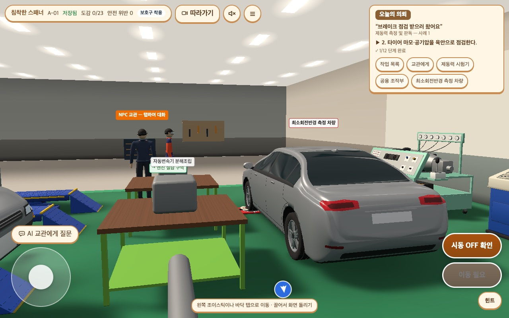

# 손맛 다듬기 설계 — 화면 품질 묶음 '다' (2026. 11. 12.)

> 상태: **승인**(MOON 2026-11-12 "계획 세워"). 구현 계획: `docs/superpowers/plans/2026-11-12-feel.md`. 계획을 세우며 저장소 복사본에서 끝까지 돌려 보고 §4.2·§4.5·§4.6·§4.8·§6·§7·§10을 보완했다(§12).
> 브랜치 `cozy-stage1`에서 구현한다. main 합치기는 "브랜치 합쳐", 공개판 반영은 "재배포해"일 때만.
> 근거: MOON 요청(2026-11-11) — "게임처럼 보이는 요소를 잘 넣은 다른 작업과 견주면 우리 것은 숙련도 낮은 작업 같다." → 묶음 가(빛과 재질)·다(손맛)·나(캐릭터와 움직임)·라(공간 채우기) 차례로 하기로 했다. 가는 재배포 36으로 끝났고(2026-11-12), MOON이 "다음 묶음 다 시작하자"고 했다.
> 앞선 결정: 「따뜻한 정비 공방」 설계(`2026-11-06-cozy-workshop-design.md`) §2의 규칙과 §5의 손맛 1단계를 넓힌다. 「빛과 재질 다듬기」 설계(`2026-11-11-light-and-material-design.md`)의 태블릿 기준과 확인 방법(걷기 검사 등)을 그대로 쓴다.

## 0. 한눈에

- **바꾸는 것:** 조작에 대한 작은 반응(보이는 것과 소리), 안내 있음에서 다음에 갈 곳을 알려 주는 표식, 결과 화면의 통과 연출.
- **바꾸지 않는 것:** 채점, 기록 형식, 장비 배치, 조작 방식, 계측부(눈금판·계기 화면·측정판·입력 칸)의 모양과 색, 안내 없음에서 학생이 알 수 있는 것.
- **세기:** 수행 중에는 작고 짧게, 의뢰를 끝냈을 때 한 번 크게(MOON 결정).
- **소리:** 지금처럼 처음에는 꺼져 있고 학생이 켠다(MOON 결정). 녹음 파일 없이 코드로 만든다.
- **기준:** 반응은 품질 단계와 무관하다. 태블릿(품질 낮음)과 PC(품질 높음)에서 같은 것이 보이고 들린다.
- **시안:** 소리는 [들어 보기 쪽](assets/2026-11-12-feel-sound-audition.html)을 브라우저로 열고 버튼을 누르면 들린다. 목적지 표식은 아래 사진이다(안내 있음, 품질 낮음).

## 1. 목표와 하지 않는 것

**목표:**
1. 누르면 눌렸다는 것이 바로 느껴진다(보이는 반응, 소리를 켰다면 소리도).
2. 장비가 움직일 때 그 움직임에 소리가 붙는다.
3. 단계 하나를 끝낸 것은 작게, 의뢰를 끝낸 것은 크게 느껴진다.
4. 안내 있음에서는 다음에 갈 곳이 화면 어디를 보고 있든 보인다.
5. 안내 없음에서는 지금보다 더 드러나는 것이 하나도 없다.
6. 태블릿이 매 화면 그리는 양과 걷는 동안의 숨은 부담을 늘리지 않는다.

**하지 않는 것(이번 묶음):**
- 배경 음악, 카메라 흔들림·당김, 기기 진동, 음성 안내.
- 수행 중 정답·오답에 따라 달라지는 소리나 빛(오답음·경고음 포함).
- 안내 없음에서의 목표 표시.
- 음량 조절 화면(기기 음량으로 조절한다), 녹음한 소리 파일.
- 소리를 켰는지 기록에 남기기(기록 형식을 바꿔야 해서 뺀다. §11).
- 바닥을 눌러 걸어갈 곳을 정할 때의 표시(지금도 없다. 같은 고리를 쓰면 되지만 이번 범위에는 없다).
- 11-06 설계 §6의 2단계 기능(정비 수첩·숨은 것 찾기·의뢰판. IRB 확인을 기다리는 중).
- 캐릭터 모델·동작(묶음 나), 벽 장식·소품(묶음 라).

## 2. 지금 있는 것과 모자란 것

| # | 지금 있는 것 | 모자란 것 | 자리 |
|---|---|---|---|
| 1 | 소리 세 가지: 발소리, 핸들 끝 '딸깍', 실습장 배경 소음. 처음에는 꺼져 있다. | 누를 때, 장비가 움직일 때, 단계를 끝낼 때 소리가 없다. 배경 소음은 180 Hz 위를 깎은 소음이고 발소리는 260~380 Hz 띠와 85 Hz로 만들어서, 낮은 음을 잘 못 내는 작은 스피커에서는 잘 안 들릴 수 있다(실기기 미확인). | `src/scene/sound.ts` |
| 2 | 연출 네 가지: 진행 글자("3/12 단계 완료")가 튐, 보호구 꼬리표 반짝임, 결과 화면의 '의뢰 완료' 도장, 종이 조각 8개. | 장비를 눌러도 주황 테두리가 생길 뿐 눌린 느낌이 없다. 진행이 글자뿐이다. | `src/app/reactions.ts`, `src/screens/LabScreen.tsx`, `src/screens/WorkLog.tsx` |
| 3 | 안내 있음에서 다음 단계 장비 바닥에 파란 테두리(두께 7 cm)와 의뢰 패널의 "▶ 2. …" 글. | 테두리는 멀리서, 차에 가려서, 화면 밖이면 보이지 않는다. | `FootprintFrame`(`src/scene/models/models.tsx`), `nextHighlightId`(`src/app/labGuide.ts`) |
| 4 | 소리 켬 상태는 실습 화면 안에서만 산다. | 결과 화면의 도장에는 소리를 붙일 수 없다. | `LabScreen.tsx`의 `new LabSound()` |
| 5 | 제동력 시험기는 선택했을 때도 테두리가 파랑이다(다른 장비는 주황). | 파랑이 "다음에 갈 곳"과 "내가 고른 것" 두 뜻으로 쓰여, 안내 없음에서도 파란 테두리가 보일 수 있다. | `LabScene.tsx`의 `testerHighlight` |

지금 구조에서 그대로 쓰는 것: 반응 규칙 함수 `reactionsFor`(이미 일어난 일에만 반응, 두 모드에서 같음을 시험으로 확인), 끝난 단계를 찾는 `newCue`, 끝난 수가 늘 때만 튀게 하는 `shouldPopOnDone`, 안내 있음에서만 값을 주는 `nextHighlightId`.

## 3. 방식 비교

| 방식 | 내용 | 좋은 점 | 나쁜 점 |
|---|---|---|---|
| **가. 반응 규칙표 하나로 모으기(추천, MOON 승인 "가로 진행해")** | "무슨 일이 일어났을 때 어떤 소리와 어떤 화면 반응을 낼지"를 표 하나에 둔다. 지금 있는 `reactions.ts`를 넓힌다. 소리는 코드로 만든다. | 표가 다음 단계·정답 여부·측정값을 받지 않는다는 것을 시험으로 고정할 수 있다. 태블릿 부담도 한 곳에서 본다. | 처음에 표와 사건 뽑는 자리를 정리하는 일이 든다. |
| 나. 장비마다 직접 넣기 | 리프트, 시험기, 버튼 코드에 소리와 반짝임을 각각 넣는다. | 빨리 된다. | 규칙이 흩어진다. 정답에 따라 달라지는 반응이 섞여 들어가도 알아채기 어렵다. |
| 다. 녹음한 소리 파일 쓰기 | 무료 라이선스의 실제 정비소 소리를 받아 쓴다. | 가장 사실적이다. | 내려받는 용량과 저작권 기록이 생긴다. 11-06 설계 §2-5("새 글꼴·음악 파일은 내려받지 않는다")와 어긋난다. |

## 4. 설계

### 4.1 반응 규칙표

`src/app/reactions.ts`의 표 하나가 모든 반응을 정한다. 표는 **사건 이름, 움직임 줄이기 여부, 소리 켬 여부**만 받는다. 모드(안내 있음·없음), 다음 단계, 정답 여부, 측정값, 시도가 받아들여졌는지는 받을 자리가 없다.

| 사건 | 언제 | 보이는 반응 | 소리(켰을 때) |
|---|---|---|---|
| `sceneTap` 장면 누름 | 3D에서 장비나 교관을 눌렀을 때. 1인칭의 '살펴보기' 버튼도 같다. | 누른 것의 바닥에서 흰 고리가 0.3초 퍼졌다 사라진다. | 톡 `tap` |
| `uiPress` 버튼 누름 | 허용 구역(아래)의 버튼을 눌렀을 때 | 버튼의 지금 눌림 모양 그대로 | 딸깍 `press` |
| `liftMove` 시험기 리프트 | 제동력 시험기의 리프트 판이 오르내리기 시작할 때 | 지금 있는 움직임 그대로 | 모터 소리 1.1초, 끝에 '탁' `lift` |
| `bigLiftMove` 보기용 리프트 | 정보 카드에서 '리프트 올리기·내리기'를 눌렀을 때 | 지금 있는 움직임 그대로 | 같은 소리를 2.6초로 길게 `lift` |
| `vehicleMove` 차량 이동 | 차량이 시험기로 들어오거나 나가기 시작할 때 | 지금 있는 움직임 그대로 | 굴러가는 소리 1.5초 `vehicle` |
| `pedalDown` 브레이크 | 차량이 제동 중 모습(브레이크등, 차체 눌림)이 될 때 | 지금 있는 모습 그대로 | 툭 `pedal` |
| `steerLimit` 핸들 끝 | 핸들이 조작 한계에 닿을 때(지금 있는 사건) | 없음 | 부드러운 딸깍 `tick` |
| `ppeOn` 보호구 | 보호구를 착용했을 때(지금 있는 사건) | 보호구 꼬리표 반짝임(지금 그대로) | 찰칵 `ppe` |
| `stepDone` 단계 완료 | 끝난 단계 수가 늘 때(지금 있는 사건) | 진행 점 줄에서 새로 채워진 점이 튄다(§4.3). | 짧은 두 음 `stepDone`, 0.12초 늦게 |
| `codexNew` 도감 등록 | 처음 누른 장비가 도감에 들어갈 때 | 상태 막대의 "도감 n/N" 숫자가 튄다. 둘러보기에서는 정보 카드에 '도감에 등록' 꼬리표가 1.6초 붙는다. | 사락 `codex`, 0.06초 늦게 |
| `inspectionPassed` 검사 통과 | 결과 화면에서 검사 통과일 때(지금 있는 사건) | 도장, 잉크 고리, 종이 조각 14개(§4.6) | 쾅 `stamp`, 0.25초 뒤 축하음 `celebrate` |

표 밖에서 나는 소리는 셋이다.
- **롤러 회전음 `rollers`:** 사건이 아니라 상태에 묶는다. 롤러가 도는 동안 이어지고, 멈추면 0.8초에 걸쳐 잦아든다. 제동 중에도, 측정값이 얼마든 늘 같은 소리다.
- **발소리 `step`:** 지금처럼 걸음 수에 맞춰 난다(`stepsCrossed`).
- **배경 소음:** 지금처럼 소리를 켜면 깔린다.

정해 둔 것:
- 단계 하나가 사건 둘을 낼 수 있다. 보호구 단계는 `ppeOn`과 `stepDone`, 핸들 단계는 `steerLimit`과 `stepDone`을 낸다. 지금은 보호구 단계에서 진행 글자가 튀지 않는데, 점 줄에서는 모든 단계가 같게 튄다.
- `stepDone`은 끝난 단계 수가 늘 때만 난다. 종료 단계의 하위 행동(모터 정지, 리프트 상승, 차량 빼기)은 수가 늘지 않으므로 `stepDone`이 없고, 그 움직임의 소리만 난다.
- 시도가 막히거나(순서·안전) 값이 비어 있을 때의 반응은 표에 없다. 지금처럼 알림창만 뜬다. 누름 소리는 받아들여졌든 막혔든 같다.
- 답을 내는 순간(측정·계산·판정 값 제출)에 붙는 사건은 없다.
- 최소회전반경 과제는 움직이는 장비가 앞바퀴뿐이라 누름, 단계 완료, 핸들 끝 소리만 난다.

**버튼 누름 소리의 허용 구역.** '딸깍'은 표시(`data-feel="press"`)를 단 구역의 버튼에서만 난다. 표시가 없는 곳은 조용하다. 새 화면을 더해도 표시를 달지 않으면 소리가 나지 않는다.
- 소리가 나는 곳: 작업 버튼, 의뢰 패널의 버튼, 상태 막대와 메뉴, 작업 목록, 장비 정보 카드, '계기 보기'·'측정판 보기'·연습 여는 버튼, 'AI 교관에게 질문' 여는 버튼, 교관 대화의 버튼.
- 조용한 곳: 기록 창, 계산기, 연습 창, 계기·측정판 가까이 보기, AI 질문 창, 교사 도구, 기본 화면(패널).

### 4.2 사건을 뽑는 자리

사건은 모두 "이미 화면에 일어난 일"에서 뽑는다.

| 사건 | 뽑는 곳 |
|---|---|
| `sceneTap`, `codexNew` | 장비 선택 함수(`selectEquipment`)와 교관 누름. 도감에 없던 장비면 `codexNew`도 낸다. |
| `uiPress` | 게임 화면 맨 위에서 누름을 한 번만 듣고, 허용 구역의 버튼이면 낸다. |
| `bigLiftMove` | 리프트 올리기·내리기 버튼(`toggleLift`) |
| `ppeOn`, `steerLimit`, `stepDone` | 지금 있는 자리(끝난 단계를 앞뒤로 견주는 효과) |
| `liftMove`, `vehicleMove`, `pedalDown` | 새 순수 함수 `rigEvents(앞, 뒤)`. 제동 장치 모습(`BrakeRigState`)의 앞뒤를 견준다. |
| `inspectionPassed` | 결과 화면(지금 있는 자리) |

`rigEvents`의 규칙:
- `liftUp`이 바뀌면 `liftMove`.
- 차량이 '바깥'이었다가 아니게 되거나 그 반대면 `vehicleMove`.
- `braking`이 거짓에서 참이 되면 `pedalDown`. 페달을 떼는 쪽은 소리가 없다.
- 앞 상태가 없으면 아무것도 내지 않는다. 과제를 막 받았거나 이어 하기로 돌아온 순간의 자세 바뀜은 조작이 아니라 장면 준비다.

롤러 회전음은 `소리 켬 && 롤러가 도는 중`이라는 상태에 묶는다. 그래서 롤러가 도는 도중에 소리를 켜도 회전음이 시작된다.

실습 화면은 사건을 함수 하나(`fire`)로만 낸다. 이 함수가 규칙표를 읽어 연출 상태를 바꾸고 소리를 부른다. 소리를 직접 부르는 곳은 이 함수, 발소리, 결과 화면뿐이다(켜졌다는 확인음은 엔진이 스스로 낸다).

### 4.3 보이는 반응

**누름 고리.** 흰 고리 하나를 미리 만들어 두고 누를 때마다 자리와 크기만 바꿔 다시 쓴다. 누른 것의 바닥 둘레(대각선 절반)의 0.9배에서 1.2배로 퍼지며 불투명도가 0.8에서 0으로 간다. 0.3초다. 흰색을 쓰는 까닭은 주황이 선택, 노랑이 가까이 있음, 파랑이 목적지라는 뜻을 이미 갖고 있어서다. 그림자도 화면 효과도 받지 않는다.

**진행 점 줄.** 의뢰 패널의 "✓ 3/12 단계 완료" 줄을 점 줄과 숫자로 바꾼다.
- 점은 단계 수만큼이다(제동력 12개, 최소회전반경 8개). 끝난 수만큼 왼쪽부터 채운다.
- 점은 "몇 개 끝났는지"만 나타낸다. 몇 번째 점이 어느 단계인지는 나타내지 않는다. 지금 글자가 주는 정보와 같다.
- 새로 채워진 점이 0.3초 튄다. 옆에 "3/12" 숫자를 둔다. "단계 완료" 글자는 화면 낭독용으로 남긴다.
- 색은 패널 색 안에서 고른다(남색 `--wa-navy`로 채우고 빈 점은 테두리만). 주황은 쓰지 않는다. 안전 경고와 헷갈리지 않게 하려는 것이다.
- 두 모드에서 똑같다.

**도감.** 처음 누른 장비면 상태 막대의 "도감 n/N" 숫자가 0.3초 튄다. 둘러보기(과제를 받기 전)에서는 그 장비의 정보 카드 머리에 '도감에 등록' 꼬리표가 1.6초 붙었다 사라진다. 대화에서 말한 "알림"을 따로 뜨는 창이 아니라 카드에 붙는 꼬리표로 정했다. 학생이 이미 보고 있는 카드라 다른 것을 가리지 않는다. 과제 중에는 숫자만 튄다.

**보호구 반짝임.** 지금 그대로다.

**움직임 줄이기 설정일 때.** 고리 없음, 점은 튀지 않고 채워지기만 함, 숫자 튐 없음, 꼬리표는 움직임 없이 붙었다 사라짐, 목적지 표식 정지(§4.5), 도장은 정지 표시이고 종이 조각 없음(지금 그대로). 소리는 학생이 켠 그대로 난다. 이 설정은 보이는 움직임만 줄인다.

### 4.4 소리

**만드는 법.** `src/scene/sound.ts`의 `LabSound`를 넓힌다. 모든 소리는 Web Audio의 발진기와 소음에 거르개와 세기 곡선을 씌워 만든다. 파일을 받지 않는다. 소리 하나는 "오디오 장치, 나갈 곳, 시작 시각"만 받는 함수라서, 같은 코드를 화면 밖 장치(OfflineAudioContext)에 그려 세기와 길이를 잴 수 있다.

**시안에서 잰 값.** 시안 엔진을 44.1 kHz로 그려 쟀다(아래의 압축기를 지난 뒤). 세기는 가장 큰 순간의 값이고 0 dBFS가 낼 수 있는 가장 큰 소리다. 길이는 −50 dB보다 큰 동안이다.

| 소리 | 쓰는 곳 | 뜻한 느낌 | 세기(dBFS) | 길이 | 음높이 중심 | 300 Hz 아래 몫 |
|---|---|---|---|---|---|---|
| `tap` | 장면 누름 | 톡 | −22.8 | 30 ms | 449 Hz | 0.05 |
| `press` | 버튼 누름 | 딸깍 | −24.6 | 68 ms | 2,915 Hz | 0.01 |
| `lift` | 리프트 | 모터 + 끝 '탁' | −17.2 | 1,108 ms | 374 Hz | 0.59 |
| `vehicle` | 차량 이동 | 굴러감 | −19.8 | 1,545 ms | 570 Hz | 0.52 |
| `pedal` | 브레이크 | 툭 | −19.3 | 34 ms | 343 Hz | 0.62 |
| `tick` | 핸들 끝 | 부드러운 딸깍 | −27.4 | 62 ms | 1,650 Hz | 0.00 |
| `stepDone` | 단계 완료 | 올라가는 두 음(미·라) | −22.6 | 162 ms | 900 Hz | 0.00 |
| `ppe` | 보호구 | 찰칵 | −28.2 | 75 ms | 1,271 Hz | 0.00 |
| `codex` | 도감 등록 | 사락 + 높은 한 음 | −27.5 | 142 ms | 1,325 Hz | 0.00 |
| `stamp` | 도장 | 쾅 | −10.2 | 94 ms | 320 Hz | 0.72 |
| `celebrate` | 축하 | 올라가는 세 음 + 잔향 | −23.5 | 584 ms | 1,161 Hz | 0.00 |
| `step` | 발소리 | 지금보다 높은 띠를 더함 | −25.6 | 36 ms | 551 Hz | 0.68 |
| `rollers` | 롤러 회전 | 낮게 이어지는 웅웅 | −18.9 | 이어짐 | 346 Hz | 0.62 |

소리는 열세 가지이고 배경 소음이 따로 있다. 배경 소음은 지금의 낮은 웅웅거림(260 Hz 아래)에 환풍기 바람 같은 650 Hz 띠를 얇게 더하고, 가끔 멀리서 나는 공구 소리는 그대로 둔다. 배경 소음과 2.6초짜리 리프트 소리는 시안에서 재지 않았다.

**한도(시험과 측정으로 지킨다).**
- 도장을 뺀 모든 소리는 −16 dBFS 이하다. 도장은 −12에서 −9 dBFS 사이다. 큰 소리는 도장 하나다.
- 누름 계열(`tap`, `press`, `pedal`, `tick`, `ppe`, `step`)은 0.1초 이하, 도장은 0.15초 이하, 완료 계열(`stepDone`, `codex`)은 0.2초 이하, 축하음은 0.7초 이하다. 장비 소리는 보이는 움직임의 길이를 따른다.
- 같은 소리는 0.04초 안에 다시 내지 않는다(연달아 눌러도 쌓이지 않게).
- 모든 소리는 압축기 하나(문턱 −16 dB, 비율 4)를 지나 나간다. 여러 소리가 겹쳐 한꺼번에 커지는 것을 눌러 준다. 브라우저의 압축기는 누른 만큼 전체를 조금 키우기도 하므로, 세기는 늘 이 압축기를 지난 뒤에 잰다.

**장치 다루기.**
- 오디오 장치는 학생이 소리를 처음 켜는 그 누름 안에서 만든다. 브라우저가 사용자 동작 뒤에만 소리를 허락하기 때문이다. 켜지 않으면 만들지 않는다.
- 장치가 멈춰 있을 때 온 소리 요청은 버린다. 모아 두었다가 한꺼번에 내지 않는다.
- 화면이 뒤로 갔다 돌아와 장치가 멈춰 있으면, 소리가 켜져 있는 동안 다음 누름에서 다시 깨운다.

**한계.** 이 소리들은 수치로만 맞췄다. 만든 쪽은 소리를 들을 수 없어서, 실제로 어떻게 들리는지는 MOON이 들어 봐야 안다(§10, §11). 소리 조립값은 한 파일에 모여 있어 값만 바꾸면 된다.

### 4.5 목적지 표식(안내 있음에서만)

**무엇을 그리나.** 다음 단계의 장비에 세 가지를 붙인다.
- **마름모:** 파란 팔면체(반지름 0.2 m, 세로로 1.5배)에 흰 테. 장비 위 0.9 m에 떠서 위아래로 8 cm씩 오르내리고 천천히 돈다(한 바퀴 약 7초).
- **빛기둥:** 바닥에서 마름모까지 가는 파란 기둥(반지름 3.5 cm, 불투명도 0.28).
- **바닥 테두리:** 장비 둘레에서 18 cm 바깥, 두께 10 cm. 불투명도가 0.5에서 0.95 사이로 숨 쉬듯 바뀐다(주기 약 2.4초).

색은 지금의 파란 테두리와 같은 `#2d6cdf`이고 색 보정을 받지 않는다. 그림자를 만들지도 받지도 않는다. 멀리 있는 작동 장비 표시(빨간 동그라미 속 ◆)와는 색, 크기, 모양이 다르다.

**높이.** 장비 자리에 다른 것이 겹쳐 있으면(시험기 위의 차량) 그 가운데 가장 높은 것 위에 띄운다. 시안에서 표식이 차 안에 묻히는 것을 보고 넣은 규칙이다.

**방향 화살표.** 목적지가 카메라 뒤에 있거나 화면 가운데 영역(가로 94%, 세로 90%) 밖이면 화면 가장자리에 파란 동그라미 화살표(44 px, 글자가 아니라 SVG 그림)가 그쪽을 가리킨다. 목적지가 화면 안으로 들어오면 사라진다.
- 화살표는 화면 가장자리 안쪽 띠(가로 5%, 세로 11% 안쪽)를 따라 움직인다. 상태 막대, 의뢰 패널, 작업 버튼, 조이스틱, 'AI 교관에게 질문' 버튼, 아래 안내 막대가 차지한 구간에는 서지 않는다. 그 구간에 걸리면 같은 변에서 가장 가까운 빈 자리로 밀려난다.
- 이 요소들의 자리는 화면을 다시 그릴 때(HUD가 바뀔 때)와 창 크기가 바뀔 때만 다시 잰다. 3D의 매 화면마다 재지 않는다. 재는 목록은 저장소에 이미 있는 HUD 부품 목록(`src/app/hudLayout.ts`)이다.
- 시안은 고정 여백(가로 5%, 세로 9%)이라 오른쪽 위에서는 의뢰 패널 밑에 깔릴 수 있었다. 구현에서는 위처럼 자리를 재서 피한다.
- 화살표는 누를 수 없고(`pointer-events: none`) 3D 누름을 막지 않는다. 화면 낭독에서는 뺀다. 의뢰 패널의 글이 같은 내용을 말하고 있다.
- 조이스틱이 보이는 상태에서만 보인다. 교관 대화, 기록 창, 가까이 보기, 연습 창, 작업 목록, 질문 창이 열려 있으면 숨긴다.
- 게임 화면에서만 쓴다. 기본 화면(패널)에는 지금처럼 "다음 단계 장비로 이동" 글이 있다.

**바꾸는 것.**
- 지금의 파란 바닥 테두리(`FootprintFrame`의 `#2d6cdf`)를 뗀다. 표식의 바닥 테두리가 그 자리를 맡는다. 3D 표식은 같은 장면을 쓰는 기본 화면에서도 함께 바뀐다.
- 시험기를 선택했을 때의 테두리를 다른 장비처럼 주황으로 고친다. 이제 파랑은 목적지에만 쓴다.
- 목적지 이름표 강조(`label3d hl`)는 그대로 둔다.

**숨기는 때.** 계기·측정판 가까이 보기 중에는 3D 표식도 숨긴다. 눈금을 가리지 않게 하려는 것이다.

**나오는 조건.** 표식과 화살표는 `nextHighlightId(run)`이 값을 줄 때만 붙는다. 이 함수는 안내 있음일 때만 값을 준다. 안내 없음, 시간 제한 평가, 둘러보기에서는 표식 물체가 장면에 없고 화살표는 보이지 않는다.

### 4.6 결과 화면

검사 통과일 때만, 지금 도장이 나오는 그 자리에서 다음이 더해진다.
- **도장:** 지금처럼 0.35초에 내려앉는다. 내려앉는 순간 도장 둘레에서 잉크 고리가 한 번 퍼진다(0.45초).
- **종이 조각:** 8개에서 14개로 늘린다. 모양 둘(네모, 동그라미), 색 셋(지금 쓰는 주황·남색·연두), 조각마다 조금씩 옆으로 흐르고 돈다. 늦춤을 더해도 1.5초 안에 끝난다. DOM 요소 14개의 CSS 움직임이라 품질 단계와 무관하다.
- **소리(켠 채 넘어왔을 때):** 도장이 내려앉는 0.3초에 `stamp`, 0.25초 뒤 `celebrate`.
- 통과가 아닐 때는 지금처럼 아무 연출도 소리도 없다. 아쉬움을 알리는 소리는 넣지 않는다.
- 결과 화면에는 배경 소음과 회전음이 없다. 이 두 소리 말고는 나지 않으므로 소리 버튼을 따로 두지 않는다.

### 4.7 소리 켜기·끄기와 이어지는 범위

- 새 수행은 늘 꺼진 채 시작한다. 상태 막대의 소리 버튼은 그대로다.
- 켜면 '딸깍'이 한 번 난다(켜졌다는 확인). 끌 때는 소리가 없다. 끄면 울리던 소리와 예약해 둔 소리가 0.05초 안에 사라지고, 다시 켜도 돌아오지 않는다(§12-15). 오디오 장치를 못 만드는 기기에서는 버튼을 눌러도 켜지지 않는다(§12-17).
- 켠 상태는 그 수행의 결과 화면까지 이어진다. 결과 화면을 떠나면 꺼진다.
- 소리는 소리 버튼이 있는 게임 화면(3D)에서만 난다. 기본 화면(패널)이나 도식 모드로 바꾸면 소리를 끄고, 돌아와도 꺼진 채로 둔다.
- 켬 상태는 기기에 저장하지 않고 기록에도 남기지 않는다.

그래서 소리 엔진과 켬 상태를 실습 화면보다 위(`App.tsx`)로 올린다.

### 4.8 코드 구조

| 파일 | 하는 일 | 시험 |
|---|---|---|
| `src/app/reactions.ts`(고침) | 반응 규칙표. 사건 → 보이는 반응과 소리 이름. 입력은 사건 이름, 움직임 줄이기, 소리 켬뿐. 끝난 단계 → 사건들(`eventsForStep`) | `tests/reactions.test.ts` |
| `src/app/cozyState.ts`(고침) | 연출 상태: 연출마다 켠 차례 번호, 켜기와 하나만 끄기 | `tests/cozyState.test.ts` |
| `src/app/feelEvents.ts`(새) | 제동 장치 모습의 앞뒤를 견주어 사건을 뽑는 순수 함수(`rigEvents`) | `tests/feelEvents.test.ts` |
| `src/app/feelZones.ts`(새) | 버튼 누름 소리의 허용 구역 판정 | `tests/feelZones.test.ts` |
| `src/scene/sound.ts`(고침) | 합성 소리 엔진. 소리 열세 가지와 배경, 한 번 내기, 이어지는 소리, 켜기·끄기 | `tests/sound.test.ts`(가짜 오디오 장치) |
| `src/scene/feel/tapPulse.ts`(새), `TapRing.tsx`(새) | 누름 고리의 계산과 3D 부품. 하나를 만들어 두고 다시 쓴다 | `tests/tapPulse.test.ts`, 배선 시험, 걷기 검사 |
| `src/scene/feel/edgeArrow.ts`(새) | 화살표 자리 계산(순수 함수) | `tests/edgeArrow.test.ts` |
| `src/scene/feel/goalSpot.ts`(새), `GoalBeacon.tsx`(새) | 목적지 표식의 자리 계산, 3D 부품과 화살표 자리 갱신 | `tests/goalSpot.test.ts`, 배선 시험, 촬영 |
| `src/app/hudLayout.ts`(고침) | HUD 부품 목록에 화살표를 더하고 상자 재기를 떼어 낸다(화살표가 피할 자리) | `tests/hudLayout.test.ts` |
| `src/scene/LabScene.tsx`(고침) | 표식과 고리 붙이기, 파란 바닥 테두리 떼기, 시험기 선택 색을 주황으로 | 배선 시험 |
| `src/screens/LabScreen.tsx`, `NpcDialog.tsx`(고침) | 사건 → 규칙표 → 연출 상태와 소리(`fire`), 도감 꼬리표, 누름 소리 허용 구역, 화살표 요소와 띠 | 배선 시험(`tests/feelWiring.test.ts`) |
| `src/screens/ProgressDots.tsx`(새) | 진행 점 줄 | `tests/progressDots.test.ts` |
| `src/screens/WorkLog.tsx`, `ResultScreen.tsx`(고침) | 잉크 고리, 종이 조각 14개, 결과 화면 소리 | `tests/resultFeel.test.ts` |
| `src/App.tsx`(고침) | 소리 엔진과 켬 상태를 갖고 실습 화면·결과 화면에 넘기며, 새 수행에서 끔 | 배선 시험 |
| `src/styles.css`(고침) | 진행 점, 숫자 튐, 꼬리표, 잉크 고리, 종이 조각, 화살표, 움직임 줄이기 | 배선 시험 |
| `src/app/buildInfo.ts`, `src/records/researchBundle.ts`(고침) | 앱 판 `0.3.4-demo`, 연구용 묶음 설명서에 판의 뜻 한 구절 | 지금 있는 시험 고침 |
| `scripts/lookdev/lookdev.mjs`, `README.md`(고침) | 명령 `goal`·`sound` 더함, `walk`·`ctx`에 과제 중 돌리기 더함(§7.2) | — |

경계: 소리 엔진은 과제 상태를 모른다(아무것도 들여오지 않는다). 규칙표는 화면도 소리 장치도 모른다. 둘을 잇는 곳은 실습 화면의 `fire` 하나다.

## 5. 지키는 규칙

1. **표는 이미 일어난 일만 받는다.** 입력은 사건 이름, 움직임 줄이기, 소리 켬이다. 모드, 다음 단계, 정답 여부, 측정값, 시도 결과를 받을 자리가 없다. 지금은 모드를 받고 "일부러 쓰지 않는다"고 적어 두었는데, 이번에 인자에서 아예 뺀다.
2. **막힌 시도와 틀린 답에는 고유한 반응이 없다.** 오답음도 경고음도 없다. 누름 소리는 받아들여졌든 막혔든 같다.
3. **답을 적고 내는 곳은 조용하다.** 기록 창, 계산기, 연습 창, 가까이 보기 안에서는 누름 소리와 연출이 없다. 답을 내는 순간에 아무 소리도 없으면 "소리가 정답을 알려 준다"는 의심이 생길 자리가 없다. 기록 창의 '단계 완료'로 단계가 끝나면 창이 닫힌 뒤 단계 완료 반응이 다른 단계와 똑같이 난다(4번).
4. **단계 완료 반응은 지금 화면이 알려 주는 그 순간에만 붙는다.** 끝난 단계 수는 지금도 두 모드 모두 화면에 보인다. 단계는 값이 적혀 있기만 하면 끝나고 그 값이 맞았는지와 무관하다(`taskEngine.ts`의 `attemptStep`). 그래서 완료 소리는 새로 알려 주는 것이 없다.
5. **장비 소리는 보이는 움직임에만 붙고 값과 무관하다.** 롤러 회전음이 제동력 크기나 좌우 차이에 따라 달라지면 판독의 단서가 된다. 그래서 늘 같은 소리다.
6. **목적지 표식은 안내 있음에서만 나온다.** `nextHighlightId`가 값을 줄 때만 붙는다. 파랑은 목적지에만 쓴다.
7. **연출이 수행을 막지 않는다.** 모든 반응은 조작과 함께 시작하고, 반응이 끝나기를 기다리는 조작은 없다(11-06 설계 §2-6).
8. **속도·연속 보상이 없다.** 완료 소리와 연출은 얼마나 빨리 했든, 몇 번 연달아 했든 늘 같다(11-06 설계 §2-4).
9. **계측부는 건드리지 않는다.** 눈금판, 바늘, 계기 화면, 측정판, 입력 칸의 모양과 색은 그대로다(11-06 설계 §2-1). 표식, 고리, 화살표는 가까이 보기에서 숨긴다.
10. **채점과 기록은 그대로다.** `src/domain/`, 기록 형식, 서버 함수를 바꾸지 않는다. 소리를 켰는지, 어떤 반응이 나왔는지는 기록하지 않는다.
11. **태블릿에서 같은 인상이다.** 반응은 품질 단계에 따라 달라지지 않는다. 새로 내려받는 파일이 없다(11-06 설계 §2-5).
12. **앱 판을 올린다.** 겉모습과 소리가 달라지므로 `0.3.4-demo`로 올려 기록에서 구분한다.

## 6. 성능·용량

- **그리는 양(셈, 시안 코드 기준).** 표식은 그리기 호출 4번(바닥 테두리, 빛기둥, 마름모, 흰 테)이고 떼는 파란 테두리가 1번이라 안내 있음에서 +3이다. 고리는 보이는 0.3초 동안만 +1이다. 안내 없음과 둘러보기는 고리가 보이는 순간 말고는 +0이다.
- **한도.** 품질 낮음에서, 고정 구도 10개(둘러보기)의 그리기 호출 수는 0.3.3-demo 값과 같아야 한다. 안내 있음 촬영(`goal`)에서는 같은 구도의 0.3.3-demo 값 + 4 이하다. 구현 뒤 촬영으로 잰다.
- **걷는 동안.** 학생이 걷는 동안 React가 실습장 장면 부품을 1초에 네 번쯤 다시 계산한다(묶음 가에서 확인). 그래서 반응용 3D 물체는 미리 만들어 두고 값만 바꾼다. 고리 하나, 표식 한 벌이다. 표식의 바닥 테두리 도형은 목적지 장비가 바뀔 때(단계가 넘어갈 때) 한 번만 새로 만들고 앞의 것은 버린다. 걷기 검사(`walk`) 둘째 바퀴에서 새로 만드는 그림·그림판·셰이더는 0, 버퍼는 지금 값(68) 이하여야 한다. 표식이 떠 있는 과제 중에도 같다.
- **화살표.** React 상태를 쓰지 않고 요소의 모양 값만 바꾼다. 화살표 때문에 화면을 다시 그리지 않는다.
- **소리.** 켜기 전에는 오디오 장치를 만들지 않는다. 끄고 쓰는 학생에게는 부담이 없다. 소리 하나는 오디오 부품 2~12개를 만들고 끝나면 버린다.
- **용량.** 새로 내려받는 파일은 없다. 시안 소스는 소리 엔진 11.6 KB, 표식 3.7 KB다(줄이기 전). 주 번들 증가 한도는 +18 KB다(계획을 세우며 잰 값은 +16.9 KB, 압축하면 +6.2 KB — §12).

## 7. 시험·확인

### 7.1 단위 시험(vitest)

- **규칙표:** 사건 목록이 §4.1의 열한 개와 같다. 사건마다 보이는 반응과 소리(늦춤 포함)를 기대값 표로 고정한다. 소리가 꺼져 있으면 어떤 사건도 소리를 내지 않고 보이는 반응은 그대로다. 움직임 줄이기면 고리, 점 튐, 반짝임, 숫자 튐, 종이 조각이 없고 도장과 도감 꼬리표는 남으며 소리는 그대로다.
- **규칙표가 받지 않는 것:** `reactionsFor`의 인자에 모드가 없다. `reactions.ts`와 `feelEvents.ts` 원본에 모드, 다음 단계, 정답, 채점, 최초 응답, 판독값을 가리키는 이름이 없다(원본 글 검사).
- **단계 → 사건:** 보호구는 `ppeOn`과 `stepDone`, 핸들은 `steerLimit`과 `stepDone`, 그 밖은 `stepDone`. 끝난 수가 늘지 않으면 `stepDone`이 없다.
- **`rigEvents`:** §4.2의 규칙 네 가지와, 앞뒤가 같으면 빈 목록.
- **소리 목록:** 규칙표가 쓰는 소리 이름이 엔진에 모두 있고, 엔진에만 있고 쓰이지 않는 이름이 없다(발소리와 회전음은 따로 센다). 엔진 원본이 `src/domain`, `src/app`을 가져오지 않는다.
- **화살표 자리:** 목적지가 화면 안이면 없음. 뒤에 있으면 아래쪽. 막힌 구간에 걸리면 같은 변의 가장 가까운 빈 자리. 결과는 늘 화면 안.
- **목적지 표식 배선:** `nextHighlightId`는 안내 없음, 시간 제한 평가, 둘러보기에서 값을 주지 않는다(안내 없음과 둘러보기는 지금 있는 시험, 시간 제한 평가는 더한다). 장면은 표식을 그 값에서 온 것으로만 붙인다. `FootprintFrame`을 부르는 곳에 파란색이 남아 있지 않다.
- **조용한 곳 배선:** 기록 창, 계산기, 연습 창 원본에 허용 구역 표시가 없다. 소리를 직접 부르는 곳이 `fire`, 발소리, 결과 화면뿐이다.
- **결과 화면:** 통과면 도장과 종이 조각, 소리를 켠 채면 `stamp`와 `celebrate`. 통과가 아니면 아무것도 없다.
- **앱 판:** `0.3.4-demo`, 연구용 묶음 설명서의 구절.
- **채점·기록:** 지금 있는 채점·기록 시험을 고치지 않고 그대로 통과시킨다.

### 7.2 화면·소리 확인(촬영 도구, 헤드리스 크롬)

| 명령 | 보는 것 |
|---|---|
| `cams`(두 품질) | 둘러보기 고정 구도 10개의 그리기 호출 수가 0.3.3-demo와 같은지, 오류 0건 |
| `goal`(새, 두 품질) | 안내 있음으로 과제를 받아 첫 단계를 끝낸 뒤 표식을 다섯 구도로 찍는다. 그리기 호출 수가 한도 안인지. 안내 없음으로 같은 흐름을 밟아 장면의 표식 물체가 0개이고 화살표가 보이지 않는지 센다. |
| `walk`(과제 중 걷기 더함) | 표식이 떠 있는 채 두 바퀴 걷는 동안 둘째 바퀴에서 새로 만드는 것이 없는지 |
| `ctx` | 그래픽 장치 연결이 끊겼다 돌아온 뒤 표식과 고리가 돌아오는지 |
| `toggle` | 품질과 화면을 바꿀 때 오류가 없는지 |
| `inst`, `colors` | 계측부 모습과 색이 0.3.3-demo와 같은지 |
| `sound`(새) | 소리마다 화면 밖 장치에 그려 세기, 길이, 음높이 중심, 300 Hz 아래 몫을 표로 내고 §4.4의 한도를 넘으면 실패 |

기록 전송과 AI 질문은 지금처럼 모두 막고 돌린다(GET이 아닌 요청 0건).

### 7.3 실기기(MOON)

- 태블릿 스피커로 듣기: 발소리, 배경 소음, 리프트, 차량, 도장처럼 낮은 소리가 들리는지, 도장이 너무 크지 않은지, 누름 소리가 거슬리지 않는지.
- 교실에서 여러 대를 함께 켰을 때 견딜 만한지.
- iPad Safari에서 소리가 켜지는지, 화면을 껐다 켠 뒤 다시 나는지.
- 표식이 태블릿 화면에서 멀리서도 보이는지, 화살표가 버튼과 겹치지 않는지.

## 8. 위험과 대비

| 위험 | 대비 |
|---|---|
| 소리나 연출이 정답의 단서로 느껴진다. | 규칙표가 정답·측정값을 받지 않는다(§5-1). 막힌 시도와 틀린 답에 고유한 반응이 없다(§5-2). 답을 내는 곳은 조용하다(§5-3). 모두 시험으로 고정한다. |
| 목적지 표식 때문에 안내 있음의 안내가 지금보다 눈에 잘 띈다. 안내 있음과 안내 없음을 견주는 연구에서는 두 조건의 차이가 커진다. | 앱 판을 올려 기록에서 구분한다. 집필 쪽(Hermes)에 알리고, 본실험 전에 판을 고정한다(§11). |
| 교실에서 여러 대가 소리를 켜면 시끄럽다. | 기본 꺼짐. 도장 말고는 모두 작고 짧다. 실기기에서 듣고 전체 세기 값 하나로 낮출 수 있다. |
| 만든 쪽이 소리를 들을 수 없어 실제 소리가 뜻과 다를 수 있다. | 들어 보기 쪽으로 MOON이 듣는다. 조립값이 한 파일에 있어 고치기 쉽다. |
| 작은 스피커에서 낮은 소리가 안 들린다. | 낮은 소리에 300 Hz 위의 층을 더했다(§4.4 표의 "300 Hz 아래 몫"). 실기기에서 확인한다. |
| iPad Safari가 소리를 막거나, 화면이 뒤로 갔다 온 뒤 소리가 안 난다. | 켜는 누름 안에서 장치를 만든다. 멈춘 장치는 다음 누름에서 깨운다. 멈춘 동안의 요청은 버린다. |
| 이어 하기나 과제 수령 순간에 소리가 한꺼번에 난다. | 앞 상태가 없으면 사건을 내지 않는다(§4.2). 새 수행은 늘 소리가 꺼져 있다. |
| 화살표가 버튼이나 패널을 가리거나 그 밑에 깔린다. | 요소 자리를 재서 빈 구간에만 선다. 누를 수 없게 한다. 창이 열리면 숨긴다. |
| 표식이 눈금이나 계기를 가린다. | 가까이 보기에서는 표식과 화살표를 숨긴다. |
| 걷는 동안 3D 물체를 다시 만들어 태블릿이 버벅인다(묶음 가에서 겪은 일). | 미리 만들어 두고 값만 바꾼다. 걷기 검사를 과제 중에도 돌린다. |
| 움직임에 민감한 학생이 불편하다. | 움직임 줄이기 설정에서 모든 연출을 정지 표시로 바꾼다. |

## 9. 반영 순서

1. 규칙표와 사건 뽑기(시험 먼저)
2. 소리 엔진과 `sound` 측정 명령
3. 실습 화면 연결: 누름, 장비 움직임, 단계 완료, 도감
4. 진행 점 줄
5. 목적지 표식과 방향 화살표, 파란 테두리 정리
6. 결과 화면 연출과 소리, 소리 상태를 `App.tsx`로 올리기
7. 앱 판 `0.3.4-demo`와 설명서 구절
8. 촬영 도구로 전체 확인(§7.2), 설계 문서에 구현 뒤 값 적기

main 합치기와 재배포는 MOON이 말한 뒤에만 한다.

## 10. 시안에서 확인한 것과 아직 모르는 것

**확인한 것:**
- 소리 열세 가지를 시안 엔진으로 만들어 세기, 길이, 음높이를 쟀다(§4.4 표). 처음 만든 것은 대부분 에너지의 85% 넘게가 300 Hz 아래에 있어서 높은 층을 더하고 다시 쟀다.
- 들어 보기 쪽은 헤드리스 크롬에서 모든 버튼이 오류 없이 눌린다.
- 목적지 표식을 저장소 복사본에 넣어 안내 있음, 품질 낮음으로 다섯 구도를 찍었다(사진 세 장을 실었다).
- 표식이 시험기 위의 차 안에 묻히는 것을 보고 높이 규칙을 넣었다.
- drei의 화면 전체 `Html`은 3D 점을 따라다니고 카메라 뒤에서 숨겨져 화살표에 쓸 수 없었다. 화살표는 캔버스 옆의 보통 DOM 요소로 둔다.

**아직 모르는 것:**
- 소리가 실제로 어떻게 들리는지. 만든 쪽은 들을 수 없다.
- 태블릿 스피커에서 낮은 소리가 들리는지, 교실에서 여러 대가 함께 낼 때 어떤지.
- iPad Safari의 소리 허용과 화면 복귀 뒤 동작.
- 화살표의 빈 구간 찾기가 작은 화면에서 잘 되는지. 시안에는 없던 것이다.
- 번들 증가량과 그리기 호출 수의 실제 값. 위의 수는 셈이다.

## 11. MOON이 정한 것과 정할 것

**정한 것(2026-11-12):**
1. 소리는 기본 꺼짐을 유지한다.
2. 목표 표시는 목적지 표식으로 하고 안내 있음에서만 쓴다.
3. 수행 중 반응은 작고 짧게, 끝에 크게.
4. 만드는 방식은 가(반응 규칙표 하나, 합성 소리).

**정할 것(구현을 막지 않는다):**
1. **소리 듣고 고칠 것.** 들어 보기 쪽을 듣고 바꿀 소리를 알려 주면 값을 고친다. 구현 전이든 뒤든 된다.
2. **집필 쪽에 알릴지.** 알릴 내용: "0.3.4-demo부터 안내 있음에 목적지 표식이 생겨 다음 장비가 더 눈에 띈다. 조작 반응과 소리(기본 꺼짐)가 늘었다. 채점과 기록은 같다. 안내 없음에서 보이는 것은 그대로다."
3. **본실험에서 소리를 어떻게 할지.** 소리를 켰는지는 기록에 남지 않는다. 꺼 두게 할지 자유에 맡길지는 연구 절차에서 정한다. 기록에 남기려면 기록 판을 올리고 서버 함수를 배포해야 해서 이번 범위에서 뺐다.

## 12. 계획 중 보완(2026-11-12)

계획을 세우며 저장소 복사본에 과제 순서대로 넣어 끝까지 돌려 보았다(시험 1,204개, 형 검사, 헤드리스 크롬 두 품질). 그러면서 정한 것과 바꾼 것이다.

1. **화살표 띠의 세로 자리를 9%에서 11%로(§4.5).** 9%면 아래 띠가 안내 막대에 바짝 붙어, 막대 글자 길이가 바뀔 때마다 화살표가 좌우로 밀렸다.
2. **화살표가 피할 HUD 자리는 이미 있는 목록으로 잰다(§4.5).** 저장소에 게임 화면 부품의 겹침을 재는 도구(`src/app/hudLayout.ts`)가 있었다. 새로 재는 코드를 쓰지 않고 그 부품 목록을 쓴다. 화살표도 그 목록에 넣어, 다른 부품과 겹치면 개발 서버의 겹침 측정에 잡힌다. 그래서 이 파일이 운영 번들에 들어온다(겹침 측정 함수를 창에 다는 것은 여전히 개발 서버에서만).
3. **화살표 그림은 글자(➤)가 아니라 SVG(§4.5).** 기기 글꼴에 따라 글자가 다르게 보이거나 안 나올 수 있다.
4. **연출은 연출마다 따로, 수명(시간)으로 끈다(§4.3).** 지금은 CSS 움직임 하나가 끝나면 켜져 있던 연출을 모두 끈다. 보호구 단계가 반짝임(0.6초)과 점 튐(0.3초)을 함께 켜므로 따로 끄게 바꿨다. 끄는 것은 CSS 움직임이 끝났다는 신호가 아니라 연출의 수명(튐 0.5초, 반짝임 0.8초, 도감 꼬리표 1.6초 — CSS 움직임보다 0.2초 길다)으로 한다. 요소가 화면에 없으면(세로 폰의 보호구 꼬리표, 가까이 보기 중의 의뢰 패널) 그 신호가 오지 않아 연출이 남았다가 뒤늦게 터지기 때문이다(과제 1 코드 검토에서 나온 결함).
5. **소리가 켜졌다는 확인음은 엔진이 낸다(§4.4, §4.7).** 장치가 깨어난 뒤에 내야 해서 엔진 안에 두었다. 그래서 소리를 직접 부르는 곳은 `fire`, 발소리, 결과 화면 셋이다.
6. **긴 리프트 소리의 이름은 `liftLong`(§4.1).** 같은 조립에 길이만 2.6초다. 잰 값은 −17.1 dBFS, 2,609 ms다. 배경 소음은 −32.8 dBFS다.
7. **파일이 처음 표보다 늘었다(§4.8, 표를 고쳤다).** 계산을 부품에서 떼어 시험하려고 `tapPulse.ts`(누름 고리), `goalSpot.ts`(표식 자리), `feelZones.ts`(누름 구역 판정), `ProgressDots.tsx`(진행 점 줄)를 따로 두었다. 대소문자만 다른 파일 이름은 맥에서 충돌해서 고리의 계산 파일을 `tapPulse.ts`로 지었다. 단계 → 사건(`eventsForStep`)은 `reactions.ts`에 두었다.
8. **목적지가 되는 장비는 셋뿐이다(§4.5).** 과제 자료에서 단계의 장비는 제동력 시험기, 공용 조작부, 최소회전반경 측정 차량뿐이고, 보호구·계산·기록 단계에는 장비가 없다. 그 단계에서는 표식도 화살표도 없다.
9. **시험기 표식의 높이는 차량이 아직 바깥에 있을 때도 차량 높이 기준이다(§4.5).** 배치 자료에서 차량 자리가 시험기 위라서다. 표식이 조금 높이 뜰 뿐이라 그대로 둔다.
10. **번들 한도를 +18 KB로(§6).** 잰 값은 주 번들 +16.9 KB(압축하면 +6.2 KB), CSS +1.7 KB다. 2번의 `hudLayout.ts`가 들어온 몫이 있다.
11. **확인 방법을 더했다(§7.2).** `goal` 명령이 소리 장치 수와 소리 부품 시작 횟수도 센다. 켜기 전에는 둘 다 0이고, 켠 뒤 첫 단계를 끝낼 때까지의 횟수가 두 도움 방식에서 같았다(5 → 16). 표식은 품질 높음에서도 확인해서 §10의 "아직 모르는 것"에서 뺐다.
12. **지금 있는 시험 세 곳의 고정 글을 맞춘다.** `finishGate`(교관 누름), `recordWiring`(작업 버튼 묶음), `hudLayout`(부품 목록)이 바뀌는 글을 고정하고 있었다. 뜻은 그대로 두고 글만 맞춘다.
13. **측정판 사진은 색 측정으로만 견준다(§7.2).** 같은 판을 두 번 찍어도 점의 20% 넘게가 달라지는 장면이다. 계기 화면 사진은 품질 높음에서 바꾸기 전과 점 하나까지 같았다.
14. **개발 서버는 새로 띄우고 확인한다.** 오래 켜 둔 서버가 예전 파일을 내주어 표식이 안 보인 적이 있었다.
15. **끄면 예약해 둔 소리까지 사라진다(§4.7).** 처음 판은 끌 때 이어지는 소리(회전음·배경 소음)만 줄이고 0.4초 뒤 장치를 재웠다. 그러면 길게 울리던 소리(긴 리프트 2.6초, 차량 1.5초)의 나머지와 예약만 해 둔 소리가 장치와 함께 멈춰 있다가, 다시 켤 때 확인음과 함께 나온다(과제 3 코드 검토에서 나온 결함). 그래서 켤 때마다 그 '켬' 동안의 소리가 모이는 단자를 새로 달고, 끌 때 그 단자를 0.05초에 0으로 줄인다. 다시 켜면 옛 단자는 떼어 낸다.
16. **이어지는 소리를 멈출 때의 세기는 장치에서 읽지 않고 계산한다(§4.4).** 처음 판은 멈출 때 '지금 세기'를 장치에서 읽어 거기서부터 줄였다. 예약한 값이 읽히는지는 브라우저마다 달라서, 읽히지 않으면 기본값(세기 1)에서 내려오며 크게 터진다. 같은 방법으로 화면 밖 장치에 그려 재면 회전음을 멈춘 뒤가 +0.9 dBFS였다(평소 −18.8). 시작한 지 0.01초 안에 멈출 때도 같았다(과제 3 코드 검토에서 나온 결함). 이제 올라오는 길의 숫자로 그 시각의 값을 계산하고, 시작하기도 전에 멈추면 울리지 않고 끝낸다. 고친 뒤에 잰 값은 회전음을 멈춘 뒤 −24.1 dBFS, 배경 소음 −37.1 dBFS, 소리를 끈 뒤 0.15초부터 소리 없음이다. 촬영 도구의 `sound` 명령이 멈출 때와 끌 때도 재서 한도를 본다(§7.2).
17. **재우기 타이머는 하나이고, 화면의 켬 표시는 엔진을 따른다(§4.7).** 빠르게 껐다 켰다 다시 끄면 앞선 타이머가 줄이는 도중에 장치를 재울 수 있어서, 켤 때 타이머를 지우고 마지막으로 끈 때부터 0.4초를 센다. 재우기가 늦게 끝나는 브라우저에서 그 사이에 다시 켜지면, 재우기가 끝나는 대로 깨운다. 오디오 장치를 못 만들면 엔진이 켜지지 않고, 소리 버튼도 '끔'으로 남는다.
